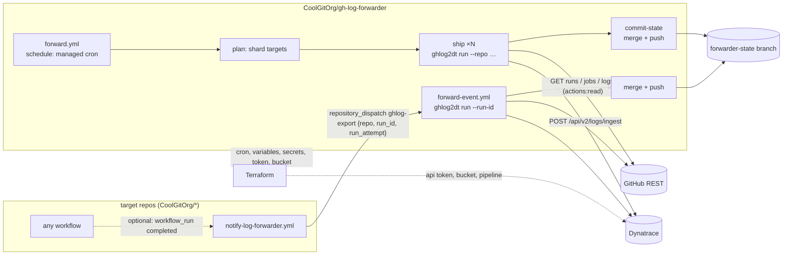

# gh-log-forwarder — `ghlog2dt`

Ship GitHub Actions job logs from one, many, or all repositories in
**CoolGitOrg** to Dynatrace through the **Log Monitoring API v2**
(`POST /api/v2/logs/ingest`), on a schedule you set with one number.

```
GitHub Actions REST API ──► ghlog2dt ──► Dynatrace /api/v2/logs/ingest ──► OpenPipeline ──► Grail bucket
   (runs, jobs, logs)      (Go, stdlib)     (Api-Token logs.ingest)        (route, parse)    ci_github_actions_logs
```

- **One static binary.** `ghlog2dt` is Go ≤ 1.24 with the standard library
  only — no SDKs, no third-party modules. `make preflight` enforces both.
- **Zero changes to the repos you watch.** The forwarder pulls existing
  logs with a read-only GitHub App token. An optional push mode adds one
  small workflow per repo for ~1-minute latency.
- **Configurable frequency.** `interval_minutes` (5–60) in Terraform renders
  the cron line and the lookback window; `make schedule INTERVAL=n` does the
  same without Terraform.
- **Exactly the right jobs, once.** Checkpoints per repository on a
  `forwarder-state` branch; dedupe by job ID; unfinished runs wait in a
  pending set; at-least-once delivery with a DQL dedupe key.
- **Honest about Dynatrace's 24-hour rule.** Lines older than `max_age`
  (23h45m) are dropped and counted, or re-stamped with `--stale=rewrite`.

## How it works



Each sweep, per repository: list runs created since the high-water mark
(minus an overlap), re-poll pending runs, list jobs of completed runs
(all attempts), skip job IDs already shipped, download each log (302 to a
signed URL; the token is never forwarded), parse it (timestamps, severity
from `##[error]`/`##[warning]`, step attribution, ANSI stripped, secrets
redacted), batch it (≤ 4 MiB / 5,000 records), POST it, and record the
job as shipped only after its last record's request completes.

## Quick start

```bash
# 0. Build and test locally (Go 1.24.x).
make ci

# 1. Create the checkpoint branch (orphan, plumbing only).
make bootstrap-state

# 2. Try it against one repo without shipping anything.
export GH_TOKEN=$(ghlog2dt token --app-id "$GH_APP_ID" --key-file app.pem --permission actions=read)
make dry-run REPO=CoolGitOrg/app-a

# 3. Provision everything else.
cd terraform && cp terraform.tfvars.example terraform.tfvars   # edit
terraform init && terraform apply

# 4. Cut a release and pin it.
git tag v1.0.0 && git push origin v1.0.0     # release.yml builds + checksums + attests
# then set ghlog_version = "v1.0.0" and terraform apply
```

Change the cadence later with one variable:

```bash
terraform apply -var interval_minutes=10        # cron 7,17,27,37,47,57 * * * *, lookback 90m
# or, without Terraform:
make schedule INTERVAL=30                       # rewrites the managed cron line
```

## Command line

```
ghlog2dt run        sweep target repos and ship new job logs (production path)
ghlog2dt list       print unshipped completed jobs as NDJSON
ghlog2dt fetch      jobs (NDJSON, stdin) -> Dynatrace records (NDJSON, stdout)
ghlog2dt ship       records (NDJSON, stdin) -> Dynatrace
ghlog2dt checkpoint show | merge | prune | mark | rewind
ghlog2dt token      mint a GitHub App installation token (no Action needed)
ghlog2dt schedule   cron + lookback for an interval; rewrite a workflow
ghlog2dt version
```

The pieces compose like any Unix filter, which is how you debug:

```bash
ghlog2dt list --repo CoolGitOrg/app-a | ghlog2dt fetch | head -n 3 | jq .
ghlog2dt list --repo CoolGitOrg/app-a | ghlog2dt fetch | ghlog2dt ship --dry-run
```

Exit status: `0` ok · `1` error · `2` usage/config · `3` partial success ·
`4` authentication · `5` rate limit or Dynatrace budget (402) · `6` checkpoint I/O.

Full reference: [`docs/configuration.md`](docs/configuration.md) and the
manual page `man ./docs/ghlog2dt.1`.

## Repository layout

```
cmd/ghlog2dt/            main, subcommands, CLI integration tests
internal/config/         defaults < JSON file < env < flags; validation
internal/github/         REST client: pagination, rate limits, 1000-run split, App JWT
internal/parse/          job log -> lines (timestamp, severity, step, redaction)
internal/record/         reflection-free JSON record builder
internal/dynatrace/      ingest client (204/200/400/413/429…) and batching shipper
internal/state/          per-repo checkpoint, atomic save, convergent merge
internal/forward/        the engine: discover, prefetch, ship, checkpoint
internal/obs/            JSON summary, step-summary Markdown, self-monitoring record
internal/testutil/       fake GitHub API and fake Dynatrace ingest
scripts/                 install (SHA256-verified), run, commit-state, bootstrap, dql, spike
.github/workflows/       forward, forward-event, checkpoint, ci, release
templates/               notify-forwarder.yml for push-mode target repos
terraform/               github + dynatrace providers: cron, vars, secrets, token, bucket, pipeline
dynatrace/queries/       DQL for verification, alerting and dedupe
docs/                    architecture, configuration, operations, security, phase-0 spike, man page
```

## Documents

| | |
|---|---|
| [Architecture](docs/architecture.md) | data flow, correctness rules, record schema, checkpoint model |
| [Configuration](docs/configuration.md) | every flag, variable, config key, exit code; frequency design |
| [Operations](docs/operations.md) | rollout, alerting, runbook, failure modes, cost |
| [Security](docs/security.md) | permissions, secrets, redaction, supply chain |
| [Phase-0 spike](docs/phase0-spike.md) | what Dynatrace does not document, and how to settle it |

## Two clocks bound the design

1. **Dynatrace refuses log records older than 24 hours.** Exports must lag
   by minutes, not hours, and history cannot be backfilled without
   rewriting timestamps.
2. **GitHub keeps logs for the repository's retention period** (default 90
   days; since 1 Oct 2026 the same setting also expires run metadata). An
   outage longer than retention loses logs regardless.

## Status of unverified behaviour

Gzip request bodies, `Retry-After` on 429, the `X-Dynatrace-Attr` encoding
and its billing are not documented by Dynatrace. They are **off or
optional** by default and listed with test procedures in
[`docs/phase0-spike.md`](docs/phase0-spike.md). Go 1.24 has been out of
security support since Feb 2026; the code uses nothing newer than 1.24
and moves forward with a one-line `go.mod` change when the cap is lifted.
