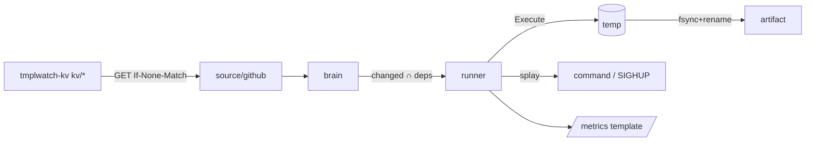
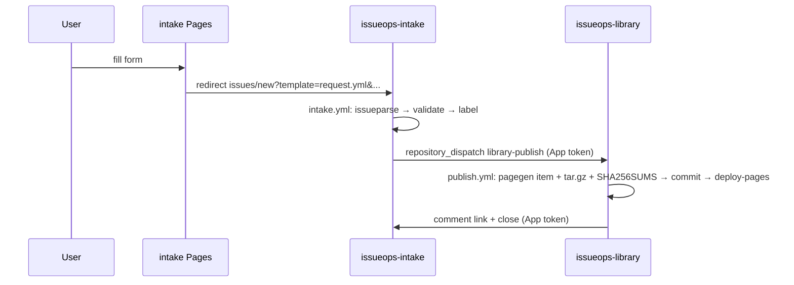

# Go Templates as a Systems Substrate: Classification, Research, and Three Buildable Case Studies (October 2026)

Go's `text/template` and `html/template` are a small, data-driven rendering language for trusted template authors, not a general-purpose language. All three requested case studies can be built on the standard library plus go-echarts. The persona's "max Go 1.24" constraint has to be read as a *language level* (`go 1.24` in go.mod), not as the *toolchain* version: Go 1.24 has been out of support since February 2026 and misses a string of 2026 `html/template` XSS fixes.

## TL;DR

- **Use `go 1.24` language semantics but build with a supported toolchain (Go 1.26.x or 1.27.x; 1.27.2 is current as of 8 Oct 2026).** Go 1.24 is end-of-life. At least seven `html/template` CVEs were published in 2026 (CVE-2026-27142, -32289, -39823, -39826, -56858, -94448, -97030), so a 1.24 toolchain is a security defect for any case study that serves HTML.
- **The engine is deliberately weak, and that is the design lever.** It is data-driven, assumes trusted authors, and has no I/O except what the FuncMap grants. The FuncMap is therefore the capability boundary, and each case study below is specified as "a FuncMap + a data source + a destination."
- **Recommended architecture:**
  - **CS1 (`tmplwatch`)** polls a GitHub repo through the contents API with ETags and renders with a consul-template-compatible FuncMap.
  - **CS2** pre-renders a static Pages form at build time. The form redirects to a prefilled issue-form URL, so no secrets live in the browser. Cross-repo writes use `actions/create-github-app-token@v3`.
  - **CS3 (`tmplforge`)** pairs a sam/ed-style line-command TUI (portable to Plan 9, no raw mode) with an `html/template` + vendored htmx server.

---

## 1. Executive Summary (Key Findings)

| # | Finding | Implication |
|---|---|---|
| 1 | Go 1.27 shipped 19 Aug 2026; 1.27.2 and 1.26.9 are current (8 Oct 2026). Go's policy: "Each major Go release is supported until there are two newer major releases." Go 1.24's last point release was go1.24.13 (2026-02-04).\[1\]\[2\] | Put `go 1.24` in go.mod and set CI to `1.26.x`. Avoid post-1.24 APIs (generic methods, `encoding/json/v2`, `strings.CutLast`). |
| 2 | Go 1.24 added range-over-int and range-over-func to `text/template` (golang/go#66107).\[3\]\[4\] | `{{range 5}}` and `{{range $k, $v := .Seq2}}` are the newest legal template features. |
| 3 | 2026 `html/template` CVEs: meta-refresh URL escaping (CVE-2026-27142, fixed 1.26.1/1.25.8; GODEBUG `htmlmetacontenturlescape=0`) and its bypass (CVE-2026-39823); JS template literals across branches (CVE-2026-32289, fixed 1.25.9/1.26.2); empty `<script type>` (CVE-2026-39826); JS regexp context (CVE-2026-56858, fixed 1.25.13/1.26.6); and two published 8 Oct 2026 (CVE-2026-94448, CVE-2026-97030 on `yield` escaping).\[5\]\[6\]\[7\]\[8\] | Run `govulncheck` in CI and treat toolchain bumps as security patches. |
| 4 | Go's model trusts template authors. The commit that added parenthesis-nesting `maxStackDepth` (10000) says so explicitly. Deep `{{if}}`/`{{range}}` nesting can still overflow the stack at parse time (golang/go#81546, triaged "not a vulnerability"). `maxExecDepth` is 100000 (1000 on wasm).\[9\]\[10\]\[11\] | CS3 accepts user templates, so it must render them in a capped, time-boxed subprocess. |
| 5 | Current action majors: `checkout@v6` (v6.1.0, Jul 2026), `setup-go@v6` (v6.5.0), `upload-pages-artifact@v5`, `deploy-pages@v5`, `configure-pages@v5`, `create-github-app-token@v3` (`client-id` replaced `app-id` in v3.1.0). Node 24 became the forced default on 2 Jun 2026.\[12\]\[13\]\[14\]\[15\] | Pin by SHA with a version comment. |
| 6 | `workflow_dispatch` allows 25 inputs (changelog 4 Dec 2025) and ≤65,535 characters. `repository_dispatch` `client_payload` allows ≤10 top-level properties, with no documented byte limit.\[16\]\[17\]\[18\] | CS2 sends one JSON `payload` property plus routing keys. |
| 7 | Issue-form fields can be prefilled with URL query params keyed by field `id`. Over-long URLs return 414.\[19\]\[20\] | CS2 intake needs no backend and no secrets. |
| 8 | GitHub Docs ("GitHub Pages limits"): published sites "may be no larger than 1 GB"; 100 GB/month soft bandwidth; a 10 builds/hour soft limit that "does not apply if you build and publish your site with a custom GitHub Actions workflow"; 10-minute deploy timeout. `upload-pages-artifact@v4+` drops dotfiles. | Serve large binaries from Releases. |
| 9 | Terraform `integrations/github` provider: v6.13.0 (8 Jul 2026). Issue #3651 (21 Sep 2026) asks maintainers to cut a release for three merged but unreleased fixes.\[21\]\[22\] | Pin `~> 6.13`. |
| 10 | htmx 2.0.11 is the latest 2.x; htmx 4.0.0 shipped 28 Aug 2026.\[23\]\[24\] | Vendor 2.0.11 for the beta. |
| 11 | go-echarts v2.7.x (v2.7.2 Apr 2026; pkg.go.dev lists v2.7.3 from 13 Sep 2026) renders through `html/template` with a `safeJS` func. It carries third-party transitive deps (6 per libraries.io).\[25\]\[26\]\[27\] | Allowed, but record the dep graph in the SBOM. |
| 12 | consul-template is still MPL-2.0 (0.43.0, Sep 2026). Consul, Nomad, Vault and Terraform have been BUSL-1.1 since Aug 2023.\[28\]\[29\] | A clean-room stdlib reimplementation avoids any license question. |

---

## 2. CLASSIFICATION REPORT

### 2.1 Taxonomy

| Class | Definition | Engine | Mechanism | Rating |
|---|---|---|---|---|
| C1 Generators | Emit code/project trees | `text/template` | `go generate`, `ParseFS`+`embed`, `Delims`, gofmt post-pass | Conventional |
| C2 Config rendering | Render config from KV/secrets in a watch loop | `text/template` + FuncMap | long-lived `*Template`, re-Execute on change, atomic write, exec hook | Conventional |
| C3 Output formatters | Shape API/CLI/log output | `text/template` | `--format`, `-o go-template`, `--template` | Conventional |
| C4 Web servers | Response bodies are templates | `html/template` (Caddy: text) | layouts/`block`, `ExecuteTemplate` | Conventional→semi |
| C5 File transfer | Listings/banners/layout via templates | both | browse/listing templates | Semi→unorthodox |
| C6 Network/storage servers | Protocol answers from templates | `text/template` | per-request Execute on request data | Unorthodox |
| C7 Unorthodox | DSL, meta-templates, shell emitters, charts | both | `define` recursion, `Delims`, AST walking | Unorthodox |

Star counts were not re-verified; capture them with `gh api repos/OWNER/REPO --template '{{.full_name}} {{.stargazers_count}} {{.pushed_at}}{{"\n"}}'`.

### 2.2 C1 generators
oapi-codegen, go-swagger, sqlc, mockery v3, Kubebuilder (scaffold "machinery" with insertion markers), and cobra-cli all ship embedded `text/template` files, and most let users override them. `stringer` is the contrast case: it builds code with `fmt` instead of templates. Generators should never use `html/template`, because it escapes the `<` in generic type parameters. Standard idiom: `template.Must(template.New("").Funcs(fm).ParseFS(fsys, "tmpl/*.go.tmpl"))`, then `go/format.Source`, then a golden test.

### 2.3 C2 config rendering
| Project | Notes |
|---|---|
| consul-template (MPL-2.0) | Dependency-tracking FuncMap, watch loop, destination/perms/backup/command (§3.8) |
| Nomad `template`, Vault Agent `template` | Both embed consul-template |
| gomplate | General renderer with datasources (not an allowed dep, so CS1 reimplements a subset) |
| Helm + Sprig | `include`, `tpl`, `toYaml`, `nindent` |
| Hugo, goreleaser, go-task, Alertmanager | Go templates over project data |
| Terraform `templatefile()` | **HCL template syntax** (`${expr}`, `%{ for }…%{ endfor }`), not Go. The `template_file` data source is deprecated. Go templates that emit HCL must not produce a stray `${`. |
| Packer | Legacy JSON used Go-template-style `{{user `x`}}`; HCL2 replaced it with typed variables |

### 2.4 C3 formatters/scraping
`kubectl -o go-template[-file]`, `docker --format '{{json .}}'` (plus `table`), and `gh api --template` (functions `tablerow`, `tablerender`, `timeago`, `color`, `pluck`, `join`, `hyperlink`, `truncate`). Vector VRL, lnav and goaccess are contrast cases: they transform data, while Go templates only print. **Position:** extract with `encoding/json`, `regexp` and `bufio.Scanner`, then render. A template that does parsing is an anti-pattern.

### 2.5 C4 web servers — Caddy `templates` deep dive
Caddy executes response bodies as `text/template`.\[30\] Options:
- `mime` (default text/plain, text/markdown, text/html)
- `between` (delimiters)
- `root`
- `extensions` (custom-function modules under `http.handlers.templates.functions.*`)

Context and functions:
- Request/response data: `.Host`, `.Cookie`, `.Req`, `.Args`, `.RespHeader.Set`, `ph`.
- File and request functions: `include` (args become `.Args`; output **is not escaped**), `import`, `httpInclude` (an in-memory virtual sub-request), `listFiles`, `fileStat`.
- Content functions: `markdown` and `splitFrontMatter` (YAML `---`, TOML `+++`, JSON).
- All of Sprig.

Caddy labels these functions "still experimental."

```caddyfile
example.com {
	root * /srv
	templates
	file_server browse
}
```
```html
{{$md := (include "/posts/hello.md" | splitFrontMatter)}}
<title>{{$md.Meta.title}}</title>{{markdown $md.Body}}
```
**net/http pattern (CS3):**
1. Parse layouts and partials once from `embed.FS`.
2. `Clone()` per page so each page can redefine `block "content"`.
3. Execute into a `bytes.Buffer`, then copy to the response. A mid-render error then never produces a half-written 200.

Contrasts:
- a-h/templ compiles to Go code; there is no runtime `text/template`.
- Gin, Echo, Fiber, Gitea/Forgejo and Pocketbase all wrap `html/template`.

### 2.6 C5 file transfer
| System | Template use | Rating |
|---|---|---|
| Caddy `file_server browse` | Directory listing is an overridable Go template | Unorthodox (canonical) |
| `rclone serve http --template` | User Go template for listings | Unorthodox |
| fclairamb/ftpserverlib, goftp/server, pkg/sftp, pin/tftp | No template use found | Opportunity |

"Template-operated FTP" is not an established category. The realistic version is to template the listings, MOTD and layout.

### 2.7 C6 network/storage — CoreDNS `template` deep dive
The plugin "allows you to dynamically respond to queries by just writing a (Go) template."\[31\] Its syntax is `template CLASS TYPE [ZONE...] { match REGEX… answer|additional|authority RR rcode CODE fallthrough }`.

- **Template data:** `.Name`, `.Zone`, `.Class`, `.Type`, `.Match`, `.Group` (named groups). `parseInt` was added later.
- **Matching:** the first matching regex wins, and regexes are capped at 10000 characters.\[32\]
- **No match:** a zone match with no regex match returns SERVFAIL unless `fallthrough` is set.\[33\]
- **Metrics and implementation:** it exports the `coredns_template_matches_total` metric, and the code holds `answer []*gotmpl.Template`.\[31\]\[34\]
```
template IN A example {
  match "^ip-(?P<a>[0-9]*)-(?P<b>[0-9]*)-(?P<c>[0-9]*)-(?P<d>[0-9]*)[.]example[.]$"
  answer "{{ .Name }} 60 IN A {{ .Group.a }}.{{ .Group.b }}.{{ .Group.c }}.{{ .Group.d }}"
  fallthrough
}
```
**Upspin** (Apache-2.0) packages:
- `upspin.io/upspin` (Client/KeyServer/DirServer/StoreServer interfaces)
- `cmd/upspin` (`shell`, `cp`, `get`, `put`, `share`, `watch`, `snapshot`, `setupserver`…)
- `cmd/upspinfs` (FUSE)
- `cmd/cacheserver`
- `dir/inprocess`
- `pack` (`ee`, `eeintegrity`, `plain`)
- `frontend`

Activity is low: upspin/upspin was last updated Jul 2025, and `upspin.github.io` ("static hosting stand-in for frontend") in Jan 2026.\[35\] Templates appear only in the docs frontend. **Position:** treat upspin as an optional phase-2 KV source for CS1.

Other entries in this class:
- **Rendered with Go templates:** WireGuard/Nebula config generators and gornir/scrapligo device configs typically use `text/template`.
- **Not Go templates:** Headscale uses YAML. Ansible uses Jinja2, as a contrast.
- **User code:** gliderlabs/ssh and wish banners are plain strings unless your own code templates them.

### 2.8 C7 unorthodox and security
1. **Interpreter:** `define`+`template` recursion, `$x =` reassignment and `{{break}}`/`{{continue}}` (Go 1.18) make templates practically Turing-complete. Depth is bounded by `maxExecDepth`, which is a reason to cap, not to exploit.
2. **Meta-templates:** `Delims("[[","]]")` lets a template emit literal `{{ }}` (F29).
3. **Template → shell → exec:** go-task style; see §3.2.
4. **go-echarts:** `html/template` strings `BaseTpl`, `ChartTpl`, `HeaderTpl`, `PageTpl` (files `templates/base.go`, `chart.go`, `header.go`, `page.go`), compiled via `render.MustTemplate`. A `safeJS` func returns `template.JS(fmt.Sprint(s))` and is used as `{{ .ChartID | safeJS }}`; options are injected with `{{ .JSON }}`. To customize, embed `render.BaseRender` and call `ExecuteTemplate(&buf, "chart", c)`.\[36\]\[37\]\[38\]
5. **CVEs:** the 2026 stdlib advisories are listed in §1. I did not re-verify app-level template CVEs (Gitea, Grafana, Hugo, Harbor), so they are not cited.

---

## 3. RESEARCH REPORT

### 3.1 Rob Pike and the design lineage
Sources:
- "Lexical Scanning in Go," GTUG Sydney, 30 Aug 2011. Slides: https://go.dev/talks/2011/lex.slide. Video: https://www.youtube.com/watch?v=HxaD_trXwRE
- The `text/template` package doc, which serves as the language spec: https://pkg.go.dev/text/template
- `text/template/parse/lex.go`

**Lesson 1: state functions replace state tables.** Each state returns the next one. Templates alternate between two macro-states, text and action.
```go
type stateFn func(*lexer) stateFn
func lexText(l *lexer) stateFn {
	if i := strings.Index(l.input[l.pos:], l.leftDelim); i >= 0 {
		l.pos += i; l.emit(itemText); return lexLeftDelim
	}
	l.pos = len(l.input); l.emit(itemText); return nil
}
```
Whitespace trimming happens in the lexer, which is why `{{- ` needs the space: `{{- range .Items }}{{ .Name }}{{- end }}`.

**Lesson 2: use concurrency for clarity, then remove it when it costs too much.**
- The talk runs the state machine "as a goroutine, emit values on a channel," because "Goroutines allow lexer and caller (parser) each to run at its own rate, as clean sequential code."\[39\]
- Before Go 1, goroutines could not run during `init`, so `var t = template.Must(...)` broke. The slides note "This restriction was lifted in Go version 1."\[39\]\[40\]
- Pike said later that the deeper purpose "was to demonstrate how concurrency can make programs nice even without obvious parallelism in the problem… the code is pretty but not necessarily fast."\[41\]
- Eli Bendersky's 2022 benchmark referenced golang/go#53261.\[42\] The goroutine was later replaced by a synchronous `nextItem`. I did not pin down the exact commit; `git log src/text/template/parse/lex.go` will show it.

**Lesson 3: pipelines are Unix pipes for values.** The previous result becomes the *last* argument: `{{ .Title | lower | printf "slug-%s" }}`.

**Lesson 4: data-driven and logic-light, with trusted authors.** Logic lives in Go (the FuncMap and methods); templates only select and format: `template.FuncMap{"shq": shellQuote}`.

**Lesson 5: simplicity is complicated.** The language has a small set of actions and exactly 19 predefined functions: the `builtins()` map in Go's `src/text/template/funcs.go` lists and, call, html, index, slice, js, len, not, or, print, printf, println, urlquery, eq, ge, gt, le, lt, ne. Every other capability is one you opt into, so the security model and the extension model are the same thing.

**html/template:** Mike Samuel designed the contextual autoescaping, which tracks HTML, attribute, URL, JS, CSS and JS template-literal contexts. The 2026 CVE stream shows how hard that context tracking still is.

**Plan 9 heritage:** this is my analysis, not a sourced claim. rc-style pipelines, a minimal action set, and text as the universal interface all echo Plan 9. I found no source tying `text/template` to Sawzall, so treat that link as unverified.

### 3.2 CLI tools operating via templates
| Tool | One-liner | Emits templates for others? |
|---|---|---|
| gomplate | `echo '{{ .Env.USER }}' \| gomplate` | Yes (alt delims) |
| kubectl | `kubectl get po -o go-template='{{range .items}}{{.metadata.name}}{{"\n"}}{{end}}'` | — |
| docker | `docker ps --format '{{json .}}'` | — |
| gh | `gh api repos/CoolGitOrg/x --template '{{.name}}'` | Yes |
| helm | `helm template ./chart` | Yes (YAML) |
| goreleaser | `name_template: '{{ .ProjectName }}_{{ .Os }}'` | — |
| go-task | `cmds: ['echo {{.VAR}}']` | Yes (shell) |
| hugo | `hugo new posts/x.md` (archetypes) | Yes |
| cobra-cli | `cobra-cli add serve` | — |
| CUE, ytt, Jsonnet, envsubst, pongo2/jet/plush/mustache | Contrast: these are other languages/engines, and the dependency policy rules them out | — |

**Persona-compliant replacement:** `tpl`, a small stdlib binary: `tpl -d data.json -t f.tmpl [-delims '[[,]]'] [-missingkey error] [-o out]`. Every case study vendors it as `cmd/tpl` + `internal/funcs`.

**Safety rules for template → bash → execute:**
1. Prefer `exec.Command` with one argument per emitted line. Avoid `sh -c` unless every interpolation is quoted.
2. Use `shq` for POSIX quoting. `printf "%q"` produces **Go** quoting, not shell quoting.
3. Start emitted scripts with `set -euo pipefail` and gate them on `bash -n` (and shellcheck where available).
4. Set `Option("missingkey=error")` so `<no value>` can never reach a command line.
```go
func shellQuote(s string) string { return "'" + strings.ReplaceAll(s, "'", `'\''`) + "'" }
```
```gotemplate
#!/usr/bin/env bash
set -euo pipefail
{{- range .Repos }}
gh repo clone {{ shq (printf "%s/%s" $.Org .) }} -- --depth=1
{{- end }}
```

### 3.3 Basic cheat sheet
| Construct | Example | Output |
|---|---|---|
| Field / key | `{{.Name}}`, `{{index .m "k-1"}}` | value |
| Dot / root | `{{.}}`, `{{$}}` | current / top |
| Variable / reassign | `{{$n := len .S}}`, `{{$n = 2}}` | |
| Pipeline | `{{.Name \| printf "%q"}}` | `"ada"` |
| if chain | `{{if .A}}a{{else if .B}}b{{else}}c{{end}}` | false/0/nil/empty are falsy |
| range | `{{range $i, $v := .S}}{{$i}}={{$v}} {{end}}` | `0=x 1=y ` |
| range map | `{{range $k, $v := .M}}…{{end}}` | keys sorted |
| range else | `{{range .E}}x{{else}}none{{end}}` | `none` |
| range int (1.24) | `{{range 3}}{{.}}{{end}}` | `012` |
| break (1.18) | `{{range .}}{{if eq . 2}}{{break}}{{end}}{{.}}{{end}}` | `01` |
| with/else | `{{with .U}}{{.Name}}{{else}}anon{{end}}` | rebinds dot |
| define/template/block | `{{define "r"}}<{{.}}>{{end}}{{template "r" .X}}` | `<x>` |
| comment / trim | `{{/* c */}}`, `a {{- 1 -}} b` | `a1b` |
| and/or/not | `{{if and .A (not .B)}}` | short-circuit (1.18+) |
| len/index/slice | `{{slice .S 1 3}}` | |
| printf | `{{printf "%05d" 42}}` | `00042` |
| call | `{{call .Fn 1 2}}` | |
| html/js/urlquery | `{{"<a>" \| html}}` | `&lt;a&gt;` |
| eq multi | `{{if eq .Env "dev" "stg"}}` | true if equal to any |
| lt/le/gt/ge/ne | `{{if lt .N 10}}` | basic types only |

### 3.4 Advanced cheat sheet
| Topic | Rule / idiom |
|---|---|
| FuncMap | `Funcs` must be called **before** `Parse`. Funcs return T or (T, error); a non-nil error aborts execution. |
| Methods | Exported methods are callable; pointer receivers need a pointer value. Unexported fields cause an exec error. |
| missingkey | `Option("missingkey=error\|zero\|default")` (maps only) |
| Delims/Clone/Lookup | `Delims("[[","]]")` before Parse; `Clone()` for per-page layouts; `DefinedTemplates()`; `AddParseTree` |
| ParseFS | `//go:embed tmpl` + `ParseFS(fsys, "tmpl/*.tmpl")` |
| Concurrency | Parse once; concurrent `Execute` is safe |
| Context | No ctx parameter. Execute in a goroutine or subprocess, cap output, and kill on timeout. |
| html contexts | HTML text, attr, URL, JS, CSS, JS template literal; typed `template.HTML/JS/JSStr/CSS/URL/Srcset/HTMLAttr` bypass escaping; `ZgotmplZ` marks a rejected value |
| Errors | `errors.As(err, &template.ExecError{})` |
| Recursion | `{{define "t"}}…{{template "t" .Child}}…{{end}}`, capped at 100000 |
| iter | `{{range .Seq}}` over `func(yield func(T) bool)` (1.24) |
| Lint | Walk `t.Tree.Root` `parse.Node`s (§4.3) |
| Tests | Golden files + `-update`; `testing.F` fuzz |
| gopls | `templateExtensions` for `.tmpl`/`.gotmpl` |
| GODEBUG | `htmlmetacontenturlescape=0` reverts a CVE fix — don't |

### 3.5 Cookbook (34 formulas)
Shared stdlib FuncMap `internal/funcs`. Signatures:
- **Collections:** `dict(kv...)(map,error)`, `list`, `sortedKeys`, `seq n`.
- **Arithmetic:** `add`/`sub`/`mul`/`mod`.
- **Defaults:** `default d v`, `coalesce`, `ternary a b cond`.
- **Strings:** `join sep s`, `upper`/`lower`/`trim`/`replace`/`split`/`repeat`, `indent n s`, `nindent n s`, `plural one many n`.
- **Serialization:** `toJSON`/`toPrettyJSON`/`fromJSON`, `toYAML` (a ~120-line emitter that always quotes strings, because the stdlib has no YAML), `b64enc`/`b64dec`, `sha256sum`.
- **Trusted-only:** `env` and `file` (rooted `fs.FS`).
- **Shell:** `shq`.
- **Time and regex:** `now`, `dateFmt layout t`, `regexMatch`, `regexReplaceAll re s repl`.

`dict` returns an error on odd argument counts or non-string keys. `default` treats nil and `reflect.Value.IsZero()` as empty.

| # | Formula | Template |
|---|---|---|
| F1 | dict partial | `{{template "badge" dict "class" "ok" "text" "passing"}}` |
| F2 | list | `{{range list "a" "b"}}{{.}}{{end}}` → `ab` |
| F3 | default | `{{.Port \| default 8080}}` |
| F4 | coalesce | `{{coalesce .Override .Region "us-east-1"}}` |
| F5 | ternary | `{{if .Prod}}prod{{else}}dev{{end}}` / `{{ternary "prod" "dev" .Prod}}` |
| F6 | join fields | `{{range $i, $u := .Users}}{{if $i}}, {{end}}{{$u.Name}}{{end}}` |
| F7 | sorted keys | `{{range $k := sortedKeys .M}}{{$k}}={{index $.M $k}}{{"\n"}}{{end}}` |
| F8 | root access | `{{range .Teams}}{{range .Members}}{{$.Org}}/{{.}} {{end}}{{end}}` |
| F9 | 1-based index | `{{range $i, $x := .S}}{{add $i 1}}. {{$x}}{{"\n"}}{{end}}` |
| F10 | zebra CSS | `<tr class="{{if eq (mod $i 2) 0}}even{{else}}odd{{end}}">` |
| F11 | plural | `{{len .F}} {{plural "file" "files" (len .F)}}` |
| F12 | date | `{{.Created.Format "2006-01-02"}}` |
| F13 | numbers | `{{printf "%.2f" .Ratio}}` |
| F14 | YAML block | `config: {{ toYAML .Config \| nindent 2 }}` |
| F15 | JSON array | `[{{range $i, $x := .S}}{{if $i}},{{end}}{{toJSON $x}}{{end}}]` (better: `{{toJSON .S}}`) |
| F16 | hash/b64 | `{{file "dist/app" \| sha256sum}}`, `{{.S \| b64enc}}` |
| F17 | env | `{{env "GITHUB_SHA"}}` (trusted only) |
| F18 | include | `{{file "partials/footer.txt"}}` |
| F19 | tree | `{{define "n"}}{{.Indent}}{{.Name}}{{"\n"}}{{range .Children}}{{template "n" .}}{{end}}{{end}}` |
| F20 | aligned table | emit `\t`, pipe through `text/tabwriter` |
| F21 | CSV | use `encoding/csv` in Go; template for trusted TSV only |
| F22 | Markdown table | `\| {{ .Name }} \| {{ .Version }} \|` in a `range` |
| F23 | HCL | `name = {{ printf "%q" .Name }}` (never emit `${`) |
| F24 | Actions YAML | parse with `Delims("[[","]]")` so `${{ }}` passes through |
| F25 | Issue form | `- type: {{ .Type }}\n    id: {{ .ID }}\n    attributes:\n      label: {{ printf "%q" .Label }}` |
| F26 | Makefile/mkfile | `{{ .Name }}: {{ join " " .Deps }}\n{{ "\t" }}{{ .Cmd }}` (tabs required) |
| F27 | Dockerfile | `ENTRYPOINT [{{range $i,$a := .E}}{{if $i}}, {{end}}{{printf "%q" $a}}{{end}}]` |
| F28 | Go source | Execute → `format.Source(buf.Bytes())` |
| F29 | meta-template | outer `Delims("[[","]]")`: `{{ define "[[.Name]]" }}Hello {{ .[[.Field]] }}{{ end }}` |
| F30 | CLI usage | `{{range .Flags}}  -{{.Name}}{{"\t"}}{{.Usage}}{{"\n"}}{{end}}` from `flag.VisitAll` |
| F31 | Prometheus text | `tmplwatch_renders_total{template="{{ .Name }}"} {{ .Renders }}` with `# HELP`/`# TYPE` header |
| F32 | htmx partial | `{{define "preview"}}<div id="preview" hx-post="/render" hx-trigger="keyup changed delay:300ms from:#src" hx-target="#preview" hx-swap="outerHTML"><pre>{{.Output}}</pre></div>{{end}}` |
| F33 | template writing a gh template | `gh api repos/{{.}} --template '{{"{{"}}.full_name{{"}}"}}'` |
| F34 | SVG sparkline | `<polyline points="{{range $i, $v := .P}}{{mul $i 4}},{{sub 20 $v}} {{end}}"/>` |

CS3's catalog also ships formulas for the CoreDNS answer (§2.7), the Caddy browse page (§2.5), go-echarts (§4.3), SQL, HTML email and C:
- **SQL:** identifiers come only from an allowlist, and values always go through placeholders.
- **HTML email:** `html/template` and `text/template` parts assembled with `mime/multipart`.
- **C:** F28 without gofmt, then `cc -fsyntax-only`.

### 3.6 Security and production hardening
| Output | Engine |
|---|---|
| HTML for browsers | `html/template` |
| Config/code/YAML/shell | `text/template` + typed quoting funcs |
| User-authored templates | `text/template` in a subprocess with a minimal FuncMap and caps |

**What templates can reach:** exported fields and methods of the data, FuncMap functions, `call` on func-valued fields, and the builtins. They cannot reach anything else. CS3's user-facing FuncMap therefore omits `env` and `file`, and its data is plain `map[string]any` with no methods.

**Limits:**
- Built in: exec depth 100000 and expression nesting 10000. Control-structure nesting is still unbounded at parse time (golang/go#81546), and a stack overflow is fatal, not recoverable.\[9\]\[10\]\[11\]\[43\]
- What CS3 adds: a 64 KiB source cap, a subprocess, a 1 MiB `limitWriter`, and `exec.CommandContext` with a timeout.

**Hot reload (stdlib only):** poll mtimes, re-parse, then swap with `atomic.Pointer[template.Template]`. On a parse failure, keep the old template and increment `template_parse_errors_total`.

**Observability:** `expvar`, `pprof` on a loopback listener, and Prometheus text rendered by F31.

**Load tools:** these facts come from general knowledge, not re-verified here.
- Go: vegeta (constant-rate), hey, bombardier.
- k6: a Go engine scripted in JS.
- Others: wrk (C), oha (Rust).

**Recommendation:** use vegeta for constant-rate beta tests, plus a stdlib `tmplload` binary for CI smoke tests.

**Beta gating:** Pages cannot do canaries. Use `flags.json` on Pages or a separate beta repo. For the Go servers, use a token allowlist plus a hand-written token bucket (`x/time/rate` is not stdlib).

### 3.7 GitHub platform facts
**Pages:**
- Static only.\[44\]
- GitHub Docs ("GitHub Pages limits"): published sites "may be no larger than 1 GB"; 100 GB/month soft bandwidth; a 10 builds/hour soft limit that does not apply to custom Actions workflows; deployments time out after 10 minutes.
- Actions deployment needs `pages: write`, `id-token: write` and the `github-pages` environment.
- `upload-pages-artifact@v4` started excluding dotfiles.\[45\] `.nojekyll` is unnecessary with Actions deploys.
- Org project-site URL: `https://coolgitorg.github.io/<repo>/`. Put heavy downloads in Releases.

**Actions versions:**
- `checkout@v6`, `setup-go@v6` (caches on go.mod by default since v6.3.0), `configure-pages@v5`, `upload-pages-artifact@v5`, `deploy-pages@v5`, `create-github-app-token@v3`.\[14\]\[46\]\[47\]
- `upload-artifact` (v6 appears in Renovate PRs)\[48\] and `github-script` (v7 in common examples) need verification. The case studies use `gh` plus Go binaries instead.

**Dispatch:**
- `workflow_dispatch`: ≤25 inputs, ≤65,535 chars.\[17\]
- `repository_dispatch`: ≤10 top-level `client_payload` properties, size undocumented (third-party actions report "client_payload is too large").\[49\]\[50\] Design for ≤32 KiB.

**Prefill:** `https://github.com/CoolGitOrg/<repo>/issues/new?template=request.yml&title=…&<field-id>=…`. GitHub docs: "You can also use URL query parameters to fill custom text fields that you have defined in issue form templates." Bad URLs return 404,\[51\] oversized ones 414.\[20\] The GitHub mobile app may drop prefilled values.\[52\]

**IssueOps toolkit** (github.com/issue-ops, Nick Alteen):
- `issue-ops/parser` (v5.0.0; keys are form field IDs since v3), `validator` (v3), `labeler` (v2), `semver`, `releaser`, and `github/command`.
- **`issue-ops/self-service`** — "Template repository to deploy a self-service IssueOps portal with GitHub Pages."\[53\] This is the closest prior art to CS2.
- Canonical guide: GitHub blog "IssueOps: Automate CI/CD (and more!) with GitHub Issues and Actions."\[54\] CS2's Go parser emits JSON compatible with `issue-ops/parser`.

**REST endpoints:**
- Issues: `POST/GET/PATCH /repos/{o}/{r}/issues[/{n}]`, `POST …/issues/{n}/comments`.
- Repo writes: `POST /repos/{o}/{r}/dispatches`, `PUT /repos/{o}/{r}/contents/{path}`.
- App tokens: `GET /repos/{o}/{r}/installation`, `POST /app/installations/{id}/access_tokens`.
- Releases: `POST /repos/{o}/{r}/releases`.

**App JWT (stdlib only):**
```go
func appJWT(clientID string, key *rsa.PrivateKey, now time.Time) (string, error) {
	enc := base64.RawURLEncoding
	h := enc.EncodeToString([]byte(`{"alg":"RS256","typ":"JWT"}`))
	c, _ := json.Marshal(map[string]any{"iat": now.Add(-60 * time.Second).Unix(),
		"exp": now.Add(9 * time.Minute).Unix(), "iss": clientID})
	si := h + "." + enc.EncodeToString(c)
	sum := sha256.Sum256([]byte(si))
	sig, err := rsa.SignPKCS1v15(rand.Reader, key, crypto.SHA256, sum[:])
	if err != nil { return "", err }
	return si + "." + enc.EncodeToString(sig), nil
}
// pem.Decode → x509.ParsePKCS1PrivateKey; then installation lookup → access_tokens
```
**Committing:**
- Default identity: `github-actions[bot]` / `41898282+github-actions[bot]@users.noreply.github.com`.
- With the App token: `issueops-autoadmin-app[bot]` / `<id>+issueops-autoadmin-app[bot]@users.noreply.github.com`. Get the id from `gh api /users/issueops-autoadmin-app%5Bbot%5D --jq .id`.
- Pushes made with `GITHUB_TOKEN` do not trigger workflows; pushes made with an App token do.

### 3.8 HashiCorp template usage
**consul-template** (MPL-2.0) "populates configuration files from Consul, Vault, or Nomad clusters using customizable templates and optional command execution."\[55\]
- **FuncMap** (from project docs, not re-fetched): `key`, `keyOrDefault`, `keyExists`, `ls`, `tree`, `service(s)`, `nodes`, `secret(s)`, `file`, `env`, `plugin`, `timestamp`, `loop`, `toJSON`, `toYAML`, `toTOML`, `parseJSON`, `regexMatch`, `regexReplaceAll`, `byTag`, `byKey`, `byMeta`, `sockaddr`, `indent`.
- **Lifecycle:**
  1. Each dependency call registers a dependency.
  2. The Watcher fills the Brain.
  3. The Runner re-renders, writes atomically with perms/backup, and runs the command, e.g. `-template "in.ctmpl:out.file:/bin/bash -c 'service nginx restart || true'"`.\[56\]
  4. `exec` mode supervises a child process and forwards signals.

**Other HashiCorp template surfaces:**
- **Nomad `template`:** `data`/`source`, `destination`, `change_mode` (noop/restart/signal/script), `change_signal`, `splay`, delimiters, `perms`, `error_on_missing_key`, `wait`.
- **Vault Agent:** `template { source|contents, destination, error_on_missing_key, command, exec }`.
- **Terraform and Packer:** see §2.3.
- **go-sockaddr:** has a `template` package that powers `bind_addr = "{{ GetPrivateIP }}"`, a template used as a network-query DSL.

**Licensing (Oct 2026):** Consul (2.0.4, Sep 2026), Nomad, Vault, Terraform, Packer, Boundary and Waypoint are BUSL-1.1. Each release converts to MPL after four years.\[57\]\[58\]\[59\] APIs, SDKs, providers and consul-template remain MPL-2.0, and OpenTofu is the MPL fork of Terraform.\[58\]\[60\] I found no source saying IBM's ownership has changed these terms.

---

## 4. CASE STUDY DESIGN SPECS

**Shared conventions:**
- **Module and deps:** `go 1.24` in go.mod; CI uses `1.26.x`; stdlib only (plus go-echarts in CS3).
- **Builds:** `CGO_ENABLED=0 go build -trimpath -ldflags="-s -w -X main.version=$TAG"` for linux/amd64, linux/arm64, darwin/arm64 and plan9/amd64.
- **Plan 9 limits:** no cgo, no race detector, no `syscall.Termios`, and signals are notes, so `change_signal` maps to the note "hangup".
- **Release:** `sha256sum * > SHA256SUMS` and `gh release create "$TAG" dist/* --verify-tag`.
- **Scripts:** bash with `set -euo pipefail`; Python only through `uv run`.
- **Repo layout:** every repo has a Makefile and an mkfile, plus `scripts/preflight.sh` (vet, test, govulncheck, `bash -n`, `terraform validate`).

### 4.1 Case Study 1 — `tmplwatch`
**Purpose:**
1. Poll `CoolGitOrg/tmplwatch-kv` (`kv/` tree) through the contents API with `If-None-Match`.
2. Render templates.
3. Write files atomically.
4. Run a command or signal a child process.
```
tmplwatch/
├── cmd/{tmplwatch,tpl,tmplload}/main.go
├── internal/funcs/{funcs.go,yaml.go,sockaddr.go}
├── internal/source/{github.go,dir.go}
├── internal/brain/brain.go
├── internal/runner/{runner.go,atomic.go,exec.go}
├── internal/httpd/{httpd.go,metrics.tmpl}
├── internal/ghapp/jwt.go
├── templates/{Caddyfile,nginx.conf,wg0.conf,prometheus.yml,main.tf,job.nomad.hcl}.tmpl
├── testdata/{kv/,golden/}
├── config/tmplwatch.json
├── terraform/{main.tf,variables.tf,outputs.tf,versions.tf}
├── .github/workflows/{ci.yml,release.yml}
├── docs/{README,DESIGN,FUNCS,OPERATIONS,LOADTEST}.md
├── scripts/{preflight.sh,loadtest.sh}
└── Makefile, mkfile, LICENSE
```
Config is JSON, because the stdlib has no HCL parser:
```json
{"source":{"type":"github","repo":"CoolGitOrg/tmplwatch-kv","ref":"main","prefix":"kv/","interval":"15s"},
 "templates":[{"source":"templates/Caddyfile.tmpl","destination":"/etc/caddy/Caddyfile","perms":"0644",
   "backup":true,"command":["caddy","reload","--config","/etc/caddy/Caddyfile"],"splay":"5s",
   "left_delimiter":"{{","right_delimiter":"}}","error_on_missing_key":true}],
 "exec":{"command":["/usr/local/bin/app"],"change_signal":"SIGHUP"},"listen":"127.0.0.1:9180"}
```
**FuncMap:** `key`, `keyOrDefault`, `keyExists`, `ls`, `tree`, `env`, `file`, `toJSON`, `toYAML`, `parseJSON`, `indent`, `timestamp`, `regexMatch`, `regexReplaceAll`, and `sockaddr` (built on `net.Interfaces`: `GetPrivateIP`, `GetInterfaceIP "eth0"`), plus the §3.5 helpers.

**Dependency tracking:** `key` records a dependency. A missing key yields `""` and marks the render incomplete, and nothing is written until every dependency resolves.

```gotemplate
[Interface]
Address = {{ key "wg/address" }}
ListenPort = {{ keyOrDefault "wg/port" "51820" }}
{{ range $peer := ls "wg/peers" }}{{ $p := parseJSON $peer.Value }}
[Peer]
PublicKey = {{ $p.public_key }}
AllowedIPs = {{ $p.allowed_ips }}
{{- with $p.endpoint }}
Endpoint = {{ . }}{{ end }}
{{ end }}
```
```hcl
terraform {
  required_providers { github = { source = "integrations/github", version = "~> 6.13" } }
}
provider "github" { owner = "CoolGitOrg" }
resource "github_repository" "tmplwatch" { name = "tmplwatch", visibility = "internal", auto_init = true }
resource "github_repository" "kv"        { name = "tmplwatch-kv", visibility = "internal", auto_init = true }
```
```yaml
name: release
on: { push: { tags: ["v*"] } }
permissions: { contents: write }
jobs:
  build:
    runs-on: ubuntu-latest
    steps:
      - uses: actions/checkout@v6
      - uses: actions/setup-go@v6
        with: { go-version: "1.26.x" }
      - env: { GH_TOKEN: "${{ github.token }}" }
        run: |
          set -euo pipefail
          go vet ./... && go test -race ./...
          go run golang.org/x/vuln/cmd/govulncheck@latest ./...
          for t in linux/amd64 linux/arm64 darwin/arm64 plan9/amd64; do
            GOOS=${t%/*} GOARCH=${t#*/} CGO_ENABLED=0 go build -trimpath \
              -ldflags="-s -w -X main.version=${GITHUB_REF_NAME}" -o "dist/tmplwatch_${t%/*}_${t#*/}" ./cmd/tmplwatch
          done
          (cd dist && sha256sum * > SHA256SUMS)
          gh release create "$GITHUB_REF_NAME" dist/* --verify-tag --generate-notes
```
**Tests:**
- One golden file per artifact.
- `FuzzRender` over random KV data.
- An `httptest` contents API returning 200/304 sequences.
- A kill-between-write-and-rename test.

**Load test:**
- vegeta at 50/s for 5 min on `/render`, and 10/s on `/metrics`.
- SLO: p99 < 50 ms, zero errors.
- API budget: polling every 15 s issues about 240 requests/hr. GitHub Docs ("Best practices for using the REST API") say a conditional request "does not count against your primary rate limit if a 304 response is returned and the request was made while correctly authorized with an Authorization header," so polls with an unchanged ETag cost almost nothing against the installation's 5,000 requests/hr minimum.

**Beta:** run on 1–2 hosts in `-dry` mode, with `caddy validate` as the command.

### 4.2 Case Study 2 — IssueOps library (Pages in → issue → Pages out, borrow ledger)
**Repos and App:**
- `CoolGitOrg/issueops-intake`: forms, intake workflow, input Pages site.
- `CoolGitOrg/issueops-library`: items, ledger, output Pages site.
- `issueops-autoadmin-app` is installed on both repos with issues:write, contents:write and metadata:read. Its client ID is stored as the variable `APP_CLIENT_ID` and its key as the secret `APP_PRIVATE_KEY`.

**Positions:**
1. Input is a pre-rendered static form plus a prefilled issue URL. `pagegen -intake` renders the form from the issue-form YAML so the two cannot drift. Go-wasm in-browser rendering is an optional `/lab/` showcase only.
2. Outputs are keyed by source: `items/<source-id>/<template-id>/<issue>/`, never by requester login.
3. "Library card" semantics: all items stay public. Borrowing reserves an item's *next-phase slot*, so only the borrower's follow-up issues can trigger the next job until they return it or it falls overdue.
```yaml
name: Library request
description: Submit a payload to produce a library item
title: "[request] "
labels: ["issueops", "request"]
body:
  - type: input
    id: source-id
    attributes: { label: Source ID, description: "a-z0-9-" }
    validations: { required: true }
  - type: dropdown
    id: template-id
    attributes: { label: Template, options: [caddyfile, workflow, issue-form, terraform-module, nomad-job] }
    validations: { required: true }
  - type: textarea
    id: payload
    attributes: { label: Payload (JSON), render: json }
    validations: { required: true }
```
```html
<form id="f">…</form>
<script>
document.getElementById('f').addEventListener('submit', function (e) {
  e.preventDefault();
  var fd = new FormData(e.target), q = new URLSearchParams();
  q.set('template', 'request.yml');
  q.set('title', '[request] ' + fd.get('source-id') + '/' + fd.get('template-id'));
  fd.forEach(function (v, k) { q.set(k, v); });
  try { JSON.parse(fd.get('payload')); } catch (err) { alert('Payload is not JSON'); return; }
  var url = 'https://github.com/CoolGitOrg/issueops-intake/issues/new?' + q.toString();
  if (url.length > 7000) { alert('Payload too large for a URL'); return; }
  window.location.href = url;
});
</script>
```
The 7000-character guard is a conservative choice; GitHub does not document the exact URL limit.

```yaml
# issueops-intake/.github/workflows/intake.yml
name: intake
on: { issues: { types: [opened, edited] } }
permissions: { contents: read, issues: write }
concurrency: { group: "intake-${{ github.event.issue.number }}", cancel-in-progress: true }
jobs:
  intake:
    if: contains(github.event.issue.labels.*.name, 'request')
    runs-on: ubuntu-latest
    steps:
      - uses: actions/checkout@v6
      - uses: actions/setup-go@v6
        with: { go-version: "1.26.x" }
      - env: { BODY: "${{ github.event.issue.body }}" }
        run: |
          set -euo pipefail
          go build -o bin/ ./cmd/...
          printf '%s' "$BODY" | bin/issueparse -form .github/ISSUE_TEMPLATE/request.yml > req.json
          bin/validate -schema schema/request.json req.json
      - uses: actions/create-github-app-token@v3
        id: app
        with:
          client-id: ${{ vars.APP_CLIENT_ID }}
          private-key: ${{ secrets.APP_PRIVATE_KEY }}
          repositories: issueops-library,issueops-intake
      - env: { GH_TOKEN: "${{ steps.app.outputs.token }}", N: "${{ github.event.issue.number }}" }
        run: |
          set -euo pipefail
          bin/dispatch -repo CoolGitOrg/issueops-library -event library-publish -issue "$N" req.json
          gh issue edit "$N" --add-label accepted
```
```yaml
# issueops-library/.github/workflows/publish.yml
name: publish
on:
  repository_dispatch: { types: [library-publish] }
  issues: { types: [opened] }
permissions: { contents: write, pages: write, id-token: write, issues: write }
concurrency: { group: library-pages, cancel-in-progress: false }
jobs:
  build:
    runs-on: ubuntu-latest
    steps:
      - uses: actions/checkout@v6
      - uses: actions/setup-go@v6
        with: { go-version: "1.26.x" }
      - env: { EVENT: "${{ toJSON(github.event) }}" }
        run: |
          set -euo pipefail
          go build -o bin/ ./cmd/...
          printf '%s' "$EVENT" | bin/pagegen -event - -out site/ -ledger ledger/ledger.json
          git config user.name "github-actions[bot]"
          git config user.email "41898282+github-actions[bot]@users.noreply.github.com"
          git add items ledger site
          git diff --cached --quiet || git commit -m "publish"
          git push
      - uses: actions/configure-pages@v5
      - uses: actions/upload-pages-artifact@v5
        with: { path: site }
  deploy:
    needs: build
    runs-on: ubuntu-latest
    environment: { name: github-pages, url: "${{ steps.d.outputs.page_url }}" }
    steps:
      - id: d
        uses: actions/deploy-pages@v5
```
Untrusted issue text always travels through `env:` and is never interpolated into `run:`.

| Binary | Role |
|---|---|
| `issueparse` | Issue-form Markdown (`### Label`, `_No response_`, `- [x]`) → JSON keyed by field `id`. Reads `id:`/`label:` pairs from the form YAML with a line scanner. |
| `validate` | Schema-lite rules: required, pattern, enum, maxLength. Failures are posted as a comment. |
| `dispatch` | Builds the `client_payload` (≤10 keys) and POSTs to `/dispatches` |
| `pagegen` | Writes item `index.html`, `next.tmpl`, `config.json`, `bundle.tar.gz`, `SHA256SUMS`, the catalog, the ledger HTML and JSON fragments, and (`-intake`) the form |
| `ledger` | `borrow`, `return`, `overdue` |

Ledger record: `{"item":"payments-api/caddyfile/42","borrower":"octocat","borrow_issue":57,"borrowed_at":"2026-10-19T12:00:00Z","due":"2026-11-02T12:00:00Z","returned_at":null}`.

**Ledger rules:**
- At most 3 open borrows per login.
- 14-day loan period.
- A daily `overdue.yml` cron warns borrowers, then auto-returns after 7 days.

The catalog page uses minimal htmx with static GETs, which work on Pages: `<button hx-get="ledger/open.html" hx-target="#ledger">Show borrowed</button><div id="ledger"></div>`.
```hcl
resource "github_repository" "library" {
  name       = "issueops-library"
  visibility = "public"
  has_issues = true
  auto_init  = true
  pages { build_type = "workflow" }
}
resource "github_issue_label" "lib" {
  for_each   = toset(["borrow", "return", "overdue", "published"])
  repository = github_repository.library.name
  name       = each.key
  color      = "0e8a16"
}
```
I recalled the `pages { build_type = "workflow" }` schema rather than checking it; confirm it against the v6.13 docs. Installing the App is a UI/API step outside Terraform.

**Tests and load:**
- Golden tests for `issueparse` on real bodies, including user-edited ones, and for `pagegen` HTML.
- Beta run: 50 issues created via `gh issue create --body-file`, one every 10 s, measuring issue-to-Pages latency.
- Constraints:
  - **Rate limit:** GitHub Docs ("Rate limits for the REST API") give installation tokens a minimum of 5,000 requests/hour. The limit grows by 50/hr for each repo and each user beyond 20, up to 12,500/hr, and is 15,000/hr on GitHub Enterprise Cloud organizations, which covers CoolGitOrg under CoolGitEnterprise.
  - **Write pacing:** GitHub's REST best-practices page says to "wait at least one second between each" POST, PATCH, PUT or DELETE request and to make requests serially.
  - **Deploys:** serialized, with a 10-minute timeout.

**Beta gating:** the form is linked only from a beta README, plus `flags.json`.

**Open questions:** whether GHEC access-controlled Pages counts as "open access to all users," and how large the wasm `/lab/` page will be (not measured).

### 4.3 Case Study 3 — `tmplforge`
**Positions:**
- **TUI:** stdlib cannot do portable raw-mode TTY (`x/term` is not stdlib, and Plan 9 has no termios), so the TUI is a sam/ed-style command language over `bufio`. ANSI color is used only when `TERM` is set and is not `dumb`.
- **Formats:** fixtures are JSON. Outputs are HTML, MD, JSON, TXT and YAML.

| Subcommand | Purpose |
|---|---|
| `sh` | Command TUI: `c workflow`, `f yaml`, `v env string dev`, `e` ($EDITOR or line input), `p` preview, `l` lint, `t a.json b.json` diff, `w out`, `x` export, `q` |
| `serve [-a 127.0.0.1:8088]` | htmx GUI |
| `render`, `lint`, `vars` | one-shot render; `file:line` errors; skeleton fixture from parse tree |
| `test -t f d1 d2` | multi-fixture render with LCS line diff (stdlib has no diff, and `internal/diff` cannot be imported) |
| `export` | template + fixture + output + `run.go` + SHA256SUMS |
| `catalog`, `new issueops NAME`, `new cicd {release,tag,dispatch,repository_dispatch}` | generators |
```
tmplforge/
├── cmd/tmplforge/main.go
├── internal/funcs/ (safe subset flagged)
├── internal/forge/{render,lint,vars,diff,export,sandbox}.go
├── internal/tui/{sh,ansi}.go
├── internal/web/{server,handlers,metrics,chart}.go
├── internal/web/tmpl/{layout,index,builder,test,partials}.html
├── internal/web/static/{htmx.min.js,app.css,LICENSE.htmx,SHA256SUMS}
├── catalog/{workflow.yml,issue-form.yml,Dockerfile,Makefile,mkfile,Caddyfile,main.tf,job.nomad.hcl,
│            rules.yml,Corefile,README.md,CHANGELOG.md,config.json,config.yml,motd.txt,release.yml,dispatch.yml}.tmpl
├── catalog/fixtures/*.json, testdata/golden/, terraform/, .github/workflows/{ci,release}.yml
├── docs/{README,TUI,GUI,CATALOG,SECURITY,LOADTEST}.md
└── Makefile, mkfile
```
```go
func Fields(src string) ([]string, error) {
	t, err := template.New("u").Funcs(funcs.Safe()).Parse(src)
	if err != nil { return nil, err } // "template: u:LINE: ..."
	seen := map[string]bool{}
	var walk func(parse.Node)
	walk = func(n parse.Node) {
		switch n := n.(type) {
		case *parse.ListNode:
			if n != nil { for _, c := range n.Nodes { walk(c) } }
		case *parse.ActionNode:
			walk(n.Pipe)
		case *parse.PipeNode:
			if n != nil { for _, c := range n.Cmds { walk(c) } }
		case *parse.CommandNode:
			for _, a := range n.Args { walk(a) }
		case *parse.FieldNode:
			seen["."+strings.Join(n.Ident, ".")] = true
		case *parse.IfNode:
			walk(n.Pipe); walk(n.List); walk(n.ElseList)
		case *parse.RangeNode:
			walk(n.Pipe); walk(n.List); walk(n.ElseList)
		case *parse.WithNode:
			walk(n.Pipe); walk(n.List); walk(n.ElseList)
		case *parse.TemplateNode:
			walk(n.Pipe)
		}
	}
	for _, tt := range t.Templates() { if tt.Tree != nil { walk(tt.Tree.Root) } }
	out := make([]string, 0, len(seen))
	for k := range seen { out = append(out, k) }
	sort.Strings(out)
	return out, nil
}
```
Fields inside `range`/`with` are relative to the rebound dot, so the wizard nests them under the parent field.

**Sandboxed render:** the handler re-executes itself as `tmplforge render -sandbox` with:
- a 2 s `exec.CommandContext` timeout
- a 64 KiB template cap and a 1 MiB output cap
- the safe FuncMap

Output is escaped into `<pre>` through `html/template`.
```go
func (s *Server) render(w http.ResponseWriter, r *http.Request) {
	ctx, cancel := context.WithTimeout(r.Context(), 2*time.Second)
	defer cancel()
	start := time.Now()
	out, err := forge.SandboxRender(ctx, r.FormValue("src"), r.FormValue("data"), r.FormValue("fmt"))
	s.lat.Observe(time.Since(start))
	s.tmpl.ExecuteTemplate(w, "preview", map[string]any{"Output": out, "Err": err})
}
func (s *Server) chart(w http.ResponseWriter, _ *http.Request) {
	line := charts.NewLine()
	line.SetGlobalOptions(charts.WithTitleOpts(opts.Title{Title: "render latency (ms)"}))
	xs, ys := s.lat.Series()
	items := make([]opts.LineData, len(ys))
	for i, v := range ys { items[i] = opts.LineData{Value: v} }
	line.SetXAxis(xs).AddSeries("p50", items)
	_ = line.Render(w)
}
```
**Vendoring and CSP:**
- go-echarts loads the ECharts JS from a remote assets host by default. For air-gapped beta, vendor it into `static/` and point the assets host there; verify the option name against v2.7.x.
- htmx 2.0.11 is vendored with its LICENSE and a SHA256.
- CSP: `script-src 'self'`.

The catalog templates for GitHub Actions (`release.yml.tmpl`, `dispatch.yml.tmpl`) are parsed with `[[ ]]` delimiters (F24). Their triggers come from wizard booleans (`OnTag`, `OnDispatch`), and their `workflow_dispatch` inputs from a `range .Inputs`, capped at 25.

**Tests:**
- Golden outputs for all 17 catalog entries against each fixture.
- `FuzzSandbox`: random templates may crash only the child process, never the server.

**Load test:** vegeta `POST /render` at 20 req/s for 5 min. SLO: p99 < 150 ms including the spawn; if it is missed, move to a pre-forked worker pool.

**Beta:** binds to loopback by default. `-a 0.0.0.0:8088` requires `-token` and enables a 10 req/s per-IP token bucket.

**Docs (all repos):** README, DESIGN, FUNCS (generated by a template), OPERATIONS, SECURITY (toolchain bump ≤7 days after a Go security release), LOADTEST, CHANGELOG.

---

## 5. Caveats

- **Persona conflict:** this report honors "max Go 1.24" as a language ceiling only. Shipping with a 1.24 toolchain would include published `html/template` XSS defects.
- **Not verified in this pass:** star counts, `github-script`/`upload-artifact` majors, `checkout@v7` GA status, the `github_repository.pages` schema, the go-echarts assets option, load-tool maintenance, the lexer-goroutine removal commit, the first Go release with `maxStackDepth`, consul-template's full FuncMap, IBM details, and app-level template CVEs.
- **Agent/model constraints** (≤4 agents; Fable 5 / Opus 5.5 / Sonnet 4.6) govern the build phase and were not exercised here.
- **"Complete code"** here means full specs, key glue code, templates, workflows and Terraform. File-by-file implementation is the build phase's job, gated by `scripts/preflight.sh` and SHA256SUMS.
- **"Template-operated FTP"** is not an established category. This report reframes it as listing/MOTD/layout templating.

## Sources

1. [Go](https://endoflife.date/go)
2. [Release History - The Go Programming Language](https://go.dev/doc/devel/release)
3. [Go 1.24 Release Notes - The Go Programming Language](https://go.dev/doc/go1.24)
4. [text/template: range over func and int · Issue #66107 · golang/go · GitHub](https://github.com/golang/go/issues/66107)
5. [CVE-2026-27142: HTML Meta Tag XSS Vulnerability](https://www.sentinelone.com/vulnerability-database/cve-2026-27142/)
6. [Vulnerability Reports - Go Packages](https://pkg.go.dev/vuln/list)
7. [Fix Javascript regexp context tracking in html/template (CVE-2026-56858)](https://hol.org/guard/security/cves/CVE-2026-56858-fix-javascript-regexp-context-tracking-in)
8. [Go security: five stdlib boundaries still fail (2026)](https://www.securecoding.com/blog/fixing-common-go-vulnerabilities/)
9. [src/text/template/exec.go - go - Git at Google](https://go.googlesource.com/go/+/go1.15.5/src/text/template/exec.go)
10. [text/template/parse: uncatchable stack overflow · Issue #81546 · golang/go · GitHub](https://github.com/golang/go/issues/81546)
11. [text/template: limit expression parenthesis nesting · golang/go@42f9ee9 · GitHub](https://github.com/golang/go/commit/42f9ee904caf6681ee32e7b048f15ab7cddf3eb3)
12. [Is there a target release date for actions/create-github-app-token@v3? · community · Discussion #188645 · GitHub](https://github.com/orgs/community/discussions/188645)
13. [ci: migrate deprecated app-id to client-id in create-github-app-token action · Issue #988 · Second-Hand-Friends/kleinanzeigen-bot · GitHub](https://github.com/Second-Hand-Friends/kleinanzeigen-bot/issues/988)
14. [Releases · actions/setup-go · GitHub](https://github.com/actions/setup-go/releases)
15. [Releases · actions/checkout · GitHub](https://github.com/actions/checkout/releases)
16. [Actions workflow dispatch workflows now support 25 inputs - GitHub Changelog](https://github.blog/changelog/2025-12-04-actions-workflow-dispatch-workflows-now-support-25-inputs/)
17. [Events that trigger workflows - GitHub Docs](https://docs.github.com/en/actions/reference/workflows-and-actions/events-that-trigger-workflows)
18. [Events that trigger workflows - GitHub Docs](https://docs.github.com/actions/using-workflows/events-that-trigger-workflows)
19. [Pre-populate issue forms HTTP supplied values · community · Discussion #15477 · GitHub](https://github.com/orgs/community/discussions/15477)
20. [Using query parameters to create a pull request - GitHub Docs](https://docs.github.com/en/pull-requests/collaborating-with-pull-requests/proposing-changes-to-your-work-with-pull-requests/using-query-parameters-to-create-a-pull-request)
21. [Issues · integrations/terraform-provider-github · GitHub](https://github.com/integrations/terraform-provider-github/issues)
22. [integrations/terraform-provider-github v6.13.0 on GitHub](https://newreleases.io/project/github/integrations/terraform-provider-github/release/v6.13.0)
23. [htmx.org - npm](https://www.npmjs.com/package/htmx.org)
24. [Htmx](https://en.wikipedia.org/wiki/Htmx)
25. [github.com/go-echarts/go-echarts/v2 v2.6.4 on Go - Libraries.io - security & maintenance data for open source software](https://libraries.io/go/github.com%2Fgo-echarts%2Fgo-echarts%2Fv2)
26. [charts package - github.com/go-echarts/go-echarts/v2/charts - Go Packages](https://pkg.go.dev/github.com/go-echarts/go-echarts/v2/charts)
27. [go-echarts module - github.com/go-echarts/go-echarts/v2 - Go Packages](https://pkg.go.dev/github.com/go-echarts/go-echarts/v2)
28. [Arch Linux - consul-template 0.43.0-1 (x86\_64)](https://archlinux.org/packages/extra/x86_64/consul-template/)
29. [Consul 1.18 End of Life: 30 April 2026, LTS and BSL](https://www.osseva.io/eol/consul-1-18)
30. [templates package - github.com/masipcat/caddy/v2/modules/caddyhttp/templates - Go Packages](https://pkg.go.dev/github.com/masipcat/caddy/v2/modules/caddyhttp/templates)
31. [template](https://coredns.io/plugins/template/)
32. [coredns/plugin/template at master · coredns/coredns · GitHub](https://github.com/coredns/coredns/tree/master/plugin/template)
33. [template package - github.com/coredns/coredns/plugin/template - Go Packages](https://pkg.go.dev/github.com/coredns/coredns/plugin/template)
34. [coredns/plugin/template/template.go at master · coredns/coredns · GitHub](https://github.com/coredns/coredns/blob/master/plugin/template/template.go)
35. [Upspin · GitHub](https://github.com/upspin)
36. [examples/examples/renderer.go at master · go-echarts/examples · GitHub](https://github.com/go-echarts/examples/blob/master/examples/renderer.go)
37. [How to render standalone HTML snippets with go-echarts · Jack Henschel's Blog](https://blog.cubieserver.de/2020/how-to-render-standalone-html-snippets-with-go-echarts/)
38. [templates package - github.com/codeindex2937/go-echarts/v2/templates - Go Packages](https://pkg.go.dev/github.com/codeindex2937/go-echarts/v2/templates)
39. [Lexical Scanning in Go](https://go.dev/talks/2011/lex.slide)
40. [Lexical Scanning in Go](https://groups.google.com/g/golang-nuts/c/DcONCTJUDhY)
41. [GitHub - yashi/lex: C version of Lexical Scanning in Go by Rob Pike · GitHub](https://github.com/yashi/lex)
42. [Performance of coroutine-style lexers in Go - Eli Bendersky's website](https://eli.thegreenplace.net/2022/performance-of-coroutine-style-lexers-in-go/)
43. [\`hclsyntax\` parser crashes with \`fatal error: stack overflow\` on deeply nested parentheses · Issue #809 · hashicorp/hcl · GitHub](https://github.com/hashicorp/hcl/issues/809)
44. [GitHub Pages with Free Account: Private Repos, Static Content, and Limitations? · community · Discussion #167331 · GitHub](https://github.com/orgs/community/discussions/167331)
45. [Releases · actions/upload-pages-artifact · GitHub](https://github.com/actions/upload-pages-artifact/releases)
46. [Releases · actions/deploy-pages · GitHub](https://github.com/actions/deploy-pages/releases)
47. [GitHub - actions/create-github-app-token: GitHub Action for creating a GitHub App Installation Access Token · GitHub](https://github.com/actions/create-github-app-token)
48. [chore(deps): update github actions to v6 by renovate\[bot\] · Pull Request #10 · kilip/omed · GitHub](https://github.com/kilip/omed/pull/10)
49. [plugin-rest-endpoint-methods.js/docs/repos/createDispatchEvent.md at main · octokit/plugin-rest-endpoint-methods.js · GitHub](https://github.com/octokit/plugin-rest-endpoint-methods.js/blob/main/docs/repos/createDispatchEvent.md)
50. [GitHub - maxisam/repo-dispatch: yet another repository dispatch action · GitHub](https://github.com/maxisam/repo-dispatch)
51. [Creating an issue - GitHub Docs](https://docs.github.com/en/issues/tracking-your-work-with-issues/using-issues/creating-an-issue)
52. [Clicking a "New issue" link with pre-filled url params doesn't prefill those fields when the GitHub mobile app is installed · community · Discussion #113726 · GitHub](https://github.com/orgs/community/discussions/113726)
53. [issue-ops repositories · GitHub](https://github.com/orgs/issue-ops/repositories)
54. [IssueOps: Automate CI/CD (and more!) with GitHub Issues and Actions - The GitHub Blog](https://github.blog/engineering/issueops-automate-ci-cd-and-more-with-github-issues-and-actions/)
55. [Consul Template (hashicorp/consul-template)](https://context7.com/hashicorp/consul-template)
56. [GitHub - hashicorp/consul-template: Template rendering, notifier, and supervisor for @HashiCorp Consul and Vault data. · GitHub](https://github.com/hashicorp/consul-template)
57. [Consul (software)](<https://en.wikipedia.org/wiki/Consul_(software)>)
58. [HashiCorp BSL License Change: What It Means for You](https://flowfactor.be/blogs/hashicorp-licensing-changes-much-ado-about-nothing)
59. [Open Source or Source Available in 2026](https://try.direct/blog/open-source-or-source-available-in-2026)
60. [List of formerly open-source or free software](https://en.wikipedia.org/wiki/List_of_formerly_open-source_or_free_software)
