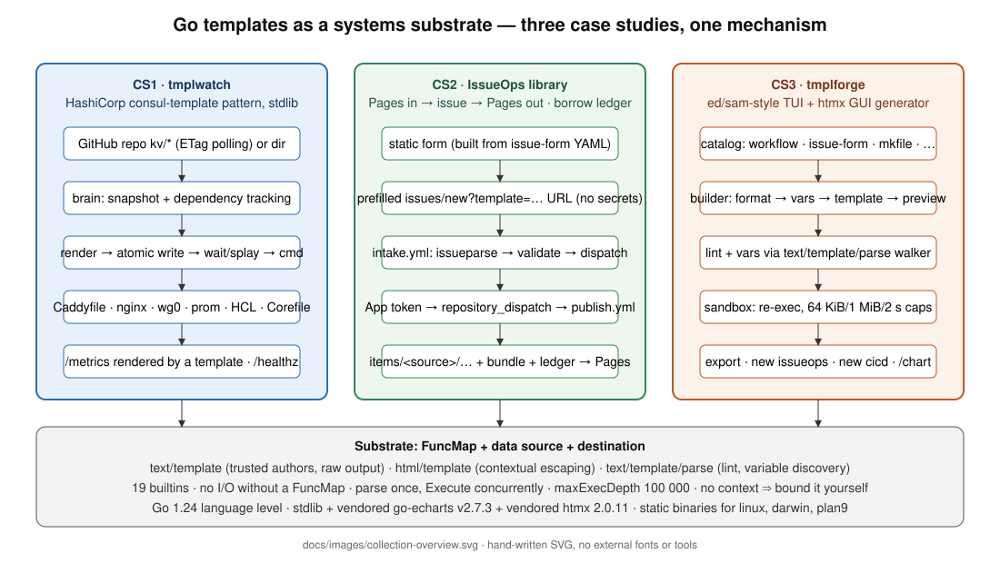

# Go Templates as a Systems Substrate

A master-depth classification, research report, cheat sheets, an executable cookbook, and
three complete beta-quality case-study repositories built on `text/template`,
`html/template` and `text/template/parse` — standard library only (plus vendored go-echarts
and htmx), Go 1.24, static binaries for linux/amd64, linux/arm64, darwin/arm64 and plan9/amd64.



## Contents

| Path | What |
|---|---|
| `docs/CLASSIFICATION-REPORT.md` | Taxonomy C1–C7 of template-driven systems, mechanisms, packages, conventionality ratings |
| `docs/RESEARCH-REPORT.md` | Rob Pike design lineage, CLI tools, security/hardening, GitHub platform facts (Oct 2026), HashiCorp usage, bibliography |
| `docs/CHEATSHEET-BASIC.md`, `docs/CHEATSHEET-ADVANCED.md` | Every row verified on go1.24.7 (`docs/verify/`) |
| `docs/COOKBOOK.md`, `docs/FUNCS-SHARED.md` | **Generated** from `cookbook/` — every formula is a passing test |
| `docs/CASE-STUDY-DESIGN-SPECS.md` | The three designs: data flow, FuncMaps, workflows, Terraform, tests, load/beta plans |
| `case-studies/01-tmplwatch/` | CS1 — HashiCorp consul-template pattern reimplemented on the stdlib |
| `case-studies/02-issueops-library/` | CS2 — IssueOps self-service: Pages form → issue → cross-repo publish → Pages pickup, library-card borrow ledger |
| `case-studies/03-tmplforge/` | CS3 — template generator: ed/sam-style TUI + htmx GUI, catalog, sandboxed render, go-echarts chart |
| `cookbook/` | Executable cookbook module (`cookbook list|show|run|gen|check`) |
| `third_party/htmx/` | htmx 2.0.11 (0BSD) with checksum; go-echarts v2.7.3 is vendored inside CS3 |
| `BUILD-CONVENTIONS.md` | The rules every repo follows |

## Quickstart

```sh
make preflight        # vet, test, cross-build, bash -n, checksums — works offline
make cookbook         # regenerate docs/COOKBOOK.md from the executable formulas
make package          # SHA256SUMS + zip
```
Each case study has its own `README.md`, `Makefile`, `mkfile` (Plan 9), `scripts/preflight.sh`,
Terraform, GitHub Actions workflows (CI, release with SHA256SUMS via `gh release create`,
load test), `docs/` and `docs/images/*.svg`.

## Standing assumptions

GitHub Enterprise Cloud enterprise **CoolGitEnterprise**, organisation **CoolGitOrg**,
GitHub App **issueops-autoadmin-app** (variable `APP_CLIENT_ID`, secret `APP_PRIVATE_KEY`).
Terraform provider `integrations/github ~> 6.13`. Actions majors: checkout v6, setup-go v6,
configure-pages v5, upload-pages-artifact v5, deploy-pages v5, create-github-app-token v3.

## Go version note

The project ceiling is `go 1.24`; everything here builds with go1.24.7. Go 1.24 is past
upstream support and the 2026 `html/template` fixes landed in 1.25.x/1.26.x; each repo's
`SECURITY.md` says so and CI's `GO_VERSION` variable lets an operator lift the toolchain
without changing the language level.

## Build provenance

Research: one extended research pass (sources in `docs/RESEARCH-REPORT.md` §10).
Build: Fable 5.1 orchestrating ≤4 concurrent agents (Opus 5.5 ×3 for the case studies,
Sonnet 4.6 ×1 for the cookbook); every module verified with `go vet`, `go test`, gofmt and
four-target cross-builds in this environment.
