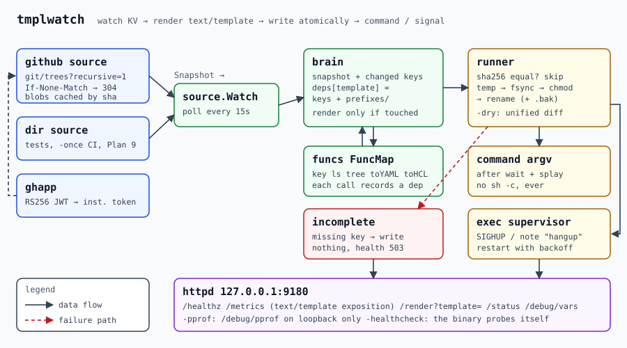
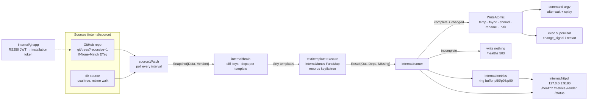
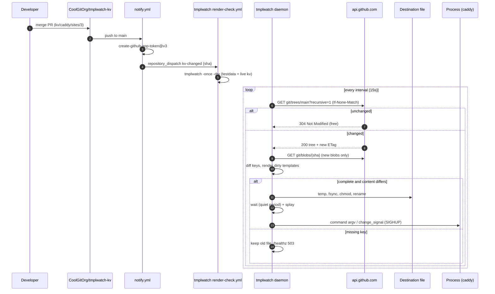

# tmplwatch

Watch a key/value source, render Go templates from it, write the results
atomically, then run a command or signal a process. It is a clean-room,
standard-library-only take on the [consul-template] pattern, sized to read in
an afternoon: about 4,000 lines of Go (plus 2,100 of tests), no dependencies, and it builds for
Linux, macOS and Plan 9.

The key/value store is a **Git repository**. `CoolGitOrg/tmplwatch-kv` holds
one file per key under `kv/`, so every configuration change is a reviewed
pull request with history and revert. tmplwatch polls it through the GitHub
API with ETags, so a poll that finds nothing new costs no rate limit. A
local directory works too, for tests, CI and Plan 9.

```
kv/caddy/sites/0  ──►  templates/Caddyfile.tmpl  ──►  /etc/caddy/Caddyfile  ──►  caddy reload
```

Case study 1 of the Go-templates collection. It is beta: complete and
tested, deployed on canaries first (see [docs/LOADTEST.md](docs/LOADTEST.md#beta-plan)).

## Architecture





One loop, no goroutine per template. Each poll yields a snapshot. The
**brain** diffs it against the previous one to get the set of changed keys.
Every template remembers which keys and prefixes its last render read (each
`key`, `ls` and `tree` call is recorded), and only templates whose
dependencies intersect the changed set are rendered again. A render that
asked for a missing key is **incomplete** and nothing is written. Complete
renders whose bytes differ from the file on disk are written with
temp file, fsync, chmod and rename. Commands then run as argument vectors
after a quiet period, and the supervised child gets its change signal.

The sequence from a merged pull request to a reloaded process, including the
workflow-to-workflow dispatch, is in
[docs/diagrams/sequence.mmd](docs/diagrams/sequence.mmd):



## Quickstart

```sh
make build                                        # bin/tmplwatch bin/tpl bin/tmplload
bin/tmplwatch -c config/testdata.json -once -dry  # show what would be written
bin/tmplwatch -c config/testdata.json -v          # run; files land in out/
curl -s 127.0.0.1:9180/status | jq '.templates[] | {name, complete, dependencies}'
echo 10.0.1.13 > testdata/kv/hosts/web-3          # within 2s out/hosts changes
curl -s '127.0.0.1:9180/render?template=hosts'
```

Against GitHub:

```sh
export GITHUB_TOKEN=$(gh auth token)              # or a GitHub App, below
bin/tmplwatch -c config/tmplwatch.json
```

One-shot rendering, with no daemon and no KV store:

```sh
echo '{"name":"web","port":8080}' | bin/tpl -t my.tmpl -d - -missingkey error
bin/tpl -t templates/hosts.tmpl -kv testdata/kv
```

The full preflight (format, vet for all targets, race tests, docs freshness,
`bash -n`, cross-builds, checksums) runs offline:

```sh
make preflight          # = scripts/preflight.sh
```

## Configuration

JSON, because the standard library reads it (see
[DESIGN.md](docs/DESIGN.md#why-json)). Unknown fields are errors.
[config/tmplwatch.json](config/tmplwatch.json) is the GitHub example,
[config/github-app.json](config/github-app.json) uses App authentication,
and [config/testdata.json](config/testdata.json) renders every shipped
template from `testdata/kv`.

| Field | Default | Meaning |
|---|---|---|
| `source.type` | (required) | `github` or `dir` |
| `source.repo` | | github: `owner/name` |
| `source.ref` | `main` | github: branch, tag or commit |
| `source.prefix` | `""` | path prefix stripped from keys, e.g. `kv/` |
| `source.path` | | dir: root directory |
| `source.interval` | `15s` | poll interval, minimum `1s` |
| `source.api_url` | `https://api.github.com` | GitHub Enterprise Server: `https://HOST/api/v3` |
| `source.token_env` | `GITHUB_TOKEN` | env var holding a token; `<NAME>_FILE` names a file instead |
| `source.app_client_id` / `app_client_id_env` | | GitHub App client ID (or the env var holding it) |
| `source.app_private_key_file` / `app_private_key_env` | | App private key PEM (PKCS#1 or PKCS#8) |
| `templates[].source` | (required) | template file |
| `templates[].destination` | (required) | output file; parent directories are created |
| `templates[].name` | file base minus `.tmpl` | label in logs, metrics and `/render` |
| `templates[].perms` | `0644` | octal mode, applied before the rename |
| `templates[].backup` | `false` | keep the previous file as `destination.bak` |
| `templates[].command` | | argv run after a write; **never** passed to a shell |
| `templates[].command_timeout` | `30s` | the command is killed after this |
| `templates[].wait` | `0` | quiet period: a new write restarts it (debounce) |
| `templates[].splay` | `0` | random extra delay, up to this, before the command |
| `templates[].left_delimiter` / `right_delimiter` | `{{` `}}` | e.g. `[[` `]]` for files that contain `{{` |
| `templates[].error_on_missing_key` | `false` | `missingkey=error` for map lookups such as `.field` |
| `exec.command` | | child process to supervise |
| `exec.change_signal` | | sent to the child after writes; empty means restart it |
| `exec.kill_signal` / `kill_timeout` | `SIGTERM` / `5s` | how the child is stopped |
| `listen` | `127.0.0.1:9180` | HTTP listener; `off` disables it |
| `dry` / `once` | `false` | same as `-dry` / `-once` |

Flags: `-c file`, `-once`, `-dry`, `-a addr`, `-pprof`, `-v`,
`-healthcheck`, `-version`. Exit codes, signals and metrics are in
[docs/OPERATIONS.md](docs/OPERATIONS.md).

## Templates

Templates are Go [`text/template`](https://pkg.go.dev/text/template) files
with 45 extra functions. The reference, [docs/FUNCS.md](docs/FUNCS.md), is
**generated** from a table in `internal/funcs/docs.go` by a Go template
(`make docs`). Every example in it is executed by the tests, so the reference
cannot drift from the code.

Nine production-shaped templates ship in [templates/](templates). Each has a
golden output in [testdata/golden/](testdata/golden) rendered from
[testdata/kv/](testdata/kv):

| Template | Shows |
|---|---|
| `Caddyfile.tmpl` | `ls` + `parseJSON`, optional fields with `index`, `fail` on bad data |
| `nginx.conf.tmpl` | cross-checking servers against upstreams with `contains` |
| `wg0.conf.tmpl` | WireGuard peers; key format validated with `regexMatch`; private key stays on the host |
| `prometheus.yml.tmpl` | grouping `tree` output into jobs; `toYAML` + `indent` |
| `main.tf.tmpl` | Terraform; every KV value through `toHCL`, so data never becomes `${...}` |
| `job.nomad.hcl.tmpl` | `[[ ]]` delimiters so Nomad's own `{{ }}` passes through |
| `corefile.tmpl` | CoreDNS with a `template` plugin block whose `{{ .Name }}` is emitted literally |
| `motd.txt.tmpl` | `plural`, `timestamp`, `keyOrDefault` |
| `hosts.tmpl` | the smallest useful template |

`go test ./templates -update` rewrites the golden files. `make fuzz` runs
`FuzzRender`, which writes arbitrary bytes into every key and checks that no
render panics and that no data-borne `${` reaches HCL output. The fuzzer
found exactly that once, in `count = [[ key ... ]]`; the template now uses
`add 0`.

## Compared with consul-template

| | consul-template | tmplwatch |
|---|---|---|
| Sources | Consul KV, services, Vault, Nomad | GitHub repo (trees + blobs, ETag), local directory |
| Change detection | blocking queries | polling; a 304 costs nothing ([budget](docs/DESIGN.md#api-budget)) |
| Config | HCL | JSON (stdlib) |
| `key` `keyOrDefault` `keyExists` `ls` `tree` | yes | yes, same semantics; a missing `key` holds the render |
| `env` `file` `timestamp` | yes | yes; `file` is confined to the template's directory |
| `toJSON` `toPrettyJSON` `parseJSON` `toYAML` | yes | yes; `toYAML` is a ~160-line stdlib emitter |
| `sockaddr` | full go-sockaddr language | `GetPrivateIP`, `GetPublicIP`, `GetInterfaceIP`, `GetAllInterfaces` |
| `service`, `services`, `secret`, `pkiCert`, `nomad*` | yes | **no**: no Consul, Vault or Nomad client |
| sprig-style helpers | partial | `add sub mul mod default coalesce dict list values sortedKeys sha256sum b64enc b64dec shq plural toHCL fail` |
| Atomic write, perms, backup | yes | yes; also skips identical content and repairs mode drift |
| `wait` / `splay` | yes | yes (per template) |
| `command` | shell string or argv | argv only, never a shell |
| exec mode | yes | yes: start after first full render, signal or restart on change, backoff |
| `-dry` / `-once` | yes | yes; `-dry` prints a unified diff |
| De-duplication, Vault token renewal, `-config` directories | yes | no |
| Metrics | via telemetry | Prometheus `/metrics` rendered by `text/template`, plus `/status`, expvar |
| Plan 9 | no | yes: dir source, notes instead of signals ([deploy/plan9](deploy/plan9/README.md)) |
| Dependencies | many | none |

## Deploying

* **systemd**: [deploy/systemd/tmplwatch.service](deploy/systemd/tmplwatch.service), hardened
  (`DynamicUser`, `ProtectSystem=strict`, an empty capability set, the token through `LoadCredential`).
* **Container**: [Dockerfile](Dockerfile), a `FROM scratch` static binary running as 65532 with a
  `HEALTHCHECK` that calls `tmplwatch -healthcheck`.
* **Plan 9**: [deploy/plan9/README.md](deploy/plan9/README.md).
* **Canary**: [scripts/beta-rollout.sh](scripts/beta-rollout.sh) stages one or two hosts, shows
  the `-dry` diff, validates a scratch render, and switches only with `-apply`.
* **GitHub**: [terraform/](terraform/README.md) creates both repositories, the rulesets,
  the seed data and the variables.

## Workflows

| Workflow | Trigger | Does |
|---|---|---|
| [ci.yml](.github/workflows/ci.yml) | push, PR | gofmt, vet, `go test -race`, 30s fuzz, preflight, 4-target cross-build, `terraform validate` |
| [release.yml](.github/workflows/release.yml) | tag `v*` | static binaries, `SHA256SUMS`, smoke test, `gh release create --verify-tag` |
| [render-check.yml](.github/workflows/render-check.yml) | template or testdata change; `repository_dispatch: kv-changed` | `tmplwatch -once -dry` on testdata and on the live kv repository at the pushed SHA |
| [loadtest.yml](.github/workflows/loadtest.yml) | manual | starts tmplwatch, runs `scripts/loadtest.sh`, renders the job summary with `tpl` |
| [kv notify.yml](terraform/kv-repo-seed/.github/workflows/notify.yml) | push to kv `main` | App token, then `gh api .../dispatches -f event_type=kv-changed` |

## Documentation

* [docs/DESIGN.md](docs/DESIGN.md): lifecycle, dependency tracking, atomic writes, why JSON, why polling, API budget
* [docs/OPERATIONS.md](docs/OPERATIONS.md): runbook, flags, exit codes, signals, metrics, alerts
* [docs/SECURITY.md](docs/SECURITY.md): trust model, tokens, toolchain and CVE notes
* [docs/LOADTEST.md](docs/LOADTEST.md): targets, method, results, beta plan
* [docs/FUNCS.md](docs/FUNCS.md): template function reference (generated)
* [CHANGELOG.md](CHANGELOG.md)

## Layout

```
cmd/tmplwatch      the daemon
cmd/tpl            one-shot renderer
cmd/tmplload       open-loop HTTP load generator
internal/config    JSON config, defaults, validation
internal/source    github (trees/blobs/ETag) and dir sources; Watch loop
internal/ghapp     RS256 JWT and installation tokens, stdlib only
internal/brain     snapshot, key diff, dependency tracking, render
internal/funcs     the FuncMap, toYAML, toHCL, sockaddr, docs table
internal/runner    atomic write, commands, exec supervisor, signals
internal/httpd     /healthz /metrics /render /status /debug/vars
internal/metrics   counters, ring-buffer quantiles, exposition template
internal/diff      unified diff for -dry
templates          shipped templates + golden and fuzz tests
```

[consul-template]: https://github.com/hashicorp/consul-template

## License

MIT; see [LICENSE](LICENSE).
