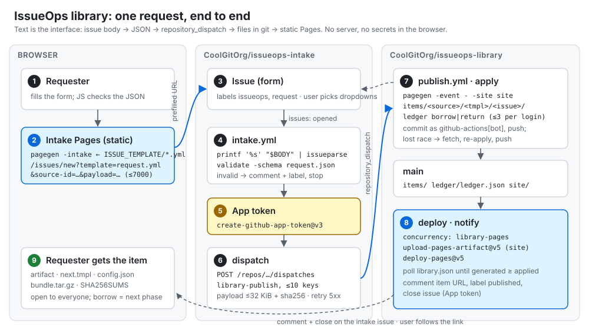
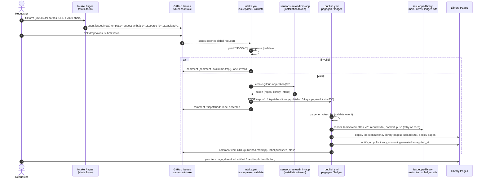
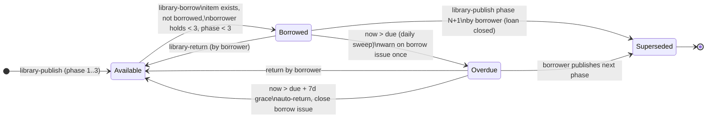

# Case study 02: an IssueOps self-service library

Two repositories, a GitHub App and two GitHub Pages sites that together turn a
GitHub issue into a published, checksummed, versioned artifact, with no server
anywhere. Everything is Go `text/template` and `html/template`, the Go standard
library, `gh`, and plain files in git.

```
issueops-intake/    CoolGitOrg/issueops-intake   input: issue forms, static form page, intake workflows
issueops-library/   CoolGitOrg/issueops-library  output: items/, ledger/, the catalog site, publish workflows
terraform/          provisions both repos, Pages, labels, variables, environments, rulesets
docs/               DESIGN, OPERATIONS, SECURITY, API, LOADTEST, BETA, FUNCS, diagrams, images
scripts/            beta-run.sh, loadtest.sh, set-secrets.sh
```



## What it does

1. A requester opens **https://coolgitorg.github.io/issueops-intake/**, a static page
   rendered at build time by `pagegen -intake` *from the issue-form YAML itself*, so the
   page and the form cannot drift. The page's only JavaScript checks that the payload is a
   JSON object, builds a prefilled `issues/new?template=request.yml&source-id=…&payload=…`
   URL, refuses URLs over 7,000 characters, and navigates there. No token, no API call.
2. The requester picks the dropdowns (GitHub does not reliably prefill dropdowns or
   checkboxes from the URL) and submits the issue.
3. **`intake.yml`** runs `issueparse` (issue body to JSON keyed by field id, the same
   keying as `issue-ops/parser`) and `validate` (a five-rule schema). An invalid request
   gets a templated comment listing every problem and the `invalid` label; editing the
   issue re-runs the check.
4. A valid request mints an **App installation token** and `dispatch` sends a
   `repository_dispatch` (`library-publish`) to the library: ten keys at most, the payload
   as a compact JSON string of at most 32 KiB, and its sha256.
5. **`publish.yml`** in the library verifies the event, renders the item with the template
   named by `template_id`, and writes
   `items/<source-id>/<template-id>/<issue>/{artifact.<ext>, next.tmpl, config.json, bundle.tar.gz, SHA256SUMS}`.
   It rebuilds the entire site (catalog, item pages, ledger fragments, Atom feed, sitemap,
   `library.json`), commits as `github-actions[bot]`, and pushes.
6. A `deploy` job (concurrency group `library-pages`) publishes `site/` to Pages; a
   `notify` job waits until the live `library.json` was generated after the commit, then
   comments the item URL on the intake issue and closes it.

## The library card model

- **Items are open access.** Every item page, artifact and bundle is public to anyone
  who can see the Pages site. Nothing is ever checked out of reading.
- **A borrow reserves the next phase.** Each item can be continued: phase 1 to 2 to 3.
  Borrowing `payments-api/caddyfile/42` reserves the right to publish phase 2 of
  `payments-api`/`caddyfile` for **7 or 14 days**. While the loan is open, a phase 2
  request from anyone else is refused with a comment naming the borrower and due date.
- **At most 3 open loans per login.** Phase 3 is final and cannot be borrowed.
- **Publishing the next phase returns the loan** automatically and closes the borrow issue.
  The old item's page then links forward to the new one.
- **Overdue loans lapse.** A daily sweep warns the borrower once on their borrow issue when
  the loan passes its due date, and returns it automatically 7 days later.
- Items are keyed by **source**, never by requester: the requester's login appears only in
  `config.json` as `requested_by` and on the ledger. No URL contains a person's name.

`next.tmpl` is the hand-off: a Go template, emitted by a meta-template that runs with
`[[ ]]` delimiters so its `{{ }}` survive as literal output. A borrower renders it with
their changes (`tpl -d mine.json -t next.tmpl -o payload.json`) to produce the next
phase's payload, with every key they did not set carried over from the previous phase.

## Sequence



## Loan states



Sources: [`docs/diagrams/flow.mmd`](docs/diagrams/flow.mmd), [`docs/diagrams/ledger-state.mmd`](docs/diagrams/ledger-state.mmd).

## The binaries

| Repo | Binary | Reads | Writes |
|---|---|---|---|
| intake | `issueparse -form f.yml` | issue body (stdin) | JSON keyed by field id |
| intake | `validate -schema rules.json` | that JSON | `{"ok", "errors": [...]}`; exit 1 if invalid |
| intake | `dispatch -repo o/r -event e -issue N` | that JSON, `GH_TOKEN` | `POST /dispatches`; JSON receipt |
| intake | `pagegen -intake` / `-comment x.md.tmpl` | issue forms, rules | the intake site / a Markdown comment |
| library | `pagegen -event -` | `toJSON(github.event)` | `items/…`, `site/…`; JSON result; exit 3 = refused |
| library | `ledger borrow\|return\|overdue\|list\|render` | `ledger/ledger.json` | the ledger; JSON results; `tabwriter` tables |
| library | `tpl -d data.json -t x.tmpl` | any template + JSON | rendered text (refuses `<no value>`) |
| library | `siteload -base url -rate 50 -d 2m` | the live site | latency report; exit 1 over budget |

Every binary is Go 1.24 standard library only, and cross-compiles for `linux/amd64`,
`linux/arm64`, `darwin/arm64` and `plan9/amd64`. The intake's `/lab/` page also builds
`lab/wasm` with `GOOS=js GOARCH=wasm`: Go's `text/template` running in the browser, shown
as documentation, never required by the form.

## Quickstart

```sh
make preflight                 # both repos: vet, gofmt, test, bash -n, workflow lint, cross builds, wasm
make site-sample               # re-render issueops-library/site-sample/ from testdata/events
open issueops-library/site-sample/index.html

# try the pipeline by hand, no network:
cd issueops-intake && make build
bin/issueparse -form .github/ISSUE_TEMPLATE/request.yml testdata/bodies/request-basic.md > /tmp/req.json
bin/validate -schema schema/request.json /tmp/req.json
GITHUB_REPOSITORY=CoolGitOrg/issueops-intake bin/dispatch -n -repo CoolGitOrg/issueops-library \
  -issue 42 -requester alice /tmp/req.json
```

Deploying for real: [`terraform/README.md`](terraform/README.md) (apply order, App setup),
then [`docs/OPERATIONS.md`](docs/OPERATIONS.md) and [`docs/BETA.md`](docs/BETA.md).

## Documents

- [DESIGN](docs/DESIGN.md): why two repos, why dispatch, why full rebuilds, the concurrency model.
- [OPERATIONS](docs/OPERATIONS.md): runbook, replays, recovering from bad states.
- [SECURITY](docs/SECURITY.md): trust boundaries, token scope, escaping, prefill limits.
- [API](docs/API.md): every REST endpoint and payload the system uses.
- [LOADTEST](docs/LOADTEST.md) and [BETA](docs/BETA.md): how to measure and how to gate.
- [FUNCS](docs/FUNCS.md): the template FuncMap and the `#!tmpl` header.

## Not verified here

- Nothing was run against live GitHub: no network or credentials in the build
  environment. Workflows, `gh` calls and the REST shapes follow GitHub's documented
  behaviour and are covered by `httptest` and golden tests, but a first real run belongs in
  [BETA](docs/BETA.md).
- `terraform` is not installed here; the HCL is hand-formatted and unvalidated
  ([terraform/README.md](terraform/README.md#caveats-read-before-the-first-apply)).

MIT licensed; see each repo's `LICENSE`.
