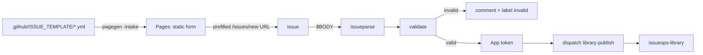

# issueops-intake

The front door of the CoolGitOrg library: issue forms, the static request page at
**https://coolgitorg.github.io/issueops-intake/**, and the workflows that turn a request
issue into a validated `repository_dispatch` to
[`issueops-library`](https://github.com/CoolGitOrg/issueops-library).



## Layout

| Path | What |
|---|---|
| `.github/ISSUE_TEMPLATE/` | `request.yml`, `borrow.yml`, `return.yml`, `config.yml` (blank issues off) |
| `schema/*.json` | validation rules per form (required, pattern, enum, min/maxLength, `type: json`) |
| `templates/*.md.tmpl` | comment templates: invalid, dispatched, failed |
| `.github/workflows/` | `intake.yml`, `borrow.yml`, `return.yml` (one per form), `pages.yml`, `ci.yml`, `release.yml` |
| `scripts/intake.sh` | the shared parse/validate/dispatch steps the three intake workflows run |
| `cmd/issueparse` | issue-form Markdown → JSON keyed by field id |
| `cmd/validate` | JSON + rules → `{"ok", "errors"}`, exit 1 if invalid |
| `cmd/dispatch` | `POST /repos/{o}/{r}/dispatches` with retries and ≥1 s write pacing |
| `cmd/pagegen` | `-intake`: the site from the forms; `-comment`: Markdown comments |
| `internal/yamlite` | the YAML subset issue forms use, as a line scanner |
| `lab/wasm` | `text/template` compiled to WebAssembly for the `/lab/` page (documentation only) |
| `flags.json` | beta gate read by the form page (`{"submit": true}`) |

## Fields

| Form | id | type | rule |
|---|---|---|---|
| request | `source-id` | input | required, `^[a-z0-9][a-z0-9-]*[a-z0-9]$`, 2-48 |
| | `template-id` | dropdown | caddyfile, workflow, issue-form, terraform-module, nomad-job, readme |
| | `phase` | dropdown | 1, 2, 3 |
| | `payload` | textarea `render: json` | required JSON object ≤ 32 KiB |
| | `notes` | textarea | optional, ≤ 4000 |
| borrow | `item-id` | input | `source/template/issue` |
| | `days` | dropdown | 7, 14 |
| | `reason` | textarea | optional, ≤ 1024 |
| return | `item-id` | input | `source/template/issue` |

Prefill: GitHub fills `input` and `textarea` fields from `?<id>=value`. **Dropdowns and
checkboxes are not reliably prefilled**, so the page does not send them and asks the user
to pick them on GitHub; `validate` checks whatever was actually submitted.

## Use it by hand

```sh
make build
bin/issueparse -form .github/ISSUE_TEMPLATE/request.yml testdata/bodies/request-basic.md > req.json
bin/validate -schema schema/request.json req.json > report.json ||
  bin/pagegen -comment templates/comment-invalid.md.tmpl -d report.json   # the comment an invalid request gets
GITHUB_REPOSITORY=CoolGitOrg/issueops-intake bin/dispatch -n -repo CoolGitOrg/issueops-library -issue 42 -requester alice req.json
make site && open _site/index.html     # the form page + wasm lab
```

## Check it

```sh
scripts/preflight.sh    # vet, gofmt, test, bash -n, workflow lint, cross builds (incl. plan9/amd64), wasm, site
make fuzz               # 30 s of FuzzParse
```

Tests are golden-file based (`go test ./... -update` rewrites `testdata/golden/`):
nine real-looking issue bodies (user-edited, CRLF, missing optional, fenced JSON with a
fake heading inside, checkboxes, multi-select), validation reports, dispatch payloads, the
generated page, and the three comments. `dispatch` is tested against `httptest` for the
auth header, the ≤10-key payload, backoff on 5xx, `Retry-After`, and write pacing.

Configuration: variable `APP_CLIENT_ID`, secret `APP_PRIVATE_KEY`, optional `GO_VERSION`.
Design, security and operations: [`../docs/`](../docs/). MIT licence.
