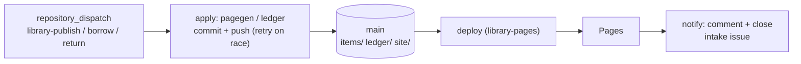

# issueops-library

The CoolGitOrg library: rendered items, the loan ledger, and the public catalog at
**https://coolgitorg.github.io/issueops-library/**. Written only by automation acting as
`issueops-autoadmin-app`, in response to `repository_dispatch` events from
[`issueops-intake`](https://github.com/CoolGitOrg/issueops-intake).



## Layout

| Path | What |
|---|---|
| `items/<source>/<template>/<issue>/` | `artifact.<ext>`, `next.tmpl`, `config.json`, `bundle.tar.gz`, `SHA256SUMS` |
| `ledger/ledger.json` | every loan ever: `{item, borrower, borrow_issue, borrowed_at, due, returned_at}` |
| `site/` | the rendered Pages site (committed, so every deploy is a plain upload of `main`) |
| `site-sample/` | the site rendered from `testdata/events/` for reviewers: open `site-sample/index.html` |
| `templates/items/*.tmpl` | caddyfile, workflow, issue-form, terraform-module, nomad-job, readme |
| `templates/meta/next.tmpl.tmpl` | meta-template emitting each item's `next.tmpl` (`[[ ]]` delimiters) |
| `templates/comments/*.md.tmpl` | published, refused, borrowed, returned, overdue-warning |
| `.github/workflows/` | `publish.yml` (apply → deploy → notify), `overdue.yml` (daily), `pages.yml`, `ci.yml`, `release.yml` |
| `cmd/pagegen` | apply an event and rebuild the site; `-describe` validates an event for the workflow |
| `cmd/ledger` | `borrow`, `return`, `overdue`, `list -json\|-table`, `render` |
| `cmd/tpl` | render any template with JSON data (`-delims`, `-missingkey`, `-o`) |
| `cmd/siteload` | constant-rate load generator (and `-serve dir` static server) |
| `internal/site/static/htmx/` | vendored htmx 2.0.11 (0BSD), with `LICENSE` and `SHA256SUMS` |

## Rules

- Items are readable by everyone, always. Item paths are keyed by source; the requester
  appears only as `requested_by` in `config.json`.
- A borrow reserves the next phase of an item for 7 or 14 days; at most 3 open loans per
  login; phase 3 cannot be borrowed.
- A phase N+1 publish for a borrowed phase N item is accepted only from the borrower, and
  returns the loan.
- Loans past due are warned once; past due + 7 days they are returned automatically.

## Use it by hand

```sh
make build
printf '%s' "$(cat testdata/events/publish.json)" |
  bin/pagegen -event - -site /tmp/site -items /tmp/items -ledger /tmp/ledger.json
bin/ledger -f /tmp/ledger.json -items /tmp/items borrow -item payments-api/caddyfile/42 -by bob -days 14 -issue 50
bin/ledger -f /tmp/ledger.json list
echo '{"port": 9443}' | bin/tpl -d - -t /tmp/items/payments-api/caddyfile/42/next.tmpl
make site-sample        # re-render site-sample/
make loadtest           # BASE=... RATE=50 DURATION=2m; or scripts/loadtest.sh -local
```

## Check it

```sh
scripts/preflight.sh    # vet, gofmt, test, bash -n, workflow lint, cross builds (incl. plan9/amd64),
                        # htmx checksum, site-sample reproducibility
make fuzz               # 30 s of FuzzDecode
```

Every output format has a golden file under `testdata/golden/`: each item template's
artifact, `next.tmpl`, `config.json` and `SHA256SUMS`; the catalog, an item page, the
status and ledger fragments, `open.json`, `library.json`, `feed.xml`, `sitemap.txt`, the
site `SHA256SUMS`, `404.html`; ledger files, tables and JSON; every comment. Ledger tests
cover the borrow limit, double borrow, return by a stranger, forced return and overdue
warn/return. `siteload` is tested against `httptest`.

Configuration: variables `APP_CLIENT_ID`, `LIBRARY_BASE_URL`, optional `GO_VERSION`;
secret `APP_PRIVATE_KEY`. Design, security and operations: [`../docs/`](../docs/). MIT licence.
