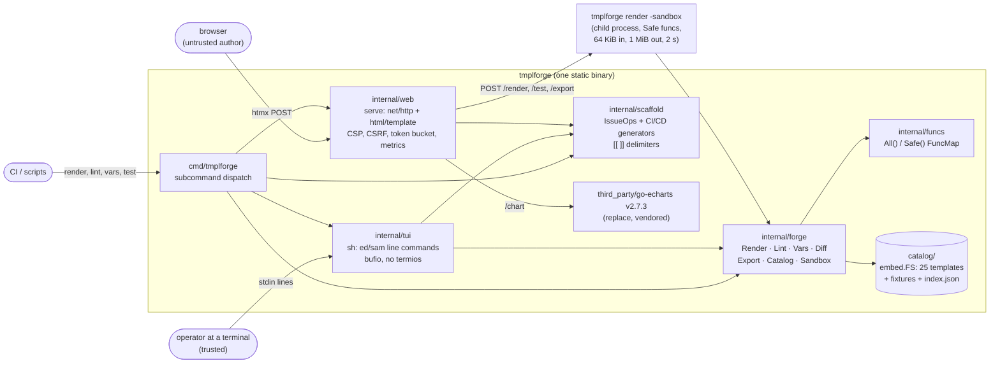
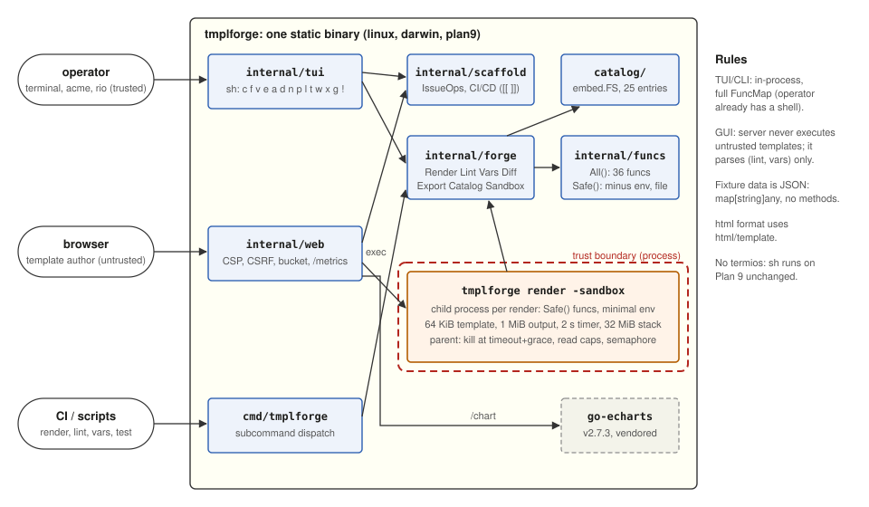

# tmplforge

**Go templates, forged at the terminal or in the browser.** tmplforge is
one static binary that builds, lints, tests and serves `text/template` and
`html/template` templates. It has two front ends over one engine:

- **`tmplforge sh`**: a line-command language in the manner of ed(1) and
  sam(1). It reads lines from stdin and writes text to stdout, with no
  curses and no termios, so it runs unchanged on Plan 9, in acme, over
  ssh, and from scripts.
- **`tmplforge serve`**: an HTML GUI built from `html/template` and htmx.
  It has a catalog, a builder wizard with live preview, a two-fixture
  diff, and IssueOps and CI/CD generators. Every untrusted render runs in
  a sandboxed child process.

It also ships 25 catalog templates (Dockerfile, mkfile, Corefile,
workflows, Terraform, Plan 9 C and more), a parse-tree walker that derives
fixture skeletons, an LCS line diff, and reproducible export bundles that
re-render themselves with nothing but a Go toolchain.

Case Study 3 of the Go-templates case-study collection. Go 1.24, standard
library only, plus go-echarts v2.7.3 (vendored). Cross-compiles for
linux/amd64, linux/arm64, darwin/arm64 and plan9/amd64.

## Architecture





The operator at a terminal is trusted. Their renders run in-process with
the full FuncMap, and `!cmd` runs a shell. A browser user is not trusted.
The server only parses their templates. Execution happens in
`tmplforge render -sandbox`, the same binary re-executed as a child with
the safe FuncMap, a 64 KiB template cap, a 1 MiB output cap, a 2 s timeout
and a 32 MiB stack. A child that loops is killed, and a child that crashes
takes nothing with it. See [docs/DESIGN.md](docs/DESIGN.md) and
[docs/SECURITY.md](docs/SECURITY.md).

## Quickstart

```sh
make                         # vet + test + build bin/tmplforge (offline)
bin/tmplforge catalog        # 25 starter templates
```

### The TUI

```sh
bin/tmplforge sh             # interactive: prompt "tf> ", h for help
bin/tmplforge sh < x.tf      # scripted: same commands, exits 1 on first error
bin/tmplforge sh -c hello.go # preload a catalog entry
```

An excerpt of a real session (the full transcript is in [docs/TUI.md](docs/TUI.md)):

```
tf> c motd.txt
motd.txt: 13 lines, txt, 7 vars
tf> d 1
tf> i 1
== {{ upper .host }} ({{ .user | default "nobody" }}) ==
.
tf> D glenda.json
glenda.json: 4 keys
tf> p
== PLAN9 (glenda) ==
Welcome, glenda.

Kernel:      9front 10522
Last login:  Sun Oct 18 21:04 UTC 2026
Updates:     3 packages

Notices:
  * venti scrub tonight
tf> l
ok
tf> v extra string
tf> l
motd.txt:1: warning: variable "extra" declared but never referenced
tf> t glenda.json rob.json
--- glenda.json
+++ rob.json
@@ -1,9 +1,6 @@
-== PLAN9 (glenda) ==
-Welcome, glenda.
+== PLAN9 (rob) ==
+Welcome, rob.
 
 Kernel:      9front 10522
 Last login:  Sun Oct 18 21:04 UTC 2026
-Updates:     3 packages
-
-Notices:
-  * venti scrub tonight
+Updates:     1 package
tf> x bundle
bundle/Makefile
...
bundle/SHA256SUMS
tf> q
```

| | |
|---|---|
| `c NAME` load catalog entry | `f FMT` html md json txt yaml |
| `v NAME TYPE [DEF]` declare var / `V` list | `e` edit ($EDITOR, or lines until `.`) |
| `a` append / `i N` insert / `d N[,M]` delete | `n` numbered listing |
| `p` preview / `D FILE` load fixture | `l` lint / `t F1 F2 ...` diff renders |
| `w FILE` output / `W FILE` template | `x DIR` export bundle |
| `g issueops NAME` / `g cicd KIND` | `!CMD` pipe output to a command, `q` quit |

### The GUI

```sh
bin/tmplforge serve                                   # http://127.0.0.1:8088
TMPLFORGE_TOKEN=$(head -c 24 /dev/urandom | base64) \
  bin/tmplforge serve -a 0.0.0.0:8088 -rate 10        # off loopback: token + rate limit required
scripts/fetch-echarts.sh && make build                # optional: draw /chart (else a data table)
```

Routes, the builder steps and the security model are covered in
[docs/GUI.md](docs/GUI.md) ([wireframe](docs/images/gui-wireframe.svg)).

### One-shot commands

```sh
tmplforge render -t catalog/motd.txt.tmpl -d catalog/fixtures/motd.txt.json
tmplforge render -sandbox -t - < untrusted.tmpl       # what the GUI runs per request
tmplforge lint   -t x.tmpl -vars name,items           # file:line: message, exit 1 on error
tmplforge vars   -t x.tmpl                            # JSON skeleton fixture from the parse tree
tmplforge test   -t x.tmpl a.json b.json              # unified diff of renders, exit 1 if different
tmplforge export -t x.tmpl -d a.json -o bundle/       # template fixture output run.go Makefile SHA256SUMS
tmplforge new issueops repo-request -fields 'repo:string!,vis:dropdown=internal|private'
tmplforge new cicd dispatch -binary tmplforge -inputs 'env:choice=beta|prod,dry_run:boolean'
```

Generators parse their templates with `[[ ]]` delimiters so
`${{ github.* }}` survives. Every untrusted value reaches `run:` steps
through `env:` only.

## Catalog

| Name | Format | Delims | Description |
|---|---|---|---|
| `CHANGELOG.md` | md | - | Keep-a-Changelog CHANGELOG from a list of releases and typed changes. |
| `Caddyfile` | txt | - | Caddy v2 Caddyfile: one block per site with optional file server and reverse proxies. |
| `Corefile` | txt | `[[,]]` | CoreDNS Corefile with a template plugin block; [[ ]] delimiters leave CoreDNS's own {{ }} alone. |
| `Dockerfile` | txt | - | Two-stage Go Dockerfile: golang builder to scratch, non-root, labels. |
| `Makefile` | txt | - | POSIX make Makefile with a cross-compile target per GOOS/GOARCH (tabs preserved). |
| `README.md` | md | - | Project README with badges, install steps and a generated command table. |
| `config.json` | json | - | Application JSON config assembled with dict/list and printed with toPrettyJSON. |
| `config.yml` | yaml | - | YAML config: hand-written header, then toYAML of a nested fixture section. |
| `dispatch.yml` | yaml | `[[,]]` | workflow_dispatch workflow with typed inputs passed through env, never run interpolation. |
| `email.html` | html | - | HTML email rendered with html/template: hostile fixture strings are escaped. |
| `email.txt` | txt | - | Plain-text email twin of email.html, wrapped at 72 columns. |
| `hello.c` | txt | - | Plan 9 C program (u.h, libc.h, ARGBEGIN) printing a configurable greeting. |
| `hello.go` | txt | - | Go command with flag package and single-dash flags; output is gofmt-clean. |
| `htmx-partial.html` | html | - | htmx partial: rows that swap themselves, escaped by html/template. |
| `issue-form.yml` | yaml | - | GitHub issue form (ISSUE_TEMPLATE) with typed fields and dropdowns. |
| `job.nomad.hcl` | txt | `[[,]]` | Nomad service job; [[ ]] delimiters keep consul-template {{ }} blocks intact. |
| `main.tf` | txt | - | Terraform (integrations/github ~> 6.13): repositories with topics and a branch ruleset. |
| `mkfile` | txt | - | Plan 9 mkfile for a C program (mkone), the native build of the Thompson-Pike world. |
| `motd.txt` | txt | - | Message of the day with aligned columns, indent and plural. |
| `prometheus-rules.yml` | yaml | `[[,]]` | Prometheus alerting rules; [[ ]] delimiters preserve {{ $labels }} annotations. |
| `release.yml` | yaml | `[[,]]` | Tag-triggered release workflow: static binaries, SHA256SUMS, gh release create. |
| `repository-dispatch.yml` | yaml | `[[,]]` | repository_dispatch receiver; client_payload flows through env only. |
| `sparkline.svg` | html | - | Inline SVG sparkline computed in-template from a list of points. |
| `sql-migration.sql` | txt | - | SQL migration (up/down) from a table spec, with index creation. |
| `workflow.yml` | yaml | `[[,]]` | GitHub Actions CI workflow: Go matrix build with pinned action majors. |

Each entry has a fixture in `catalog/fixtures/` and a golden output in
`testdata/golden/catalog/`. Regenerate the goldens with
`go test ./... -update`. Generated docs: [docs/CATALOG.md](docs/CATALOG.md),
[docs/FUNCS.md](docs/FUNCS.md) (36 template functions, `make docs`).

## Repository

```
cmd/tmplforge      the binary              internal/forge     engine + sandbox
cmd/forgeload      stdlib load generator   internal/funcs     FuncMap, FUNCS.md generator
catalog/           embedded templates      internal/scaffold  IssueOps / CI/CD generators
testdata/golden/   golden outputs          internal/tui       sh
third_party/       go-echarts (vendored)   internal/web       serve
terraform/         repo, ruleset, GO_VERSION variable, beta environment
deploy/systemd/    hardened unit           scripts/           preflight, loadtest, fetch-*
```

| Make target | |
|---|---|
| `make` / `make build` | vet, test, build `bin/` |
| `make test` / `make race` / `make fuzz` | tests, race detector, 30 s per fuzz target |
| `make lint` | vet, gofmt, `bash -n` |
| `make cross` / `make release` | four static binaries, plus `SHA256SUMS` |
| `make docs` | regenerate FUNCS.md, CATALOG.md and CHANGELOG.md (with tmplforge itself) |
| `make loadtest` | 20 req/s for 5 min against a local server, SLO p99 < 150 ms |
| `make preflight` | everything CI checks, offline |

## Documentation

[DESIGN](docs/DESIGN.md) · [TUI](docs/TUI.md) · [GUI](docs/GUI.md) ·
[CATALOG](docs/CATALOG.md) · [FUNCS](docs/FUNCS.md) ·
[SECURITY](docs/SECURITY.md) · [LOADTEST](docs/LOADTEST.md) ·
[OPERATIONS](docs/OPERATIONS.md) · [CHANGELOG](CHANGELOG.md)

**Toolchain note:** the module targets Go 1.24 per the collection's
conventions, but Go 1.24 and 1.25 no longer receive security fixes, and
2026 security releases fixed html/template only on newer lines. Build
release binaries with Go 1.26 or 1.27 by setting the `GO_VERSION`
repository variable. See [docs/SECURITY.md](docs/SECURITY.md#toolchain-go-124-is-past-upstream-support).

## License

MIT. go-echarts is Apache-2.0 and htmx is 0BSD; see [LICENSE](LICENSE).
