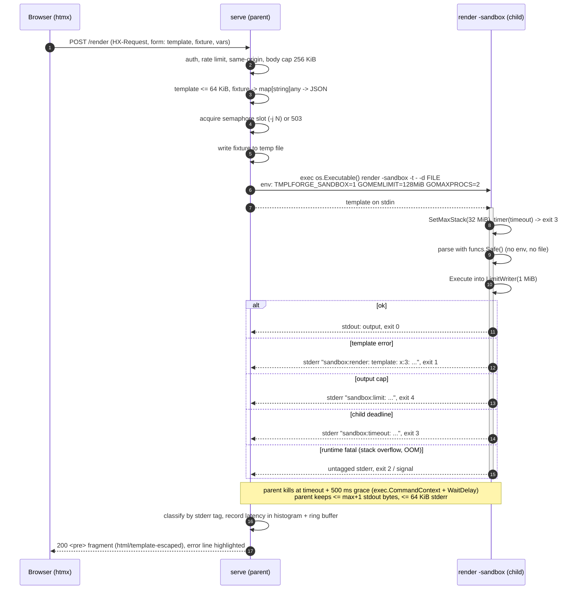

# Design

tmplforge is one binary that builds, tests and serves Go templates. It has
two front ends over one engine: `sh`, a line-command language for a person
at a terminal, and `serve`, an HTML GUI for a person in a browser. This
document records why each piece is shaped the way it is.


```
cmd/tmplforge       subcommand dispatch, flag parsing, exit codes
internal/forge      Render Lint Vars Diff Export Catalog Sandbox, `render` command
internal/funcs      the FuncMap: All() and Safe(); FUNCS.md generator
internal/scaffold   IssueOps and CI/CD generators ([[ ]] templates)
internal/tui        `sh`
internal/web        `serve`
catalog/            embed.FS of starter templates, fixtures, index.json
cmd/forgeload       open-loop load generator (stdlib)
third_party/        go-echarts v2.7.3, vendored, consumed by replace
```

## 1. The TUI is a command language, not a screen

`tmplforge sh` reads one command per line from standard input and writes
plain text to standard output:

```
tf> c motd.txt
motd.txt: 13 lines, txt, 7 vars
tf> D glenda.json
glenda.json: 4 keys
tf> p
== PLAN9 (glenda) ==
...
```

The alternative was a curses-style full-screen application (bubbletea and
similar). We chose the ed/sam approach for these reasons:

- **Portability is a requirement.** The binary must cross-compile for
  `plan9/amd64`. Plan 9 has no termios, no raw mode and no cursor
  addressing in the console. rio and acme windows are text buffers that
  the user edits, not grids that a program paints. A command language
  works there unchanged. A screen program does not work at all.
- **No dependencies.** Raw mode needs `golang.org/x/term` or hand-rolled
  `syscall.Termios`, and both are forbidden by the build conventions. bufio
  is enough for a command language.
- **Scriptability falls out.** A session is a text file:
  `tmplforge sh < session.tf`. The scripted-session test in
  `internal/tui/tui_test.go` drives the REPL with exactly what a user
  would type and compares the whole transcript. Testing a full-screen
  program needs a terminal emulator in the test.
- **The editor is already solved.** `e` hands the template to `$EDITOR`
  (sam, acme via `E`, vi, whatever the operator uses). Without `$EDITOR` it
  falls back to ed's input mode: lines until a lone `.`. tmplforge does not
  try to be a worse text editor.
- **ed's error discipline.** Unknown commands print `?`. Known commands
  that fail print `? reason`. Interactive sessions carry on; scripts stop
  at the first error with a non-zero exit, like `ed -s`.

The command letters follow ed where a meaning exists (`a`, `i`, `d`, `n`,
`p`, `w`, `q`, `!`, `=`, `r`), sam where ed has none (`x`), and are
mnemonic otherwise (`c`atalog, `f`ormat, `v`ar, `D`ata, `l`int, `t`est,
`g`enerate). Upper case is a heavier version of lower case: `W` writes the
template where `w` writes the output, and `V` lists what `v` declares.

Terminal detection uses `os.Stdin.Stat()` and checks
`Mode()&os.ModeCharDevice`. That is true for a Unix tty and for Plan 9's
`/dev/cons`, and false for pipes and files. No prompt is printed for a
script. Colour needs TERM set and not `dumb`, NO_COLOR unset, and stdout
a character device. Otherwise output is byte-for-byte plain, which is what
acme wants.

The full command reference with a transcript is in [TUI.md](TUI.md).

## 2. Trust model and the sandbox

There are two kinds of user, and they get different engines:

| | TUI / CLI | Web GUI |
|---|---|---|
| Who | the operator, who already has a shell | anyone who can reach the port |
| FuncMap | `funcs.All()` (includes `env`, `file`) | `funcs.Safe()` (no `env`, `file`) |
| Where templates execute | in-process | in a child process, every time |
| Limits | none by default (`render -sandbox` opts in) | 64 KiB template, 1 MiB output, 2 s, 32 MiB stack |

The web server parses untrusted templates (lint, vars) but never executes
them in its own process. The reasons are specific to `text/template`:

1. **`Execute` cannot be cancelled.** It takes no context. A
   `{{range seq 100000000}}` loop, or a `{{template}}` call that recurses
   a million times, runs until it finishes. A goroutine running it cannot
   be killed. The only stoppable unit is a process.
2. **Some failures are fatal, not panics.** Unbounded `{{template}}`
   recursion overflows the goroutine stack. A large allocation can run out
   of memory. Both are runtime fatal errors that `recover` cannot catch,
   so in-process they would kill the server. In a child they kill only the
   child. `TestCrashingChildDoesNotKillServer` checks this.
3. **Resource caps are per process.** `GOMEMLIMIT`, `GOMAXPROCS` and
   `debug.SetMaxStack` apply to the whole runtime. Setting them in a child
   bounds one render without touching the server.

### Protocol

Source: [diagrams/render-sandbox.mmd](diagrams/render-sandbox.mmd).



```
parent: exec.CommandContext(os.Executable(), "render", "-sandbox",
             "-t", "-", "-d", TMPFILE, "-f", FORMAT, "-timeout", T, "-max", N)
        Env   = TMPLFORGE_SANDBOX=1 GOMEMLIMIT=128MiB GOMAXPROCS=2 [SOURCE_DATE_EPOCH, TZ]
        Stdin = template source
        Stdout -> capWriter(N+1)      Stderr -> capWriter(64 KiB)
        ctx deadline = T + grace; WaitDelay = grace
child:  SetMaxStack(32 MiB); time.AfterFunc(T, exit 3)
        parse with funcs.Safe(); execute into LimitWriter(N)
        exit 0 | 1 "sandbox:render: ..." | 3 "sandbox:timeout: ..." | 4 "sandbox:limit: ..."
```

- **The binary re-executes itself.** No helper binary has to be
  installed, versioned or found on PATH. `os.Executable()` is the same
  code at the same version. In tests, `forge.SandboxChildMain()` in
  `TestMain` lets the test binary play the child, so the sandbox is
  tested for real.
- **Two streams, no framing.** The template goes on stdin and the fixture
  in a temp file. That avoids a length-prefixed protocol and keeps the
  child usable by hand (`tmplforge render -sandbox -t - -d x.json`). It
  also avoids `ExtraFiles` descriptor passing, which Plan 9 does not
  support.
- **Classification is by stderr tag, not exit status.** Plan 9 exit
  statuses are strings, so small integers do not round-trip. The child's
  first stderr line starts with `sandbox:render:`, `sandbox:timeout:`,
  `sandbox:limit:` or `sandbox:usage:`. An untagged failure means the child
  died without reporting, which the parent reports as `ErrCrashed` with the
  first line of the runtime's message. Exit statuses are still distinct
  (usage is 64, not 2, so it cannot be confused with a Go runtime fatal
  error) for people using the CLI.
- **Two clocks.** The child stops itself at T, which gives a clean error
  message. The parent kills at T + grace in case the child is wedged (a
  stop-the-world GC near the memory limit, for example).
  `TestSandboxHardKill` replaces the child with `sleep 30` to prove the
  backstop works.
- **The parent caps what it reads.** A child that writes forever cannot
  grow the parent's memory or block on a full pipe: `capWriter` keeps N+1
  bytes, discards the rest, and keeps draining.
- **Minimal environment.** Nothing is inherited, so even a FuncMap bug
  could not reveal the server's secrets.
- **Concurrency is bounded.** A semaphore (`-j`, default 2×NumCPU) limits
  live children. A request that cannot get a slot before its context ends
  gets 503 with `Retry-After`.

The cost is a fork/exec per render, measured at about 5–7 ms p50 on a
laptop-class runner (see [LOADTEST.md](LOADTEST.md)). That fits inside the
150 ms p99 SLO by a wide margin. If it ever stops fitting, the fallback is
a pool of pre-forked workers, sketched in LOADTEST.md.

### No methods on data

Fixtures are decoded into `map[string]any` holding only maps, slices,
strings, numbers and bools. No Go value with methods reaches a template,
so a template can call only the FuncMap. JSON numbers are normalised:
integral values become `int` and the rest `float64`, so `{{if gt .port 1024}}`
and `{{.port}}` behave as an author expects (8080, not 8.08e+03).

## 3. The parse-tree walker (`vars`)

`tmplforge vars -t x.tmpl` prints a JSON fixture skeleton containing every
path the template reads. It is built from the template's own parse tree,
without executing anything:

```go
t := parse.New("tmpl")
t.Mode = parse.SkipFuncCheck      // works on templates using unknown funcs
t.Parse(src, left, right, trees)  // trees: every {{define}} too
```

The walker tracks a **shape** for dot as it descends:

| Node | Effect on dot / shapes |
|---|---|
| `{{.a.b}}` (FieldNode) | dot.field(a).field(b) |
| `{{range .xs}}` | `.xs` becomes a list, and dot becomes its element shape (`.xs[]`) |
| `{{range $i, $e := .xs}}` | `$e` = element, `$i` = int |
| `{{range seq 3}}` | dot is an int, and no fixture list is created |
| `{{with .m}}` | dot becomes `.m` |
| `{{$v := .owner}}{{$v.login}}` | variables are bound to shapes, scoped per block |
| `{{$.root}}` | `$` is always the root shape |
| `{{template "row" .x}}` | walk `row`'s tree with dot = `.x` (memoised; depth ≤ 16) |
| `{{(.cfg).port}}` (ChainNode) | the field chain on the pipeline's shape |
| `{{index .m "k"}}` | literal keys become fields. A computed key makes `.m` a map (string key) or list (number key) |
| `{{if .on}}`, `not`, `and`, `or` | leaf type guess is bool |
| `add`, `sub`, `lt`, `gt`, ... | leaf type guess is int |
| `join` | its list argument becomes a list |
| `sortedKeys` | its argument becomes a map |

A shape is a scalar (with an optional type guess), a map of field shapes,
or a list with an element shape. Rendering the root shape gives the
skeleton: `""` / `0` / `false` for leaves, `{...}` for maps, and a
one-element list for lists. The walk records the first line each path
appears on (`Tree.ErrorContext`), which `lint` uses for "referenced but
not declared" warnings.

The walker is conservative. A function result's shape is unknown, so
`{{(fromJSON .s).x}}` contributes `.s` but not `.x`. It can be wrong in
the other direction too: a field used both as a scalar and a map keeps
the first evidence. A skeleton is only a starting fixture. The test suite
pins its behaviour on a template that uses every node type
(`TestVarsWalker`).

## 4. Why html/template for the html format

The `html` format, and only `html`, is executed by `html/template`. The
other formats (`md`, `json`, `txt`, `yaml`) use `text/template` and treat
the format as a label that picks a file extension and, for `json`, an
output validity check.

`html/template` escapes contextually. The same `{{.x}}` is HTML-escaped in
element content, attribute-escaped in `href="..."` (with `javascript:` URLs
replaced by `#ZgotmplZ`), JS-escaped in `<script>`, and CSS-escaped in
`style`. In the GUI, the author of a template and the author of the
fixture data may be different people. Without contextual escaping, a
preview of `<a href="{{.url}}">` would be an XSS vector. The
`email.html` and `htmx-partial.html` catalog entries carry hostile
fixtures (`<script>`, `javascript:alert(1)`, attribute-breaking quotes),
and their goldens show the neutralised output.

The GUI shows rendered output as text inside `<pre>`, escaped a second
time by the GUI's own `html/template`. It is never inserted as live DOM.
Rendering a preview into the page would mean trusting `html/template`'s
output inside our origin. Escaping it costs nothing.

Using `html/template` for md would be wrong, because Markdown is not HTML
and the escaper would mangle `<`, `&` and quotes in code spans. Templates
for HTML embedded in Markdown should use the html format.

## 5. go-echarts integration

`/chart` draws render latency (p50 and p95 per window) with go-echarts
v2.7.3, vendored under `third_party/go-echarts` and consumed with
`replace`. Three adaptations make it fit a strict CSP and an offline
deployment:

1. **Assets host.** go-echarts emits
   `<script src="{AssetsHost}echarts.min.js">`, with a public CDN as the
   default. tmplforge sets
   `charts.WithInitializationOpts(opts.Initialization{AssetsHost: "/static/echarts/"})`.
   The 1 MB `echarts.min.js` is not vendored. `scripts/fetch-echarts.sh`
   installs it from the npm registry tarball, verified against the npm
   SRI hash and the file's SHA-256. The operator then either rebuilds (the
   file is embedded) or serves it with `serve -assets DIR`.
2. **No inline script.** go-echarts' `Render` writes an inline
   `<script>`, which `script-src 'self'` forbids. tmplforge uses
   `RenderSnippet()`. The element `<div>` goes in the page, and the script
   body is served from `/chart.js`, a same-origin URL. The script is
   wrapped in `if (typeof echarts === "undefined")`, so without
   `echarts.min.js` it reveals a notice instead of throwing.
3. **Graceful degradation.** The same series is printed as an HTML table
   under the chart. Without JavaScript, without echarts, or in a text
   browser, the numbers are still there.

The latency samples come from a 4096-entry ring buffer in `web.Metrics`,
bucketed by `?w=` (default 10 s) with nearest-rank percentiles. The same
observations feed the Prometheus histogram `tmplforge_render_seconds` on
`/metrics`, whose bucket bounds include 0.15 s so the SLO can be computed
exactly.

go-echarts builds for `plan9/amd64`. It imports only `html/template`,
`encoding/json`, `reflect`, `regexp` and `math/rand`, so no build tag is
needed.

## 6. Delimiters as a first-class feature

Every generator that emits GitHub Actions YAML parses its templates with
`[[ ]]` delimiters, so `${{ github.ref_name }}` is plain text to the
engine. The catalog uses the same trick for Prometheus rules
(`{{ $labels.instance }}`), CoreDNS (`{{ .Name }}`) and Nomad's
consul-template blocks. `index.json` records each entry's delimiters,
`sh` adopts them on `c NAME`, and the GUI carries them through every
request. Generated-docs templates whose prose mentions both `{{ }}` and
`[[ ]]` use `<% %>`.

## 7. Diff

The standard library has no diff. `forge.Diff` is the classic LCS dynamic
programme over lines. Common prefix and suffix are stripped first, so the
usual small edit is cheap, and the table is capped at 4 M cells
(`MaxDiffCells`). Above the cap it falls back to "delete all, insert all",
which is correct but not minimal, so a hostile pair of outputs cannot make
the server allocate n×m. `Unified` formats the script with `@@` hunks and
configurable context, like `diff -u`. `TestDiffIsLCS` checks the kept
lines against the textbook LCS length.

## 8. Export bundles

`x DIR`, `tmplforge export` and `POST /export` produce:

```
NAME.tmpl  fixture.json  NAME(.ext)  run.go  funcs.go  yaml.go  go.mod  Makefile  SHA256SUMS
```

`run.go` is generated (with `[[ ]]` delimiters) to re-render the template
with the same engine. `funcs.go` and `yaml.go` are this repository's
function library, embedded via `funcs.Source` and renamed to
`package main`, so the bundle builds and runs with only a Go toolchain:
`make check` re-renders and `cmp`s against the exported output.
`TestExportBundleBuilds` does exactly that offline. Tarballs use a fixed
mtime and sorted entries, so the same inputs produce the same bytes.

## 9. Things deliberately left out

- **Template storage.** The GUI is stateless. Templates live in the
  browser form and in export bundles, and git is the database.
- **Live-DOM HTML preview.** See section 4.
- **A plugin FuncMap.** Adding functions means editing `internal/funcs`,
  where they are documented, tested and reviewed.
- **TLS.** Terminate it at a reverse proxy (`catalog/Caddyfile.tmpl`).
