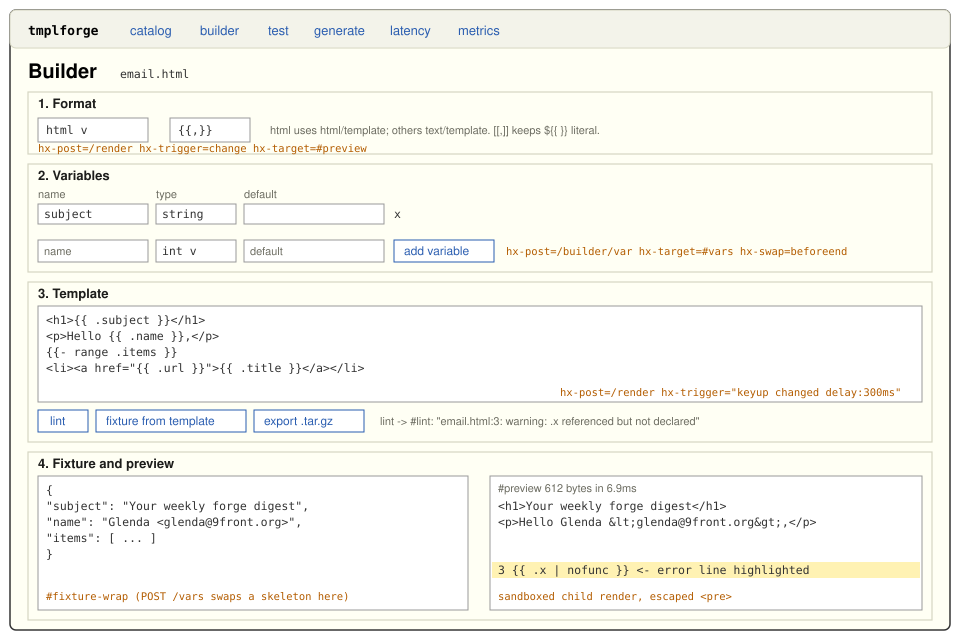

# GUI: `tmplforge serve`

```
tmplforge serve [-a 127.0.0.1:8088] [-token T] [-rate 10] [-assets DIR]
                [-timeout 2s] [-j N] [-q]

  -a ADDR      listen address. Anything but loopback requires -token (16+ chars) and -rate > 0
  -token T     bearer token (default $TMPLFORGE_TOKEN)
  -rate N      per-IP requests/second, token bucket with burst 2N. 0 disables (loopback only)
  -assets DIR  directory overlaid on /static/, e.g. holding echarts/echarts.min.js
  -timeout D   per-render sandbox limit, at most 30s (default 2s)
  -j N         concurrent sandbox processes (default 2 x NumCPU)
  -q           no request log
```

The GUI is server-rendered `html/template` pages. Interaction is htmx
attributes plus one 25-line hand-written `static/app.js`, which removes a
variable row and refreshes the preview. There is no inline script and no
client framework. htmx v2.0.11 is vendored with its SHA256SUMS and
configured with `allowEval: false`, `allowScriptTags: false` and
`selfRequestsOnly: true` through a `<meta name="htmx-config">`.



## Routes

| Method | Path | Returns | htmx usage |
|---|---|---|---|
| GET | `/` | Catalog grid: one card per entry, linking to the builder and test pages | |
| GET | `/builder?name=NAME[&format=F]` | The wizard (steps below). Without `name` it starts blank, and an unknown name is 404 | |
| POST | `/builder/var` | One `<tr>` variable row, or an error row | `hx-post="/builder/var" hx-include="#new-var" hx-target="#vars" hx-swap="beforeend"` |
| POST | `/render` | `<pre>` preview fragment, sandboxed. On error, the message plus the template with the failing line highlighted | `hx-post="/render" hx-trigger="keyup changed delay:300ms" hx-target="#preview"` |
| POST | `/lint` | `<ul>` of `name:line: message` findings (errors and warnings) | `hx-target="#lint"` |
| POST | `/vars` | Fixture textarea fragment prefilled with the JSON skeleton, plus a table of referenced paths. Add `?raw=1` for `application/json` | `hx-target="#fixture-wrap"` |
| GET | `/test[?name=NAME]` | Two-fixture diff page | |
| POST | `/test` | Diff fragment: `fixture_a` vs `fixture_b` outputs, LCS, `+N -M` | `hx-target="#diff"` |
| POST | `/export` | `application/gzip` download `NAME.tar.gz` (reproducible bundle). A plain form submit, not htmx | |
| GET | `/new` | IssueOps and CI/CD generator forms | |
| POST | `/new/issueops` | Generated files (issue form, parse workflow, Go parser) as `<pre>` sections | `hx-target="#files"` |
| POST | `/new/cicd` | Generated workflow as a `<pre>` section | `hx-target="#files"` |
| GET | `/metrics` | Prometheus text exposition 0.0.4, rendered by a `text/template` | |
| GET | `/chart[?w=10s]` | go-echarts line chart of render p50/p95 per window, plus the same data as a table | |
| GET | `/chart.js[?w=10s]` | The chart's initialisation script (same-origin, for CSP) | |
| GET | `/healthz` | `ok`. Exempt from auth and rate limiting | |
| GET | `/static/*` | Embedded assets: `htmx.min.js`, `app.js`, `style.css`, and `echarts/` if present | |

Form fields shared by `/render`, `/lint`, `/vars`, `/test` and `/export`:
`name`, `template`, `fixture` (JSON object), `format`, `delims` (`L,R`),
and the repeated triples `var_name` / `var_type` / `var_default`.
Declared defaults are merged under the fixture, so a fixture key always
wins.

Form errors come back as `200` with an error fragment, because htmx does
not swap 4xx responses by default and the author needs to see the
message. Transport-level refusals use real status codes: 401 (token), 403
(cross-site), 413 (body over 256 KiB), 429 (rate limit, with
`Retry-After`), and 503 (no sandbox slot, with `Retry-After`).

## The builder, step by step

1. **Format.** Pick html, md, json, txt or yaml, and optionally set
   delimiters. Changing the format re-renders the preview.
2. **Variables.** Name, type and default. "add variable" posts the new-row
   inputs to `/builder/var`, which validates them (a Go-template field
   name, a known type, and a default that converts) and appends a row.
   Rows are form fields, so the next preview includes them.
3. **Template.** The textarea posts to `/render` 300 ms after you stop
   typing (`keyup changed delay:300ms`). "lint" shows parse errors and
   undeclared fields. "fixture from template" replaces the fixture with
   the walker's skeleton (see [DESIGN.md](DESIGN.md#3-the-parse-tree-walker-vars))
   and refreshes the preview. "export .tar.gz" downloads the bundle.
4. **Fixture and preview.** Editing the fixture also re-renders. The
   preview shows byte count and latency (process spawn included). On a
   template error it shows the template with the error line marked.

## Security summary

All of this is in [SECURITY.md](SECURITY.md). In brief:

- Untrusted templates run only in `tmplforge render -sandbox` children,
  never in the server.
- The CSP is `script-src 'self'` everywhere. `/chart` adds
  `style-src 'unsafe-inline'` for ECharts' tooltip styles, and nothing
  relaxes `script-src`.
- Every POST must prove same-origin through `Sec-Fetch-Site`, `Origin`,
  or `HX-Request`.
- The server binds loopback by default. Any other address requires
  `-token` and rate limiting.

## The chart without echarts.min.js

`echarts.min.js` (1 MB) is not vendored. Until it is installed, `/chart`
shows a notice and the data table. To install it:

```sh
scripts/fetch-echarts.sh                       # into internal/web/static/echarts, then rebuild
scripts/fetch-echarts.sh /srv/tmplforge/echarts && tmplforge serve -assets /srv/tmplforge
```

The script verifies the npm tarball's sha512 integrity and the extracted
file's SHA-256 before installing it.
