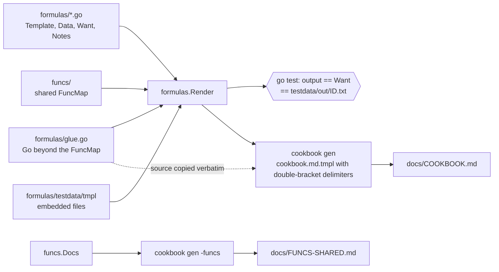

# go-template-cookbook

An executable cookbook for Go's `text/template` and `html/template`. Every formula is a
template, its data, and the exact output it must produce, held in Go values and checked by
`go test`. The Markdown cookbook is **generated** from those values, so the document cannot
describe behaviour the code does not have.

- 55 formulas (F01..F55): `dict`, `default`, YAML/JSON/CSV/HCL emission, GitHub Actions and
  Issue Forms, Dockerfile, Makefile and Plan 9 `mkfile`, shell and SQL without injection,
  `gofmt`'d Go, C, SVG, email, htmx, Prometheus, CoreDNS, Caddy, `range` over ints and
  iterators, whitespace control, `missingkey`, contextual escaping, `Clone`, `ParseFS`,
  `ExecError`, and the Terraform lookalike.
- A shared FuncMap (`funcs/`) of 36 functions, standard library only, with its own
  YAML emitter.
- Go 1.24, no dependencies, builds for `linux/amd64`, `linux/arm64`, `darwin/arm64` and
  `plan9/amd64`.

The generated documents live one level up: [`../docs/COOKBOOK.md`](../docs/COOKBOOK.md) and
[`../docs/FUNCS-SHARED.md`](../docs/FUNCS-SHARED.md).

## Quickstart

```sh
export GOFLAGS=-mod=mod GOPROXY=off     # no module proxy needed; there are no dependencies
go test ./...                           # renders all 55 formulas and compares with Want
go run ./cmd/cookbook list              # IDs and names
go run ./cmd/cookbook show F24          # problem, template, data, glue, output, notes
go run ./cmd/cookbook run F07           # render one formula to stdout
echo '{"Env":{"A":"1"}}' | go run ./cmd/cookbook run F07 -d -     # same template, your data
go run ./cmd/cookbook gen               # rewrite ../docs/COOKBOOK.md
go run ./cmd/cookbook gen -funcs        # rewrite ../docs/FUNCS-SHARED.md
go run ./cmd/cookbook check -docs ../docs
```

`make` (or `mk` on Plan 9) wraps these: `all build test vet lint cross release loadtest docs
check update preflight clean`. `scripts/preflight.sh` is the gate: gofmt, vet, tests, a fuzz
smoke run, `bash -n`, cross-builds for all four targets (plus `go vet` for plan9), checksums,
docs determinism and docs freshness. It needs no network and no `terraform`.

## How it fits together



The generator is itself a `text/template` with `[[ ]]` delimiters, so the formula bodies, which
are full of `{{ }}`, pass through as plain data. That is formula F37 applied to the cookbook
itself.

## Layout

```
cookbook/
├── go.mod                       module github.com/CoolGitOrg/go-template-cookbook, go 1.24
├── funcs/
│   ├── funcs.go                 the FuncMap: New(Options), Map(), Names(), and every function
│   ├── yaml.go                  stdlib YAML emitter behind toYAML
│   ├── docs.go                  one documented, executed example per function
│   └── funcs_test.go            table tests, error cases, ToYAML tests, a fuzz target
├── formulas/
│   ├── formulas.go              type Formula, All, Render, Options, GlueRef extraction
│   ├── basics.go                F01..F13
│   ├── emitters.go              F14..F31
│   ├── generators.go            F32..F42
│   ├── language.go              F43..F55
│   ├── glue.go                  the Go the formulas need; its source is quoted in the docs
│   ├── testdata/tmpl/           files embedded with //go:embed (F19, F52)
│   └── formulas_test.go         TestAll and the semantic checks (bash -n, JSON validity, tabs)
├── cmd/cookbook/                list, show, run, gen, check
│   ├── main.go  gen.go  main_test.go
│   └── cookbook.md.tmpl         the Markdown generator, [[ ]] delimiters
├── testdata/out/F01.txt ...     rendered outputs, committed
├── Makefile  mkfile             tabs
├── scripts/preflight.sh
└── LICENSE                      MIT
```

## Adding a formula

1. Append a `Formula` to the right group in `formulas/` with the next free ID. Put
   `Want: "@@",` as a placeholder.
2. If the template needs Go beyond the FuncMap, add it to `glue.go` and name it in `GlueRef`
   (`"name"`, `"Type"` or `"Type.Method"`, comma separated). Set `Funcs` for extra template
   functions, `PostProcess` for a text transform, or `Run` when the Go around the template is
   the point.
3. `go run ./cmd/cookbook run F56` and read the output. **Read it.** Paste it into `Want`.
4. `make update` writes `testdata/out/*.txt` and regenerates the docs; `make preflight`
   confirms everything agrees.

`Data` must marshal with `encoding/json` (the document prints it); a type with funcs in it
implements `MarshalJSON` (see `SeqData` in F44). `cookbook run ID -d file` decodes JSON into
a value of the same Go type as the formula's `Data`, so typed data keeps working.

## Rules this module keeps

- Standard library only; `go 1.24`; `GOFLAGS=-mod=mod GOPROXY=off` works.
- No `syscall` or `os/user`; every binary cross-compiles for `GOOS=plan9`.
- Output is reproducible: the clock is `2024-03-05T14:30:00Z`, the environment is a fixed map,
  `file` reads from an embedded directory.
- The impure functions (`env`, `file`, `now`) read their world from `funcs.Options`, so a host
  can pin them or take them away. `env` and `file` are for trusted templates.
- Flags are single-dash. Errors are values, wrapped with `%w`. Text is the interface.

## License

MIT. See `LICENSE`.
