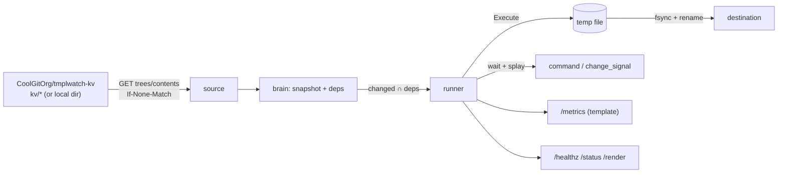
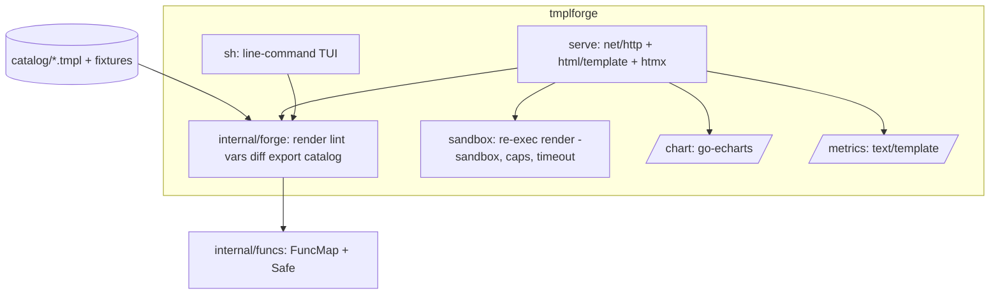

# Case-Study Design Specifications

Three systems, one substrate. Each is specified as **FuncMap + data source + destination**,
then built under `case-studies/`. Shared conventions: `BUILD-CONVENTIONS.md`.

| | CS1 `tmplwatch` | CS2 IssueOps library | CS3 `tmplforge` |
|---|---|---|---|
| Pattern | HashiCorp consul-template | GitHub IssueOps self-service + Pages in/out | Template generator: TUI + htmx GUI |
| Engine | `text/template` | `html/template` (site), `text/template` (items, feeds) | both; user templates in a sandbox |
| Data source | GitHub repo contents (ETag polling) or local dir | Issue-form payload → `repository_dispatch` | catalog fixtures, user fixtures |
| Destination | files on disk + command/signal | second repo → GitHub Pages | stdout, files, export bundles, HTTP fragments |
| Trust model | template authors trusted | issue authors untrusted (env-only), templates trusted | GUI authors untrusted (subprocess); TUI operator trusted |
| Load target | `/render` 50 req/s, p99 < 50 ms | static site 50 req/s; 50 issues @ 1/10 s end-to-end | `POST /render` 20 req/s, p99 < 150 ms incl. spawn |

Status of "complete" (user's definition): beta-quality app + designs + docs, deployable to a
production environment with limited beta traffic and a load-test plan. Each repo has a
`scripts/preflight.sh` that passes offline, golden tests, cross-builds for
linux/amd64, linux/arm64, darwin/arm64, plan9/amd64, Terraform for its GitHub resources,
CI/release/load-test workflows, a Makefile and a Plan 9 mkfile.

---

## 1. CS1 — `tmplwatch` (HashiCorp pattern, stdlib)

### 1.1 Data flow


### 1.2 Config (JSON — stdlib has no HCL)
`source{type,repo,ref,prefix,interval,token_env|app{client_id,key_file}}`,
`templates[]{source,destination,perms,backup,command[],wait,splay,left_delimiter,
right_delimiter,error_on_missing_key}`, `exec{command[],change_signal}`, `listen`, `dry`, `once`.

### 1.3 FuncMap (consul-template vocabulary)
`key keyOrDefault keyExists ls tree env file toJSON toPrettyJSON parseJSON toYAML indent
nindent timestamp regexMatch regexReplaceAll split join trimSpace toUpper toLower replaceAll
contains sockaddr{GetPrivateIP,GetPublicIP,GetInterfaceIP,GetAllInterfaces}` + helpers
`add sub mul mod default coalesce dict list sortedKeys sha256sum b64enc b64dec shq plural`.
`key` records a dependency; a missing key marks the render *incomplete* and nothing is written.

### 1.4 Artifacts rendered (each with a golden file)
Caddyfile, nginx.conf, wg0.conf (WireGuard peers from `ls "wg/peers"` + `parseJSON`),
prometheus.yml (`tree` + `toYAML|nindent`), main.tf (HCL, never a stray `${`),
job.nomad.hcl, Corefile (CoreDNS `template` plugin block), motd.txt, hosts.

### 1.5 Workflow chain
`tmplwatch-kv` push → `notify.yml` (App token) → `POST /repos/CoolGitOrg/tmplwatch/dispatches`
`kv-changed` → `render-check.yml` runs `tmplwatch -once -dry` → fails on render error.
`release.yml` on `v*`: four static binaries, `SHA256SUMS`, `gh release create --verify-tag`.
`loadtest.yml` (`workflow_dispatch`): start daemon on loopback, vegeta or `tmplload`, summary
rendered by `tpl`.

### 1.6 Terraform
`github_repository` ×2 (internal), branch ruleset on `main`, `github_repository_file` seeds,
`github_actions_variable` `APP_CLIENT_ID`; App installation is a UI step.

### 1.7 Tests / load / beta
Golden per artifact; funcs tables; brain dependency tests; atomic-write crash test; httptest
200→304 source; `/metrics` parse; JWT signature verification; `FuzzRender`.
Load: `/render` 50 req/s × 5 min, p99 < 50 ms, 0 errors; `/metrics` 10 req/s. API budget:
15 s polling ≈ 240 req/h, 304s free. Beta: `-dry` on 1–2 hosts with `caddy validate` as the
command, then real writes behind `backup: true`.

---

## 2. CS2 — IssueOps library (Pages in → issue → Pages out, library-card ledger)

### 2.1 Repos and identity
`CoolGitOrg/issueops-intake` (forms, intake workflow, input Pages site) and
`CoolGitOrg/issueops-library` (items, ledger, output Pages site). The App
`issueops-autoadmin-app` (var `APP_CLIENT_ID`, secret `APP_PRIVATE_KEY`) is installed on both
with `issues:write`, `contents:write`, `metadata:read`; its token is minted with
`actions/create-github-app-token@v3` and is what makes the cross-repo chain *trigger*
workflows (pushes/dispatches made with `GITHUB_TOKEN` do not).

### 2.2 Sequence
```mermaid
sequenceDiagram
  participant U as Any user
  participant P as intake Pages (static)
  participant I as issueops-intake
  participant L as issueops-library
  U->>P: fill form (raw JS validates JSON, builds URL)
  P->>I: redirect issues/new?template=request.yml&source-id=…&payload=…
  I->>I: intake.yml: issueparse → validate → label
  I->>L: repository_dispatch library-publish (App token, ≤10 keys)
  L->>L: publish.yml: pagegen → items/<source>/<template>/<issue>/ + bundle + SHA256SUMS
  L->>L: commit (github-actions[bot]) → configure/upload/deploy-pages
  L->>I: comment item URL + close (App token)
  U->>L: pick up output (open access); borrow via borrow.yml issue
```

### 2.3 Positions
1. **Input is static.** `pagegen -intake` renders the HTML form *from the issue-form YAML* at
   build time, so form and issue schema cannot drift. The browser only assembles a prefilled
   new-issue URL; no tokens in the browser; URL length guarded (>7000 → attach as gist).
   Go-wasm in-browser rendering is an optional `/lab/` showcase.
2. **Outputs are keyed by source**, `items/<source-id>/<template-id>/<issue>/`, never by
   requester login (requester is recorded only in `config.json`).
3. **Library card.** Every item is open-access forever. A *borrow* reserves the item's
   next-phase slot (only the borrower's follow-up issues trigger the next job) for ≤14 days,
   max 3 per login; `return.yml` releases; `overdue.yml` (daily) warns then auto-returns after
   a 7-day grace. The ledger is `ledger/ledger.json`, rendered to `ledger/open.html` and
   `ledger/open.json` fragments that the catalog loads with `hx-get` (static GET works on Pages).

### 2.4 Binaries
`issueparse` (issue-form Markdown → JSON keyed by field id, compatible with issue-ops/parser),
`validate` (schema-lite: required/pattern/enum/maxLength/json), `dispatch` (≤10-key
`client_payload`, retries, ≥1 s between writes), `pagegen` (html/template site + text/template
items/Atom/sitemap/SHA256SUMS; meta-template `next.tmpl` via `[[ ]]`), `ledger`
(borrow/return/overdue/list), `tpl`, `siteload` (stdlib loader).

### 2.5 Terraform
Both repos (library public with `pages { build_type = "workflow" }`), labels on both, Actions
variables, `github-pages` environments, main rulesets with App bypass; `APP_PRIVATE_KEY` via
`gh secret set` (script). Pages, Actions majors and limits: see RESEARCH-REPORT §7.

### 2.6 Tests / load / beta
Golden tests for parser (6 bodies incl. CRLF, edited, checkbox, fenced JSON), validate,
pagegen HTML/Atom/SHA256SUMS, ledger rules, dispatch key cap; fuzz parser.
Beta: 50 issues at one per 10 s via `gh issue create --body-file`, measure issue→Pages
latency; limits: installation token ≥5 000 req/h (15 000 GHEC), ≥1 s between writes, Pages
deploys serialized with a 10-min timeout. Gating: beta README link only + `flags.json`.
Open question: GHEC access-controlled Pages vs "open access to all users."

---

## 3. CS3 — `tmplforge` (TUI + HTML GUI template generator)

### 3.1 Positions
- **TUI is a command language, not curses.** Portable raw-mode TTY is impossible with the
  stdlib (no `x/term`, Plan 9 has no termios), so `tmplforge sh` is sam/ed-style:
  `c NAME` catalog, `f FORMAT`, `v NAME TYPE [DEFAULT]`, `e`/`a`/`d`/`n` editing, `p` preview,
  `l` lint, `t FIX…` multi-fixture diff, `w`/`W`/`x` write/export, `g issueops|cicd`,
  `!CMD`, `q`. Scriptable from stdin.
- **GUI** is `net/http` + `html/template` + vendored htmx 2.0.11: catalog, step-wise builder
  (format → variables → template with live preview on `hx-post="/render"`), test mode
  (two fixtures → LCS line diff; stdlib has no diff and `internal/diff` is unimportable),
  export (tar.gz with template, fixture, output, `run.go`, Makefile, SHA256SUMS),
  `new issueops` / `new cicd` generators, `/metrics` (template-rendered), `/chart`
  (go-echarts v2.7.3 latency chart; ECharts JS served from `/static/echarts/` when vendored).
- **Sandbox.** User templates render in a re-exec of the same binary
  (`tmplforge render -sandbox`): safe FuncMap (no `env`/`file`), 64 KiB source cap,
  1 MiB output cap, 2 s `exec.CommandContext`, data is `map[string]any` only. A crashing or
  looping child never takes the server down; CSP `script-src 'self'`; loopback by default;
  `-a 0.0.0.0` requires `-token` and enables a per-IP token bucket.
- **Catalog** (each with fixture + golden): workflow, issue-form, Dockerfile, Makefile, mkfile,
  Caddyfile, main.tf, job.nomad.hcl, prometheus-rules, Corefile, README, CHANGELOG, JSON/YAML
  config, MOTD, release/dispatch/repository_dispatch workflows, email (html+txt), SQL
  migration, hello.c, hello.go, sparkline.svg, htmx partial. Actions templates use `[[ ]]`.

### 3.2 Architecture


### 3.3 Tests / load / beta
Golden per catalog entry; lint line numbers; vars walker on nested range/with; diff cases;
sandbox timeout/output-cap/crash isolation; scripted TUI session; httptest per route incl.
CSRF and rate limit; `FuzzSandbox`, `FuzzLint`.
Load: vegeta `POST /render` 20 req/s × 5 min, SLO p99 < 150 ms incl. spawn; fallback plan:
pre-forked worker pool. Beta: loopback only, `-token` for shared hosts, 10 req/s per IP.

---

## 4. Shared open questions / assumptions

1. Go 1.24 ceiling honoured as language level; toolchain bump recommended (RESEARCH-REPORT §6.4).
2. `terraform` binary absent here — HCL is hand-formatted; `terraform validate` runs in CI.
3. No module-proxy access — go-echarts and htmx are vendored with provenance and checksums.
4. GHEC access-controlled Pages may contradict "open access to all users"; CS2 documents both modes.
5. Agent/model limits for the build (≤4 concurrent; Fable 5 / Opus 5.5 / Sonnet 4.6) were followed:
   three Opus builders (CS1–CS3) + one Sonnet builder (cookbook), orchestrated by Fable 5.1.
