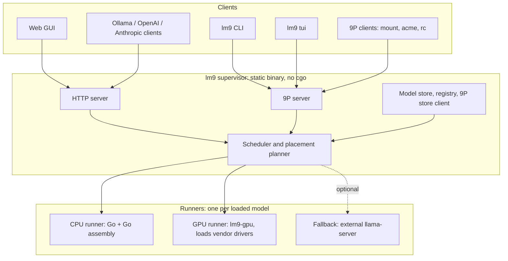

# lm9: a pure-Go replacement for the Ollama + llama.cpp stack

Design and conversion plan, 21 November 2026. Target language level: Go 1.26. `lm9` is a working name.

| Part | Sections | What it is |
| --- | --- | --- |
| I. The plan | 1 to 19 | Feasibility, architecture, flags, front ends, roadmap, risks |
| II. Code tasks | 20 to 22 | Each hard piece of the conversion: outline, snippet, definition of done |
| III. Cheatsheets | 23 to 35 | Go assembly, the Go 1.26 SIMD package, GGUF, quantization formats, 9P, system calls, build flags |

A code package, `lm9-spike0.tar.gz`, accompanies this document. It holds about 4,400 lines of Go and assembly in 53 files, standard library only, and every snippet marked "tested" in Part II is copied from it by script.

Three kinds of statement appear below, and they are marked where it matters:

- **Tested here**: I ran it or read the source in this session. Section 19 lists all of them.
- **Per source**: someone else's claim, linked.
- **Estimate**: my judgment. Every date, effort figure and performance target is an estimate.

## Contents

**[Part I. The plan](#part-i-the-plan)**

- [1. Bottom line](#1-bottom-line)
- [2. What is being converted](#2-what-is-being-converted)
- [3. Prior art and what each piece proves](#3-prior-art-and-what-each-piece-proves)
- [4. Premises checked](#4-premises-checked)
- [5. Architecture](#5-architecture)
- [6. CPU kernels](#6-cpu-kernels)
- [7. GPUs without cgo](#7-gpus-without-cgo)
- [8. Low-level control: what Go can and cannot do](#8-low-level-control-what-go-can-and-cannot-do)
- [9. Determinism](#9-determinism)
- [10. Hardware flags and the placement planner](#10-hardware-flags-and-the-placement-planner)
- [11. Storage and 9P](#11-storage-and-9p)
- [12. Front ends](#12-front-ends)
- [13. Model compatibility](#13-model-compatibility)
- [14. Performance targets](#14-performance-targets)
- [15. Roadmap](#15-roadmap)
- [16. Validation and release engineering](#16-validation-and-release-engineering)
- [17. Go version and dependencies](#17-go-version-and-dependencies)
- [18. Risks and open decisions](#18-risks-and-open-decisions)
- [19. What was verified in this session](#19-what-was-verified-in-this-session)

**[Part II. Code tasks: outlines and snippets](#part-ii-code-tasks-outlines-and-snippets)**

- [20. Map of the work](#20-map-of-the-work)
- [21. The tasks](#21-the-tasks)
- [22. What the tests found](#22-what-the-tests-found)

**[Part III. Cheatsheets and reference](#part-iii-cheatsheets-and-reference)**

- [23. Go assembly for people who know Intel syntax](#23-go-assembly-for-people-who-know-intel-syntax)
- [24. `simd/archsimd` in Go 1.26](#24-simdarchsimd-in-go-126)
- [25. GGUF file layout](#25-gguf-file-layout)
- [26. Tensor types and block layouts](#26-tensor-types-and-block-layouts)
- [27. Where to read upstream](#27-where-to-read-upstream)
- [28. Calling native libraries without cgo](#28-calling-native-libraries-without-cgo)
- [29. 9P2000](#29-9p2000)
- [30. Memory and I/O calls on Linux](#30-memory-and-io-calls-on-linux)
- [31. CPU feature bits used for dispatch](#31-cpu-feature-bits-used-for-dispatch)
- [32. Build and toolchain](#32-build-and-toolchain)
- [33. HTTP endpoints](#33-http-endpoints)
- [34. lm9 on one page](#34-lm9-on-one-page)
- [35. Determinism checklist](#35-determinism-checklist)

**[Sources](#sources)**

---

# Part I. The plan

## 1. Bottom line

1. **There is no project called "ollama.cpp."** I read the request as: replace the C/C++ engine under Ollama (llama.cpp and its GGML tensor library) with Go, and keep Ollama's product surface around it. Section 2 states that reading precisely; correct it there if I have it wrong.
2. **It can be built with zero cgo.** The CPU engine is Go plus Go assembly. GPU backends load the vendor's driver at run time through a no-cgo foreign-function layer. That still executes native driver code, because nothing else can talk to a GPU, but it needs no C compiler and no cgo at build or run time.
3. **Expect speed parity at best, and only after the kernel work.** The Go compiler does not vectorize loops. In the code package written for this plan, hand-written assembly kernels were 12 to 17 times faster than the plain Go loop while the data fit in cache, and about 2.4 times faster once it did not (section 6). Published pure-Go engines that skip this work are reported as not competitive with llama.cpp.
4. **The hard problem is keeping up, not catching up.** Ollama ran its own Go engine for a year, then returned to upstream llama.cpp in May 2026 for model compatibility and speed (section 2). The tree I read today has 187 model files and 18 backend directories (section 20). A rewrite that ignores that will repeat Ollama's year. This plan therefore has three structural defences: llama.cpp as a test oracle, model architectures described as data, and an optional fallback that hands unsupported models to an external `llama-server` process.
5. **The reasons to do it are not speed.** They are: one static binary that cross-compiles to every Go target including Plan 9; memory-safe parsing of untrusted model files; a reproducible mode that returns the same bits on x86 and ARM; inference exposed as a 9P file tree; and loading safetensors without a conversion step.
6. **Size (estimate).** Three engineers: a correct, fast CPU engine with the Ollama and OpenAI APIs, TUI, web GUI and 9P in roughly 6 to 8 months; Vulkan and Metal backends near upstream speed in roughly 10 to 14 months. Full feature parity with llama.cpp is a moving target and is not promised.

If the real need is "use local models from Go without cgo, soon", that already exists: [yzma](https://github.com/hybridgroup/yzma) binds llama.cpp's shared libraries through purego and is listed in the [llama.cpp README](https://github.com/ggml-org/llama.cpp) as the no-cgo Go binding. This plan is for when you want the engine itself in Go.

---

## 2. What is being converted

### 2.1 The stack as it stands (per sources)

| Layer | Today | Language |
| --- | --- | --- |
| CLI, REST API, model registry, scheduler | Ollama | Go |
| Inference engine for GGUF models | Upstream `llama-server`, run as a subprocess, pinned to a llama.cpp build | C++ |
| Tensor library and hardware backends | GGML inside llama.cpp: CPU, CUDA, Metal, Vulkan, HIP, SYCL, OpenCL, WebGPU and others | C, C++, CUDA, shader languages |
| Apple Silicon fast path | MLX runner, the default for supported models since 0.40 | Go over MLX |

History that matters for this plan:

- Ollama announced its own engine in May 2025: Go model code calling GGML directly ([summary](https://pcserverandparts.com/news/lm-studio-vs-ollama-hardware-2026/)).
- [Ollama 0.30](https://github.com/ollama/ollama/releases/tag/v0.30.0) (13 May 2026) announced "improved compatibility and performance using llama.cpp". A later pull request removed the vendored GGML backend and the Go model implementations ([summary](https://www.betterclaw.io/blog/ollama-vs-lm-studio)).
- A comment in Ollama's `llm/server.go` now reads "All GGUF models are served via the upstream llama-server subprocess" ([quoted here](https://aliteq.com/ollama-moe-offload-cpu)).

So the C++ that "ollama.cpp" would mean is llama.cpp itself. Note what Ollama's Go engine was not: it was never pure Go. The tensor math stayed in C. Nobody has shipped what this plan describes at Ollama's scale.

### 2.2 Scope

| Tier | Capability |
| --- | --- |
| **v1, must** | GGUF loading with every mainstream quantization. Tokenizers and chat templates. Transformer text models of the Llama, Mistral, Qwen, Gemma and Phi families. CPU kernels for amd64 and arm64. KV cache, prompt cache, parallel slots, continuous batching. Samplers, grammar and JSON-schema constrained output, tool calling. Embeddings. Ollama REST API, OpenAI-compatible and Anthropic-compatible endpoints. Pull from the Ollama registry and Hugging Face; reuse an existing `~/.ollama/models` store. CLI, TUI, web GUI, 9P. Hardware flags and placement planner. |
| **v2, should** | Vulkan backend (NVIDIA, AMD, Intel). Metal backend. Hybrid CPU+GPU placement, including mixture-of-experts weights held in RAM. Safetensors loaded directly. LoRA adapters. Vision input. Reranking. Speculative decoding. Deterministic mode certified across architectures. |
| **Later** | Native CUDA path. Audio. Mamba, RWKV and other non-transformer families. WebGPU and wasm. Bare-metal build. Tensor-level distributed inference. |
| **Not planned** | Training and fine-tuning. Image generation. ONNX. Vendor NPUs (Hexagon, CANN, OpenVINO, zDNN). Ollama cloud models. |

The feature list on the left of this table is drawn from the [llama.cpp README](https://github.com/ggml-org/llama.cpp), the [llama-server documentation](https://sources.debian.org/src/llama.cpp/8064%2Bdfsg-1/tools/server/README-dev.md) and Ollama's [OpenAI](https://docs.ollama.com/API/openai-compatibility) and [Anthropic](https://docs.ollama.com/api/anthropic-compatibility) compatibility pages.

---

## 3. Prior art and what each piece proves

| Project | What it is | What it proves | Limit |
| --- | --- | --- | --- |
| Ollama's engine, May 2025 to May 2026 | Go model definitions over GGML through cgo | Go is a workable language for the model layer | Dropped for upstream; the lesson in section 1, point 4 |
| [yzma](https://github.com/hybridgroup/yzma), [Kronk](https://github.com/ardanlabs/kronk) | llama.cpp shared libraries called from Go through purego | No-cgo FFI into a native inference library works | It is still llama.cpp |
| [dlgo](https://github.com/computerex/dlgo/releases/tag/v0.1.0) | Pure-Go GGUF engine for CPU with architectures as declarative per-layer specs | One developer can reach a working pure-Go engine | Reported as [not competitive with llama.cpp](https://aiproductivity.ai/news/dlgo-pure-go-llm-inference-engine/) on speed |
| [zerfoo](https://pkg.go.dev/github.com/zerfoo/zerfoo@v1.57.0) | Go ML framework with zero cgo; GPU libraries loaded at run time through purego | No-cgo GPU inference from Go is practical | Its headline (241 against 188 tokens/s on Gemma 3 1B) is its own benchmark against Ollama 0.17.7, which predates Ollama's return to llama-server |
| [GoMLX Go backend](https://gomlx.github.io/docs/backends/) | Portable pure-Go tensor backend, now adding AVX2 and AVX-512 through `simd/archsimd` | The Go 1.26 SIMD experiment is usable for real kernels | Its own docs call it slower but portable |
| [gogpu/wgpu](https://pkg.go.dev/github.com/gogpu/wgpu) | WebGPU implemented in Go over Vulkan, Metal, DX12 and GLES, with compute shaders and a Go shader compiler | A GPU API stack with `CGO_ENABLED=0` exists | Young, version 0.x |
| [kinfer](https://pypi.org/project/kinfer-ai/) | Go engine over `mlx-c` with no cgo | The same approach reaches Apple MLX | Single source; macOS only |
| [goformer](https://pkg.go.dev/github.com/MichaelAyles/goformer) | BERT inference straight from safetensors in pure Go | Direct safetensors loading is a small job | Embedding models only |

No single one of these is the target. Together they remove most of the "is this even possible" risk, which leaves cost and upkeep as the real questions.

---

## 4. Premises checked

Several parts of the request rest on assumptions that need adjusting. Each row says what the plan does instead.

| The request says | What is true | What the plan does |
| --- | --- | --- |
| "ollama.cpp" | No such project. Ollama is Go; its engine is llama.cpp | Replaces llama.cpp and GGML, keeps Ollama's surface (section 2) |
| Go "can compile into C code from assembly" | Go has no such path. The directions that exist are Go to assembly, and C to Go assembly | Kernel tiers in section 6: generated Go assembly first, C transpiled to Go assembly as the escape hatch |
| Use Go libraries "to produce assembly and machine bytecode from Go source" | The compiler and assembler do that at build time. The standard library has no run-time code generator | Ahead-of-time kernel variants chosen at run time by CPU feature. A JIT is listed as an experiment, not a dependency (section 8) |
| Control "gigatransfers" | GT/s is the PCIe link rate. Hardware and firmware negotiate it; user-space software cannot set it | `lm9 probe` reads link speed and width and warns when a GPU is on a slow link (section 10) |
| "Bare metal hardware instruction" | Go on bare metal exists as [TamaGo](https://github.com/usbarmory/tamago), a modified Go distribution. Its [upstream proposal](https://github.com/golang/go/issues/73608) is still open | A CPU-only unikernel build is a late experiment (section 15, phase 8) |
| "Register control" | Only inside an assembly function. Go code cannot pin registers | All register-level work lives in kernels |
| TUI "built with termbox/termloop/termui" | termbox-go's README says it is "somewhat not maintained anymore" and points to tcell. termui is built on termbox-go. termloop is a game engine | termui-style dashboard on a maintained terminal layer (section 12.2) |
| "Pure Go version 1.26" | Fine for amd64. Go 1.26's SIMD experiment is amd64 only; arm64 NEON arrived in 1.27. Go 1.26 leaves support when 1.28 ships, expected about February 2027 | `go 1.26` as the language floor, newer toolchains allowed, arm64 kernels in assembly (section 17) |
| "Avoid CGO unless completion is impossible without it" | It is never required | A written rule with CI enforcement (section 5.6) |
| This project's standing rules: Go 1.24 maximum, standard library plus go-echarts and upspin only | This request names Go 1.26 and third-party TUI packages, so it overrides them | Every added dependency is listed in section 17 so the allowlist can be changed on purpose |

---

## 5. Architecture

### 5.1 Process model



Three decisions are embedded in that picture.

**Runners are separate processes.** Ollama does this for the same reasons: a runner can crash, or be killed to free memory, without taking the server down. Here it has a second purpose. The no-cgo FFI layer makes a Linux binary dynamically linked (section 7.3), so GPU support lives in a second build, `lm9-gpu`, and the main `lm9` binary stays static.

**9P is the internal bus.** The supervisor talks to runners in the same protocol it serves to users. A runner on another machine is then just a different dial string (`--runner 'tcp!gpubox!5640'`), which gives session-level distribution with no extra protocol. HTTP between supervisor and runner is the conventional alternative and remains the fallback if 9P costs more than it saves.

**The fallback runner is how compatibility is guaranteed on day one.** If `--fallback llama-server` is set and a model's architecture is not yet supported natively, the scheduler starts an external `llama-server` and proxies to it, which is what Ollama itself does today. It is off by default, it is a separate process, and it adds no cgo. It turns "does lm9 support model X" from a blocker into a metric.

### 5.2 Package layout

```
lm9/
├── cmd/lm9/                 CLI entry: serve run pull push list show ps rm create
│                            plan probe bench tui gui sh mount convert
├── cmd/lm9-gpu/             same code plus GPU backends (-tags gpu)
├── internal/format/
│   ├── gguf/                reader, mmap, bounds-checked, fuzzed
│   ├── safetensors/         reader, sharded repos
│   └── ollamastore/         manifests and blobs, read and write
├── internal/tokenizer/      BPE, SentencePiece unigram, WordPiece, pre-tokenizer lexers
├── internal/template/       Jinja subset interpreter, Go text/template for Modelfiles
├── internal/tensor/         dtypes, shapes, quantized block formats, off-heap arenas
├── internal/kernels/        generic/ amd64/ arm64/ plus avo generators in _gen/
├── internal/graph/          ops, shape inference, fusion passes, memory plan
├── internal/arch/           model families as data, tensor-name maps
├── internal/backend/        cpu/ vulkan/ metal/ cuda/ webgpu/ behind one interface
├── internal/kv/             KV cache, context shift, prompt cache, snapshots
├── internal/sample/         samplers, GBNF grammar, JSON schema, detmath
├── internal/sched/          slots, batching, load and unload, placement planner
├── internal/hw/             probe: CPU, RAM, GPUs, storage class, PCIe link
├── internal/ninep/          9P2000 server and client
├── internal/server/         HTTP APIs, SSE streaming
├── internal/registry/       Ollama registry and Hugging Face pulls
├── internal/tui/            dashboard and chat; line mode for Plan 9
├── internal/web/            html/template pages, vendored htmx, go-echarts
├── oracle/                  conformance harness against a pinned llama.cpp
├── scripts/preflight.sh
└── Makefile, mkfile
```

### 5.3 Core interfaces

Two interfaces carry the design. Everything above them is ordinary Go.

```go
// A Backend owns memory on one device and executes plans on it.
type Backend interface {
	Name() string                                  // "cpu", "vulkan:0", "metal"
	Memory() (total, free uint64)                  // what the planner budgets against
	Alloc(spec TensorSpec) (Tensor, error)         // device memory, never the Go heap
	Upload(dst Tensor, src []byte) error           // weights: from an mmap'd file
	Compile(g *graph.Graph) (Plan, error)          // fuse, order, preallocate
	Close() error
}

// A Plan is a compiled forward pass. Run allocates nothing.
type Plan interface {
	Run(ctx context.Context, in, out []Tensor) error
}
```

llama.cpp builds a GGML graph per batch. `lm9` compiles one plan per model and batch shape, so the per-token path is a fixed list of kernel calls over preallocated buffers. That is what keeps Go's allocator and garbage collector out of the hot loop.

### 5.4 Model architectures as data

Each model family is a declarative spec: attention type, normalization, position encoding, feed-forward shape, mixture-of-experts layout, and a map from GGUF and safetensors tensor names to roles. A new family that reuses existing blocks is a new spec file and a conformance test, not a new forward pass. dlgo already works this way, and it is the main defence against the upkeep problem.

### 5.5 Memory and threads

- **Weights** are mapped read-only from the file. GGUF aligns tensor data, so a mapped file can be used in place with no copy.
- **Activations, KV cache and scratch** come from off-heap arenas (anonymous mappings). A `[]float32` holds no pointers, so the collector never scanned tensor data in the first place. What off-heap memory buys is control: huge pages, `mlock`, NUMA placement, and a heap small enough that `GOMEMLIMIT` and GC pacing stay predictable. Go 1.26 turns on the [Green Tea collector by default](https://go.dev/doc/go1.26), which helps the server side further.
- **Compute threads** are a fixed pool of goroutines locked to OS threads and pinned to cores, with performance cores preferred. Work is split statically by row, so a result never depends on thread count or scheduling. Request handling stays on ordinary goroutines.

### 5.6 The no-cgo rule

1. `CGO_ENABLED=0` for every build, enforced in CI.
2. Native code is reached in exactly three ways: Go assembly in this repository; drivers loaded at run time inside `lm9-gpu`; a separate process.
3. `unsafe` is allowed only in `tensor`, `kernels`, `backend` and `format`, and each use needs a test that would catch an out-of-bounds access.

---

## 6. CPU kernels

### 6.1 Why this is the first real problem

Go has no auto-vectorization, and hand-written assembly functions use the older stack-based calling convention and are [never inlined](https://softwarebits.substack.com/p/function-call-overhead). Kernels therefore have to be coarse: one call per row or block, never one per element.

### 6.2 Four tiers

| Tier | What | Runs on | Role |
| --- | --- | --- | --- |
| 0 | Portable Go, written lane by lane | Every `GOOS/GOARCH` | Reference, fallback, and the definition of the deterministic contract |
| 1 | Go assembly: generated with [avo](https://github.com/mmcloughlin/avo) for amd64 (AVX2, AVX-512, VNNI), hand-written or generated for arm64 NEON | amd64 and arm64 on every OS, Plan 9 included | The production fast path |
| 2 | `simd/archsimd` intrinsics under `GOEXPERIMENT=simd` | amd64 on Go 1.26; arm64 and wasm from Go 1.27 | Small kernels that benefit from inlining. Optional, never the only fast path |
| 3 | C compiled by clang and transpiled to Go assembly with [gocc](https://github.com/kelindar/gocc) or [GoAT](https://pkg.go.dev/github.com/gorse-io/goat), output committed | amd64, arm64 | Escape hatch for kernels too costly to hand-write. A developer-machine tool only; users and CI need just Go |

Tier 3 matters most on arm64 under Go 1.26. Its assembler lacks the integer widening-multiply NEON mnemonics that quantized kernels need; they [landed in Go 1.27](https://github.com/go-simd/base32). On 1.26 those instructions have to be emitted as raw encodings, which is exactly what the transpilers produce.

Go 1.26's `archsimd` already exposes what the quantized kernels need on x86 (tested here by reading the go1.26.11 source): 256- and 512-bit vector types, fused multiply-add, the pairwise dot-product operations that llama.cpp's AVX2 integer kernels are built from, and feature checks for AVX2, FMA, AVX-512 and VNNI. The package's own documentation says it supports AMD64 only and is outside the compatibility promise, and the [Go 1.27 notes](https://go.dev/doc/go1.27) say that release revised the amd64 API. Hence tier 2 stays optional.

### 6.3 Measured result (tested here)

Dot products from the code package on the sandbox's two virtual CPUs (Intel Xeon 2.10 GHz, Go 1.24.7). One benchmark run, medians of three.

| Kernel | 4,096 weights, in cache | 16.7M floats, 64 MiB per vector |
| --- | --- | --- |
| Float, plain Go loop | 2,726 ns | 17.3 ms |
| Float, deterministic reference in Go | 3,295 ns | not run |
| Float, deterministic AVX2 assembly, no FMA | 366 ns | not run |
| Float, AVX2 + FMA assembly | 222 ns | 7.2 ms |
| Float, AVX-512 assembly | 160 ns | 7.2 ms |
| Q8_0 weights, portable Go | 4,520 ns | not run |
| Q8_0 weights, AVX2 assembly reading the file layout | 370 ns | not run |

Three things to take from it. In cache, assembly is worth 12 to 17 times for floats and about 12 times for a quantized format. Out of cache it is worth about 2.4 times. And out of cache AVX-512 is no faster than AVX2, because every version is waiting on memory.

Token generation on a large model is mostly the out-of-cache case: each token reads every active weight once. That is why a Go engine can get close to llama.cpp on generation speed once its kernels are vectorized at all, and why prompt processing, which is arithmetic-bound, is where kernel quality shows most.

These are numbers from one small sandbox. They show the shape of the problem, not what `lm9` will achieve.

### 6.4 Kernel inventory and rules

Needed for v1: dot and axpy for f32 and f16; quantized dot products for the Q4, Q5, Q6 and Q8 block formats and the importance-matrix formats; blocked f32 matmul; RMSNorm and LayerNorm; softmax; SiLU and GELU; rotary position encoding; f16 conversion; KV-cache quantization.

Rules every kernel follows:

- It has a tier-0 twin, and CI runs the whole suite with `-tags noasm`.
- It is tested at every length from zero up, so tail handling is exercised.
- It is tested against guard pages: inputs are placed so they end at an unreadable page, and an over-read crashes the test. The code package does this for every tier. Its AVX-512 kernel handles the tail with a masked load, which cannot fault on the elements it skips, so it needs no scalar loop.
- Its deterministic variant matches the tier-0 reference bit for bit.
- Dispatch reads CPUID and XGETBV directly. Checking the OS half means a system that does not save AVX state gets the portable tier automatically, with no per-OS special case.

---

## 7. GPUs without cgo

### 7.1 The honest boundary

"Pure Go" stops at the driver. A GPU is reached through a vendor library with a C ABI. What can be removed is cgo, the C toolchain and build-time linkage: the library is opened at run time and called through assembly trampolines. [purego](https://github.com/ebitengine/purego) does this and treats Linux, macOS and Windows on amd64 and arm64 as tier-1 platforms. Its README still calls it beta software.

### 7.2 Routes

| Hardware | Route | Kernel language | Notes |
| --- | --- | --- | --- |
| NVIDIA, AMD, Intel | Vulkan compute, `libvulkan` opened at run time | SPIR-V embedded in the binary | One backend for three vendors and for older cards |
| Apple Silicon | Metal through the Objective-C runtime | Metal Shading Language, compiled by the OS at run time | Unified memory: one budget |
| NVIDIA, peak speed | CUDA driver API, opened at run time | CUDA C compiled to PTX at run time by NVRTC, or PTX embedded | Later. zerfoo shows the approach |
| AMD, peak speed | ROCm HIP, opened at run time | As CUDA | Later |
| Anything, and browsers | WebGPU through gogpu/wgpu, or `GOOS=js` | WGSL | Portability tier |

**Order (estimate): Vulkan first, Metal second, CUDA third.** Vulkan covers the most hardware with one set of kernels. It also covers cards that newer CUDA-based stacks have stopped shipping for: your P340 guide notes that current PyTorch no longer ships binaries for the Quadro P1000, and a Vulkan path does not depend on that toolchain at all.

### 7.3 Consequences (tested here)

On Linux, purego's no-cgo path imports `dlopen` from `libdl.so.2` through the linker. I read this in its source at the 11 November 2026 commit. A binary that uses it is dynamically linked and needs the system C library at run time. Hence two builds:

| Binary | Linking | Runs |
| --- | --- | --- |
| `lm9` | Static (the code package's CPU-only binary was reported as statically linked) | Anywhere, including `FROM scratch` containers and Plan 9 |
| `lm9-gpu` | Dynamic on Linux | Hosts with GPU drivers, which have a C library anyway |

### 7.4 Two decisions for the GPU spike

1. **Own thin bindings, or build on gogpu/wgpu?** Thin Vulkan and Metal bindings give direct control of memory budgets and transfers. gogpu/wgpu gives one WGSL kernel set for every vendor plus a Go shader compiler, so not even developers need a C toolchain, but it is young and adds an abstraction between the engine and device memory. My default is thin bindings with WebGPU as the portability tier; the spike should measure both on a matmul and attention micro-benchmark before committing.
2. **Write shaders, or reuse upstream's?** llama.cpp's Vulkan compute shaders (162 files in today's tree) and Metal kernels are MIT-licensed data that a Go host could load unchanged. If their interfaces fit `lm9`'s tensor layouts, the GPU backends start at upstream's kernel quality. I have not inspected those interfaces, so this is a question for the spike, not a promise.

Sampling, tokenization and scheduling stay on the CPU in every configuration.

---

## 8. Low-level control: what Go can and cannot do

| Asked for | Mechanism without cgo | Limit |
| --- | --- | --- |
| Assembly from Go | avo generators under `go generate`; `archsimd` intrinsics | Ahead of time only |
| Machine code at run time | Map executable memory and write encoded instructions | No standard assembler API at run time; hardened platforms restrict writable-executable memory; generated code has no stack maps. Experiment only |
| Direct memory | `syscall.Mmap`, `unsafe.Slice`, `madvise` for huge pages, `mlock`, raw `mbind` for NUMA, `runtime.Pinner` across FFI | Linux has the full set; other systems get subsets |
| Cache behaviour | Prefetch and non-temporal stores in assembly; block sizes taken from the probed cache hierarchy | Cannot reserve cache |
| Registers | Inside assembly functions | Not from Go code |
| Storage | Mapped files, positional reads from a worker pool, `O_DIRECT` with aligned buffers when RAM is tight, readahead hints | See section 11 |
| Buffers | Explicit flush per token on SSE; large read buffers for model load; `sendfile` through `io.Copy` when serving blobs | None that matter |
| Networking | `net/http` with HTTP/2 and SSE; Unix sockets; parallel ranged downloads with resume and checksum | QUIC is not in the standard library |
| Gigatransfers | Read `current_link_speed` and `current_link_width` from sysfs | Read-only by nature |
| Bare metal | TamaGo build of the CPU runner | Out-of-tree toolchain; no GPU; experiment |
| Concurrency | Goroutines for requests; pinned thread pool for compute; static work split | Go's scheduler is not real-time |
| Determinism | Section 9 | Bit-exact on CPU; not across GPU vendors |

Developer tooling for this layer is all in the Go distribution: `-gcflags=-S` to read generated code, `-gcflags=-d=ssa/check_bce` to find bounds checks left in hot loops, `-gcflags=-m` for escape analysis, `go tool objdump`, pprof, and profile-guided optimization for the non-kernel code.

---

## 9. Determinism

This is where a Go engine can be better than llama.cpp instead of merely equal.

**The trap (tested here).** The Go spec lets a compiler [fuse `x*y+z`](https://go.dev/ref/spec#Floating_point_operators) into one operation and says an explicit conversion prevents it. I checked the compiler's output for the same function on both architectures: on arm64 it emits a fused multiply-add; on amd64 it does not, at `GOAMD64=v1` or `v3`. The same Go source therefore returns different numbers on a Mac and on a PC. Writing `float32(x*y)+z` removes the difference, and the check confirms the fused instruction disappears.

**The contract for `--deterministic`:**

| Source of variation | Rule |
| --- | --- |
| Fused multiply-add | Not used. Kernels multiply and add separately; portable code pins rounding with conversions |
| Summation order | Fixed: eight lanes, one reduction tree, then the tail in order. Assembly and reference agree bit for bit (the code package tests every length from 0 to 259) |
| Threads | Static split by row. No reduction crosses a thread boundary |
| `exp`, `tanh`, `sin`, `cos` | Own implementations in `detmath`, because some architectures replace the standard ones with assembly |
| Integer kernels | Exact by nature |
| Sampling | ChaCha8 from `math/rand/v2`, seeded |
| Batching | A sequence's result never depends on what else is in the batch |
| Replay | A session snapshot holds KV cache, sampler state and generator state |

**Cost (tested here).** In cache, the deterministic kernel took 366 ns against 222 ns for the AVX2 fast kernel and 160 ns for the AVX-512 one, so 1.7 to 2.3 times slower. Fast and deterministic results differed in 45 of 50 random trials. Both are correct to rounding. They are different contracts, so the mode is a flag.

**Scope.** Bit-exact across amd64, arm64 and the portable tier on CPU. On a GPU, reproducible on the same device and driver. Across GPU vendors, not promised.

---

## 10. Hardware flags and the placement planner

### 10.1 Flags

| Flag | Values | Effect |
| --- | --- | --- |
| `--device` | `auto` `cpu` `vulkan` `metal` `cuda` `webgpu`, repeatable | Backend selection |
| `--gpu-vendor` | `auto` `nvidia` `amd` `apple` `intel` | Filters adapters |
| `--gpu-index` | list | Chooses among several adapters |
| `--vram` | size, per device | Budget cap. Default: probed free memory less `--vram-reserve` |
| `--ram` | size | Budget cap for weights, KV cache and scratch in system memory |
| `--gpu-layers` | `auto`, a number, `all` | Layer split |
| `--moe-experts` | `auto` `cpu` `gpu` | Where mixture-of-experts weights live |
| `--threads`, `--pin` | number; `off` `pcores` or a core list | Compute pool |
| `--mlock`, `--hugepages`, `--numa` | on/off; `off` `thp` `explicit`; `off` `interleave` `node=N` | Memory policy |
| `--kernels` | `auto` `generic` `avx2` `avx512` `neon` | Forces a tier, for testing |
| `--storage` | `auto` `nvme` `ssd` `flash` `hdd` `9p` `net` | Load strategy (section 11) |
| `--store`, `--cache-dir` | path or `9p://` dial string | Model store and its local cache |
| `--deterministic`, `--seed` | | Section 9 |
| `--fallback` | `off` or a path to `llama-server` | Section 5.1 |
| `--profile` | name | A named bundle of the above from `profiles.json` |

On Apple Silicon `--vram` and `--ram` describe one pool, and the planner treats them as one budget.

### 10.2 Examples

```bash
# What is in this machine, as JSON: CPU features, RAM, GPUs and free VRAM,
# storage class of the model store, PCIe link speed and width per GPU.
lm9 probe

# Will it fit, and where does each layer go? Nothing is loaded.
lm9 plan ./model.gguf --device vulkan --vram 3.6GiB --ram 26GiB --ctx 8192

# CPU only, reproducible, pinned to performance cores.
lm9 run qwen3:8b --device cpu --threads 8 --pin pcores --deterministic --seed 42

# A 4 GB NVIDIA card: shared layers on the GPU, experts in RAM.
lm9 run ./big-moe.gguf --device vulkan --gpu-vendor nvidia --vram 3.6GiB --moe-experts cpu

# AMD card.
lm9 serve --device vulkan --gpu-vendor amd --vram 15GiB

# Apple Silicon.
lm9 serve --device metal --ram 24GiB

# Single-board computer booting from an SD card.
lm9 run gemma3:1b --device cpu --storage flash

# Models on a 9P file server, cached locally.
lm9 pull qwen3:8b --store '9p://tcp!fs.example!564/models' --cache-dir /var/cache/lm9
```

### 10.3 Where the probe gets its facts

| Fact | Source, no cgo |
| --- | --- |
| CPU features | CPUID and XGETBV (in the code package); `/proc/cpuinfo` and auxiliary vector on arm64 |
| Core types and caches | `/sys/devices/system/cpu` |
| NVIDIA memory | Vulkan memory-budget extension; NVML opened at run time when present |
| AMD memory | Vulkan memory-budget extension; amdgpu sysfs |
| Apple memory | The Metal device's recommended working-set size |
| Storage class | `/sys/block/*/queue/rotational`, device naming for NVMe and MMC, the mount type for 9P and network file systems |
| PCIe link | `current_link_speed`, `current_link_width` and their `max_` counterparts under `/sys/bus/pci/devices` ([kernel patch](https://lkml.iu.edu/hypermail/linux/kernel/1706.0/00184.html)) |

### 10.4 The planner

It takes the model's per-layer tensor sizes, context length, batch size and KV-cache type, plus the budgets above, and produces a table: each layer, its device, its bytes. Two properties matter. `lm9 plan` shows the table without loading anything. And before weights are read, the runner performs the allocations for real, so a plan that the estimate got wrong fails in seconds with a clear message instead of minutes later with an out-of-memory kill.

---

## 11. Storage and 9P

### 11.1 Storage classes

| Class | Default load | Why |
| --- | --- | --- |
| `nvme` | Map the file; warm it with parallel positional reads | Random access is cheap |
| `ssd` | Map the file; sequential readahead | |
| `flash` (SD, eMMC, USB) | Read once into RAM when it fits; no write-heavy caches; session persistence off | Page-fault I/O on slow flash stalls generation, and writes wear the card |
| `hdd` | Sequential read into RAM | Seeks are the enemy |
| `9p`, `net` | Fetch to a local content-addressed cache with parallel ranged reads, verify SHA-256, then map the local copy | A page fault that becomes a network round trip is the worst case for a mapped file |

`auto` picks from the probe. The flag exists because the probe can be wrong, for example behind a USB bridge or inside a virtual machine.

### 11.2 9P as a model store

`--store '9p://tcp!host!564/models'` reads manifests and blobs from any 9P server: a Plan 9 or 9front file server, a QEMU virtio-9p share, or another `lm9`. The store layout is Ollama's (manifests plus SHA-256-named blobs), so a store can be shared between `lm9` and Ollama on the same machine.

### 11.3 9P as the control surface

The engine is a file server, in the same shape as `/net` and `/proc`.

```
/ctl                    write: load NAME, unload NAME, set KEY VALUE
/probe                  read: hardware as JSON
/metrics                read: Prometheus text
/models/NAME/manifest   read
/models/NAME/template   read, write
/models/NAME/plan       read: placement table for the current flags
/sessions/clone         open: allocates a session, returns its number
/sessions/N/ctl         write: model NAME, seed 42, temp 0.7, stop
/sessions/N/prompt      write: prompt text
/sessions/N/data        read: tokens as they are generated
/sessions/N/stats       read: tokens per second, timings
/sessions/N/kv          read, write: session snapshot
```

So a complete client is three shell lines:

```rc
n=`{cat /mnt/lm9/sessions/clone}
echo 'model qwen3:8b' > /mnt/lm9/sessions/$n/ctl
echo 'why is the sky blue?' > /mnt/lm9/sessions/$n/prompt; cat /mnt/lm9/sessions/$n/data
```

Mounting: Linux's own 9P client (`mount -t 9p -o trans=tcp,port=5640,version=9p2000`), plan9port's `9pfuse` on other Unix systems, and `srv` plus `mount` on Plan 9.

**One command language, three transports.** Every action in the TUI and the CLI is a `ctl` write. There is one grammar to document and test, and anything a user can do in the TUI can be scripted.

**Implementation.** 9P2000 is small enough to own: a server and client in `internal/ninep`, fuzzed, and tested against the Linux kernel client, plan9port and 9front. Existing Go libraries ([go9p](https://pkg.go.dev/github.com/ronsor/go9p), tested on Plan 9 and Linux, and [p9](https://pkg.go.dev/github.com/DeedleFake/p9), which describes itself as experimental) are the fallback if schedule matters more than dependency count.

---

## 12. Front ends

### 12.1 CLI

Ollama's verbs with the same meanings (`serve run pull push list show ps rm create cp`), so muscle memory and scripts carry over, plus `plan probe bench tui gui sh mount convert`.

### 12.2 Terminal UI

| Screen | Contents |
| --- | --- |
| Chat | Streaming transcript, input line, live tokens per second and context fill |
| Models | Local and remote models, size, quantization, and a "fits here" column from the planner |
| Hardware | The probe: CPU features, RAM, per-GPU memory bars, storage class, PCIe link |
| Run | Tokens-per-second sparkline, memory gauges per device, layer-placement bar, slot and queue state |
| Sessions | Save, restore, fork, replay |
| Parameters | Sampler settings, grammar, stop strings, with the equivalent `ctl` line shown |
| Bench | Standard prompts against a stored baseline or the oracle |
| Logs | Supervisor and runner logs, filterable |

A `:` command line accepts the same `ctl` grammar as 9P.

**Library choice.**

| Option | For | Against |
| --- | --- | --- |
| termui v3 on termbox-go | The libraries you named; the right widget set (gauge, sparkline, plot, table, tabs) | termbox-go is unmaintained by its own README; termui's `go.mod` still targets Go 1.15 |
| tcell with own widgets | Maintained terminal layer; full control | Widgets to write, about eight |
| [Bubble Tea v2](https://pkg.go.dev/charm.land/bubbletea/v2) | Actively released (v2.1.1 in October 2026); one project recently [moved off termui and termbox to it](https://github.com/moncho/dry/pull/239) | Larger dependency tree; an architecture to adopt |
| termloop | | A game engine; wrong tool |

**Recommendation.** Put a small `screen` interface (cells, events, resize) between the TUI and the terminal library. Build the first dashboard on termui v3 so the named library is used and the design is proven quickly, with tcell as the second driver behind the same interface. If termbox-go breaks on a terminal you care about, the swap is one package.

**Plan 9 and dumb terminals.** No termios means no full-screen mode. `lm9 sh` is a line-oriented shell over the same `ctl` grammar, in the style your `tmplforge` design already uses, and on Plan 9 the mounted file tree is itself a usable interface from acme.

### 12.3 GUI

**Basic option, in v1: an embedded web UI.** `lm9 gui` serves pages from `html/template` with assets embedded in the binary, streams tokens over SSE, and opens the default browser on a loopback address. No cgo, every OS, and it works for a remote or headless machine. htmx is vendored with a checksum, as in your earlier template work, and go-echarts (already on this project's allowlist) draws the throughput and memory charts. Pages: chat, models, hardware, run monitor, settings.

**Native window, later and optional.** [goui](https://pkg.go.dev/github.com/golang-gui/goui@v0.5.0) advertises native windows on Windows, macOS and Linux with `CGO_ENABLED=0`, but is at version 0.x. [Gio](https://gioui.org) is the mature Go toolkit; I did not verify its cgo requirements per platform. On Plan 9 a native client over `/dev/draw` is possible and is a stretch item.

### 12.4 HTTP API

Ollama's native endpoints, the OpenAI-compatible set (chat completions, completions, embeddings, models, responses) and the Anthropic-compatible messages endpoint, as Ollama documents them. The acceptance test is that existing Ollama clients work against `lm9 serve` with only the address changed.

---

## 13. Model compatibility

"More universal" has to be measured, so it is broken into six things that can each be counted.

| Layer | v1 | How it widens beyond llama.cpp |
| --- | --- | --- |
| File formats | GGUF, including split files; Ollama stores | Safetensors repositories loaded directly, quantized at load time, so a model is usable before anyone publishes a GGUF. llama.cpp [requires GGUF](https://github.com/ggml-org/llama.cpp) and converts with Python scripts |
| Tokenizers | The GGUF-embedded types | A `tokenizer.json` interpreter. Per the [go-huggingface docs](https://github.com/gomlx/go-huggingface), most Hugging Face tokenizers have no Go-only implementation yet, so this is real work |
| Chat templates | Jinja subset plus Go templates | Rendered output is diffed against the Python reference for the most-used templates |
| Operations | The transformer set | Coverage report lists the ops each unsupported model is missing |
| Architectures | Five families | Specs as data (section 5.4) |
| Everything else | | The fallback runner |

Two implementation notes.

Pre-tokenizers for BPE families are defined upstream by regular expressions that use lookahead. Go's `regexp` is RE2 and has none, so each family gets a hand-written state-function lexer, the pattern from your text-processing manual.

llama.cpp replaced its template engine with an in-tree Jinja implementation in January 2026 ([note here](https://pypi.org/project/ggufdoctor/0.3.0/)), so "matches upstream" means matching that engine as well as Python's. A Go port of MiniJinja [exists](https://docs.rs/crate/minijinja) and is the alternative to writing the interpreter.

**The compatibility number.** A nightly job walks the most-downloaded GGUF repositories, reads metadata only, and asks the planner whether each model can run natively. The percentage is published with the release. Compatibility becomes a tracked metric with a trend.

**Security.** Model files are untrusted input. llama.cpp's GGUF parser has had a series of heap overflows, including [four reported by Cisco Talos in 2024](https://talosintelligence.com/vulnerability_reports/TALOS-2024-1912) and an [integer-overflow advisory](https://github.com/ggml-org/llama.cpp/security/advisories/GHSA-3p4r-fq3f-q74v) that followed an earlier fix. Go's bounds checks remove that class in the parsers. They do not remove denial of service, so every length is checked against the file size before anything is allocated, and the readers are fuzzed with `go test -fuzz`.

---

## 14. Performance targets

All targets are estimates, measured against a pinned llama.cpp build on the same machine with the same model file, thread count and context.

| Measure | Target | Phase |
| --- | --- | --- |
| Logits against the oracle | Within tolerance on every reference model | 2 |
| Teacher-forced agreement with the oracle | Same most-likely token at 99 percent of positions or better on reference prompts | 2 |
| CPU generation speed | At least 0.85 of llama.cpp; stretch 0.95 | 3 |
| CPU prompt processing | At least 0.80 of llama.cpp | 3 |
| Load time, mapped | No slower | 3 |
| Resident memory | Within 5 percent | 3 |
| GPU generation speed, same API | At least 0.85 of llama.cpp's Vulkan and Metal backends | 5 |
| Deterministic mode | Identical output hashes on amd64 and arm64 | 5 |

Identical free-running output is deliberately not a gate. Upstream rounds activations to 8 bits before its integer dot products (Part II, T4). An engine that does not copy that rounding exactly will sooner or later pick a different token at a near-tie, and every token after that differs. Teacher forcing, feeding the oracle's tokens and comparing the prediction at each position, measures the same thing without that cliff.

**Reference machines.**

| | Machine | Exercises |
| --- | --- | --- |
| A | x86-64 desktop, AVX2, no GPU | Tier-1 kernels, threading |
| B | x86-64 with AVX-512 | Wide kernels |
| C | Your ThinkStation P340 with the 4 GB Quadro P1000 | Tight VRAM, hybrid placement, experts in RAM |
| D | Current NVIDIA card, 12 GB or more | Vulkan now, CUDA later |
| E | AMD Radeon | Vulkan on a second vendor |
| F | Apple Silicon | NEON kernels, Metal, unified memory |
| G | arm64 single-board computer on SD or eMMC | `--storage flash`, small models |

Machine C is worth having in the matrix because it is the case planners get wrong: almost nothing fits, so every placement decision is visible in the result.

---

## 15. Roadmap

Durations are estimates for three engineers working in parallel lanes (engine and kernels; serving and front ends; GPU). Re-baseline after phase 2, when the real cost of correctness is known.

| Phase | Work | Exit gate | Estimate |
| --- | --- | --- | --- |
| 0. Baseline | Pin a llama.cpp build as oracle. Conformance and benchmark harness. Repository, Makefile, mkfile, preflight, CI. License review. | Harness reproduces upstream numbers on machines A and F | 2 to 3 weeks |
| 1. Formats | GGUF and Ollama-store readers, fuzzed. Tokenizers. Templates. | Tokenization and template output identical to the oracle on the test corpus | 4 to 6 weeks |
| 2. Reference engine | Tier-0 kernels, graph, five architecture specs, quantized formats, KV cache, samplers. | Logit and agreement gates from section 14 on five models | 6 to 8 weeks |
| 3. CPU speed | Tier-1 kernels for amd64 and arm64, thread pool, arenas, cache blocking. | CPU gates from section 14 on machines A, B and F | 8 to 12 weeks |
| 4. Serving | HTTP APIs, slots, batching, prompt cache, grammar, tools, embeddings, registry, scheduler. Overlaps phase 3. | Existing Ollama clients pass unmodified | 6 to 8 weeks |
| 5. GPU | Spike and decisions from section 7.4, then Vulkan, then Metal, then hybrid placement. Starts after phase 2. | GPU gates from section 14 on machines C to F | 12 to 20 weeks |
| 6. Front ends | 9P server, TUI, web GUI, probe, planner, flags. Starts after phase 2. | Every TUI action reproducible through `ctl`; 9P interoperates with Linux, plan9port and 9front | 4 to 6 weeks |
| 7. Breadth | Safetensors direct, LoRA, vision, more families, speculative decoding. | Compatibility number rises release over release | Continuous |
| 8. Experiments | TamaGo unikernel, WebGPU and wasm, run-time code generation, native CUDA. | Each has its own go or no-go note | As capacity allows |

**Decision gates, written down in advance.**

| After | If | Then |
| --- | --- | --- |
| Phase 2 | Five models do not match the oracle within eight weeks | Stop and re-scope to an embeddings-and-small-models engine |
| Phase 3 | CPU speed is under 0.80 of llama.cpp on two machines | Move the slow kernels to tier 3 (transpiled upstream C) before writing more by hand |
| GPU spike | Vulkan is under 0.75 of llama.cpp's Vulkan backend on the micro-benchmark | Reuse upstream shaders if not already, or bring the CUDA and Metal native paths forward |
| Any release | Compatibility number falls two releases running | Shift a lane from features to architecture specs |

**First week, concretely.** Create the repository through the existing governance Terraform. Land the attached code package as the seed of `internal/`, with its preflight. Build and pin the oracle. Write the GGUF header reader and its fuzz target. Record baseline numbers on machines A and C.

---

## 16. Validation and release engineering

- **Preflight** (`scripts/preflight.sh`, `set -euo pipefail`): vet, tests, tests again with `-tags noasm`, the cross-compile matrix, a check that the CPU binary is static and cgo-free, the fusion check, `govulncheck`. The code package ships a working version of all but the last.
- **Oracle tests**: logits and tokens against the pinned llama.cpp, stored as golden files with a regeneration target. Python is used only to produce reference template renderings, through `uv run`.
- **Kernel tests**: section 6.4.
- **Fuzzing**: GGUF, safetensors, tokenizer JSON, templates, 9P messages, HTTP request bodies.
- **Benchmarks**: run on the reference machines, stored as line-delimited JSON, compared release to release. GPU runs need self-hosted runners.
- **CI matrix**: the newest Go 1.26.x and the current stable release; one job with `GOEXPERIMENT=simd`; hosted arm64 runners for NEON.
- **Release**: `CGO_ENABLED=0 go build -trimpath -ldflags='-s -w'` for linux, darwin, windows and freebsd on amd64 and arm64, plus plan9/amd64 CPU-only; `SHA256SUMS`; `gh release create --verify-tag`.

```yaml
name: ci
on: [push, pull_request]
permissions: { contents: read }
jobs:
  preflight:
    strategy:
      matrix:
        os: [ubuntu-latest, ubuntu-24.04-arm, macos-latest]
        go: ["1.26.x", "stable"]
    runs-on: ${{ matrix.os }}
    steps:
      - uses: actions/checkout@v6
      - uses: actions/setup-go@v6
        with: { go-version: "${{ matrix.go }}" }
      - run: bash scripts/preflight.sh
  simd-experiment:
    runs-on: ubuntu-latest
    steps:
      - uses: actions/checkout@v6
      - uses: actions/setup-go@v6
        with: { go-version: "1.26.x" }
      - env: { GOEXPERIMENT: simd }
        run: go test ./internal/kernels/...
```

The action versions are the ones your October 2026 templates report recorded as current; pin them by commit SHA as that report recommends.

---

## 17. Go version and dependencies

### 17.1 Go version

- `go 1.26` in `go.mod`. The newest releases today are go1.26.11 and go1.27.4, and there is no 1.28 tag yet (tested here, from the repository's tag list).
- Go's policy supports a release until two newer ones exist, so 1.26 leaves support when 1.28 ships, expected around February 2027. This project runs past that date. The answer is the one your templates report used: treat 1.26 as the language level and build with any supported toolchain.
- Files that need newer features carry build tags (`go1.27` for NEON intrinsics and the newer assembler mnemonics), so a newer toolchain unlocks them and 1.26 still builds everything.

What Go 1.26 contributes ([release notes](https://go.dev/doc/go1.26)): the Green Tea collector by default, the `simd/archsimd` experiment on amd64, more slices allocated on the stack, and cheaper small allocations. From earlier releases the plan uses `os.Root` to confine the model store, `testing/synctest` for scheduler tests, tool directives in `go.mod` to pin generators, and container-aware `GOMAXPROCS`.

### 17.2 Dependencies

| Dependency | Needed for | In which binary | Avoidable? |
| --- | --- | --- | --- |
| Standard library | Almost everything, including mmap, HTTP, JSON, templates, fuzzing | Both | |
| avo | Generating amd64 assembly | Neither; developer tool | Yes, by hand-writing assembly |
| gocc or GoAT, plus clang | Tier-3 kernels | Neither; developer tool | Yes, if tier 1 is enough |
| ebitengine/purego | Loading GPU drivers | `lm9-gpu` only | No, short of writing the same trampolines |
| termui v3 and termbox-go, or tcell | TUI | `lm9` | Line mode needs neither |
| go-echarts | Charts in the web GUI | `lm9` | Yes; already allowed in this project |
| htmx, vendored | Web GUI | `lm9`, as an embedded asset | Yes |
| gogpu/wgpu | WebGPU tier | `lm9-gpu`, optional | Yes |
| A 9P library, a Jinja library | Sections 11 and 13 | `lm9` | Yes; both can be owned |
| `golang.org/x/sys` | `madvise`, `mlock` and affinity on every OS | Both | Only with per-OS files. The standard `syscall` package has `Madvise` on Linux alone; the code package's cross-compile check found that |
| `golang.org/x/text/unicode/norm` | Unicode normalization in tokenizers | `lm9` | Only by generating the tables, as upstream does |
| upspin | Nothing | | 9P covers the remote-store role |

The CPU-only `lm9` can be built from the standard library plus a TUI package and Unicode normalization tables.

---

## 18. Risks and open decisions

| Risk | Why it is real | Mitigation |
| --- | --- | --- |
| Upstream moves faster than a rewrite | Ollama's reversal in 2026 | Oracle, specs as data, fallback runner, the compatibility number, the release gate in section 15 |
| arm64 kernels on Go 1.26 | Assembler gaps; no intrinsics until 1.27 | Tier 3 and raw encodings; `go1.27`-tagged files |
| No-cgo FFI maturity | purego calls itself beta | Confined to the runner process; small binding surface; spike gate |
| Vulkan slower than CUDA | Common experience upstream | Measured in the spike; CUDA path kept on the roadmap |
| Experimental APIs change | Go 1.27 already revised the amd64 SIMD API | Tier 2 is optional and tagged |
| Memory safety lost again in `unsafe`, assembly and FFI | These are the same bugs in a new place | Section 5.6 rule 3; guard-page tests; fuzzing |
| Estimates | No one has built this at this scope | Gates with pre-agreed responses; re-baseline after phase 2 |
| Licensing | Ported algorithms and reused shaders derive from MIT code | Keep notices; record provenance per kernel; ship no vendor redistributables |

**Decisions I need from you before phase 0.**

1. Is the fallback runner acceptable, given that it means "pure Go, with an optional external C++ process for models not yet supported"? Without it, compatibility at launch is whatever the five families cover.
2. termui on termbox-go as named, or a maintained base from the start?
3. Is go1.26 a hard ceiling for the toolchain, or the language floor as proposed?
4. Which machines from section 14 do you actually have? The matrix shrinks to fit.

---

## 19. What was verified in this session

| Check | Result |
| --- | --- |
| Newest Go tags on GitHub | go1.26.11, go1.27.4; no go1.28 tag |
| `simd/archsimd` at go1.26.11, source read | AMD64 only; experimental; types and operations as listed in section 24 |
| purego at its 11 Nov 2026 commit, source read | Linux no-cgo path imports `dlopen` from `libdl.so.2`; API as listed in section 28 |
| llama.cpp at commit `46eb174` (21 Nov 2026), source read | Tree counts in section 20; type numbers, block sizes and pairings in section 26; GGUF constants and key names in section 25; Q4_K routines identical to the package's port |
| Code package: vet, formatting, tests | 12 packages pass on Go 1.24.7 linux/amd64, and again with the portable tier forced |
| Kernels against references | Deterministic assembly bit-identical at every length 0 to 259; fast tiers within rounding at every length 1 to 200 |
| Guard-page tests | No over-read by any tier, float or quantized |
| Thread pool | Same bits for 1, 2, 3, 4 and 7 workers |
| Parsers | Every truncation of a valid GGUF and safetensors file rejected; 1.2 million fuzz executions on GGUF, 720 thousand on 9P, 80 thousand on the pre-tokenizer, no failure |
| 9P | Wire format matches hand-computed bytes; session flow works against the package's own client |
| Benchmarks | Section 6.3 |
| Cross-compile with cgo off | linux/amd64, linux/arm64, darwin/arm64, windows/amd64, plan9/amd64, freebsd/amd64, js/wasm all build |
| CPU-only binary | Statically linked |
| Compiler output for `x*y+z` | Fused on arm64; not fused on amd64 at v1 or v3; explicit conversion prevents fusion |
| arm64 NEON and AVX-512 cheatsheet examples | Assemble and pass vet; AVX-512 also runs and passes tests |

**Not verified.**

- Anything on a GPU.
- Anything executed on arm64, macOS, Windows or Plan 9. Those were compiled only, and the NEON kernel is opt-in for that reason.
- The `archsimd` file and the avo generator: written against source and documentation, never compiled. The sandbox's network policy blocked the Go module proxy, so it had no Go 1.26 toolchain and no third-party modules.
- The no-cgo Vulkan call in `ffi/`: not built or run. The purego module could not be fetched, and building it from a local checkout with module checksum verification turned off was not permitted in this session. To try it on a machine with a Vulkan driver: `cd ffi && go mod tidy && CGO_ENABLED=0 go run .`
- The 9P server against a real client. The sandbox kernel has no 9P support.
- The tokenizer and Q4_K code against llama.cpp's output, as opposed to its source text.
- llama.cpp's shader interfaces, Gio's cgo requirements, and Ollama's source paths.
- Every estimate.

---

# Part II. Code tasks: outlines and snippets

This part breaks the conversion into its hard pieces. Each task says what it replaces upstream, why it is hard, the steps in order, and what "done" means. Most have a snippet.

Snippets carry one of three labels:

- **Tested**: copied by script from the attached code package (`lm9-spike0`), which passes its tests, fuzzers and preflight in this session.
- **Checked against source**: tested, and also compared line by line with llama.cpp at commit `46eb174` (21 November 2026).
- **Sketch**: not compiled or run here. Treat as a starting point.

The package is about 4,400 lines of Go and assembly in 53 files, standard library only.

## 20. Map of the work

Upstream paths were read from the llama.cpp tree at commit `46eb174`. Ollama paths are from memory and move often.

| # | Task | Replaces upstream | Hardest part | In the package |
| --- | --- | --- | --- | --- |
| T1 | GGUF reader and loader | `ggml/src/gguf.cpp`, `src/llama-model-loader.cpp`, `src/llama-mmap.cpp` | Hostile input | `gguf` |
| T2 | Quantized formats | `ggml/src/ggml-quants.c`, `ggml-common.h` | Two dozen packed layouts | `quant` |
| T3 | Float kernels | `ggml/src/ggml-cpu/vec.cpp`, `simd-mappings.h` | One behaviour across instruction sets | `kernels` |
| T4 | Quantized kernels | `ggml/src/ggml-cpu/arch/{x86,arm}/quants.c` | Integer tricks per format, per instruction set | `kernels` (Q8_0) |
| T5 | Matrix multiply | `ggml-cpu/ops.cpp`, `llamafile/`, `simd-gemm.h` | Cache blocking | `pool` |
| T6 | Thread pool | `ggml-threading.cpp`, `ggml-cpu.c` | Wake-up latency, mixed core types | `pool` |
| T7 | Graph and plan | `ggml.c`, `ggml-alloc.c`, `ggml-backend.cpp`, `src/llama-graph.cpp` | Memory planning and fusion | none |
| T8 | Architectures as data | `src/llama-model.cpp`, `src/llama-arch.cpp`, `src/models/` | General without being slow | none |
| T9 | Block operations | ops inside `ggml-cpu/ops.cpp` | Matching upstream numerics | `ops` |
| T10 | KV cache, slots, batching | `src/llama-kv-cache*.cpp`, `llama-context.cpp`, `tools/server/server-context.cpp` | Many sessions, one batch | none |
| T11 | Tokenizers | `src/llama-vocab.cpp`, `src/unicode.cpp` | Exactness; no regex lookahead in Go | `pretok` |
| T12 | Chat templates | `common/chat.cpp`, `common/jinja/` | Jinja corner cases | none |
| T13 | Sampling and grammar | `src/llama-sampler.cpp`, `llama-grammar.cpp`, `common/json-schema-to-grammar.cpp` | Grammar meets tokenizer | `sample` |
| T14 | HTTP API and streaming | `tools/server/`, Ollama `server/routes.go` | Compatibility details | `stream` |
| T15 | Model store and registry | Ollama `server/`, `common/download.cpp`, `common/hf-cache.cpp` | Resumable, verified, atomic | none |
| T16 | 9P server | nothing; new | Concurrency and interoperability | `ninep` |
| T17 | Probe and planner | Ollama `discover/`, `common/fit.cpp` | The truth about free memory | `probe`, `planner` |
| T18 | GPU backends | `ggml-vulkan/`, `ggml-metal/`, `ggml-cuda/` | Everything | `ffi` (sketch) |
| T19 | Determinism | nothing; new | Math functions and summation order | `kernels`, `cmd/fmacheck` |
| T20 | Oracle harness | nothing; uses llama.cpp | Keeping it pinned and cheap | none |
| T21 | Safetensors loading | `convert_hf_to_gguf.py` | Name mapping, quantizing at load | `safetensors` |

**How large the target is (tested here, counted in that tree).** 187 files under `src/models/`. 180 architecture names in `llama-arch.cpp`. 18 backend directories under `ggml/src`. 162 Vulkan compute shaders. 173 files in the CUDA backend. Eleven KV-cache and memory implementation files in `src/`. These counts are the upkeep problem from section 1 in numbers, and they are why the plan starts with five model families and a fallback.

## 21. The tasks

### T1. GGUF reader and loader

**Why it is hard.** The file is untrusted, and this is exactly where upstream's overflow bugs were.

**Outline.**
1. Map the file read-only. Use the mapping in place for CPU weights.
2. Header: magic, version 2 or 3, tensor count, key count. Reject counts the remaining bytes cannot hold.
3. Metadata: thirteen value types. For arrays, check `count <= remaining / smallest element` before allocating. Cap nesting.
4. Tensor directory: at most four dimensions; element count and byte size computed with overflow checks from a layout table.
5. Data starts at the directory's end rounded up to `general.alignment` (default 32). Every tensor must lie inside the file.
6. Split files: follow `split.no`, `split.count` and `split.tensors.count`.
7. Advise the kernel according to the storage class (section 11.1).

**Snippet (tested).** The two functions everything else in the reader rests on, and the bounds check written so no step can overflow:

```go
// gguf/gguf.go
func (r *reader) take(n uint64) ([]byte, error) {
	if n > r.left() {
		return nil, errShort
	}
	s := r.b[r.off : r.off+n : r.off+n]
	r.off += n
	return s, nil
}
```

```go
// gguf/gguf.go
	f.DataOffset = (r.off + f.Alignment - 1) / f.Alignment * f.Alignment
	size := uint64(len(b))
	for i := range f.Tensors {
		t := &f.Tensors[i]
		// Written so that no step can overflow.
		if f.DataOffset > size || t.Offset > size-f.DataOffset || t.Bytes > size-f.DataOffset-t.Offset {
			return nil, fmt.Errorf("gguf: tensor %q lies outside the file", t.Name)
		}
	}
	return f, nil
```

```go
// gguf/open_unix.go
// Open maps path and parses its directory. The file descriptor is closed
// before returning; a mapping outlives the descriptor it came from.
func Open(path string) (*Mapped, error) {
	fd, err := os.Open(path)
	if err != nil {
		return nil, err
	}
	defer fd.Close()
	st, err := fd.Stat()
	if err != nil {
		return nil, err
	}
	if st.Size() == 0 || st.Size() != int64(int(st.Size())) {
		return nil, errShort
	}
	b, err := syscall.Mmap(int(fd.Fd()), 0, int(st.Size()), syscall.PROT_READ, syscall.MAP_SHARED)
	if err != nil {
		return nil, err
	}
	f, err := Parse(b)
	if err != nil {
		syscall.Munmap(b)
		return nil, err
	}
	return &Mapped{File: f, Bytes: b}, nil
}
```

**Done when.** The directory agrees with the oracle's own dump for every file in the test corpus; every truncation of a valid file is rejected (the package tests all of them); an hour of fuzzing finds nothing. In this session 1.2 million fuzz executions found nothing.

### T2. Quantized formats

**Why it is hard.** There are about two dozen packed layouts, each with its own bit arrangement, and four more arrived in 2026.

**Outline.** For each format write the reference expansion to float first, then the dot kernel that works on the packed form (T4). Order:
1. F32, F16, BF16.
2. Q8_0 and Q4_0: one scale per 32 weights.
3. Q4_K and Q6_K. A `Q4_K_M` file, a common choice, contains both.
4. Q5_K, Q3_K, Q2_K.
5. The importance-matrix formats (IQ4, IQ3, IQ2, IQ1), whose lookup grids are copied from upstream with its MIT notice.
6. The newer types: MXFP4, NVFP4, Q1_0, Q2_0.

**Snippet (checked against source).** Q4_K packs eight 6-bit scales and eight 6-bit minimums into twelve bytes:

```go
// quant/blocks.go
// scaleMinK4 unpacks the 6-bit scale and 6-bit min of sub-block j from the 12
// packed bytes of a Q4_K block. Sub-blocks 0..3 sit in the low six bits of
// bytes 0..7; sub-blocks 4..7 are split between bytes 8..11 and the top two
// bits of bytes 0..7.
func scaleMinK4(j int, q []byte) (scale, min byte) {
	if j < 4 {
		return q[j] & 63, q[j+4] & 63
	}
	return (q[j+4] & 0x0f) | (q[j-4]>>6)<<4, (q[j+4] >> 4) | (q[j]>>6)<<4
}
```

```go
// quant/blocks.go
// DequantQ4_K expands Q4_K super-blocks of 256 weights. Each super-block has
// eight sub-blocks of 32 weights; weight = d*scale*nibble - dmin*min.
//
// Ported from dequantize_row_q4_K in ggml-quants.c (MIT). The test in this
// package checks it against a block built by hand, which proves the code
// matches this description. It has NOT been checked against llama.cpp output;
// that is a phase 2 oracle test.
func DequantQ4_K(dst []float32, src []byte) error {
	if len(src)%Q4_KBytes != 0 || len(dst) != len(src)/Q4_KBytes*Q4_KWeights {
		return errSize
	}
	for b := 0; b*Q4_KBytes < len(src); b++ {
		blk := src[b*Q4_KBytes : (b+1)*Q4_KBytes : (b+1)*Q4_KBytes]
		d := F16ToF32(binary.LittleEndian.Uint16(blk[0:]))
		dmin := F16ToF32(binary.LittleEndian.Uint16(blk[2:]))
		scales, qs := blk[4:16], blk[16:]
		out := dst[b*Q4_KWeights : (b+1)*Q4_KWeights : (b+1)*Q4_KWeights]
		for pair := 0; pair < 4; pair++ { // two sub-blocks share 32 bytes
			sc1, m1 := scaleMinK4(2*pair, scales)
			sc2, m2 := scaleMinK4(2*pair+1, scales)
			d1, min1 := d*float32(sc1), dmin*float32(m1)
			d2, min2 := d*float32(sc2), dmin*float32(m2)
			q := qs[pair*32 : pair*32+32 : pair*32+32]
			lo := out[pair*64 : pair*64+32 : pair*64+32]
			hi := out[pair*64+32 : pair*64+64 : pair*64+64]
			for l, v := range q {
				lo[l] = d1*float32(v&0x0f) - min1
				hi[l] = d2*float32(v>>4) - min2
			}
		}
	}
	return nil
}
```

**Done when.** Expanded tensors match the oracle within one unit in the last place for every format. The Q4_K code above matches upstream's text and a hand-built block; it has not yet been run against a real model file.

### T3. Float kernels

**Why it is hard.** The same kernel has to exist for the portable tier, AVX2, AVX-512 and NEON, give the same answer in deterministic mode, and never read past its input.

**Outline.**
1. Write the tier-0 version lane by lane. It defines the result.
2. Write an avo generator, parameterized by vector width and unroll factor.
3. `go generate` emits the `.s` file and Go stubs; both are committed.
4. A dispatch table is filled once at start-up from CPUID and XGETBV.
5. Tests: reference equality or tolerance, every length from zero, guard pages.
6. arm64: by hand, or through tier 3.

**Snippet (tested).** The reference kernel that defines the deterministic contract, and the dispatch:

```go
// kernels/dot.go
// dotDetRef is the portable reference for the deterministic contract. The
// explicit float32 conversions matter: the Go spec lets a compiler fuse
// x*y+z into one operation, and says an explicit conversion prevents it.
func dotDetRef(a, b []float32) float32 {
	var acc [8]float32
	i := 0
	for ; i+8 <= len(a); i += 8 {
		x, y := a[i:i+8:i+8], b[i:i+8:i+8]
		for j := 0; j < 8; j++ {
			acc[j] = acc[j] + float32(x[j]*y[j])
		}
	}
	t0 := acc[0] + acc[4]
	t1 := acc[1] + acc[5]
	t2 := acc[2] + acc[6]
	t3 := acc[3] + acc[7]
	u0 := float32(t0 + t2)
	u1 := float32(t1 + t3)
	s := float32(u0 + u1)
	for ; i < len(a); i++ {
		s = s + float32(a[i]*b[i])
	}
	return s
}
```

```go
// kernels/dot_amd64.go
// hasAVX2FMA checks the CPU and the operating system. The OS half matters:
// a kernel that does not save YMM state (XCR0 bits 1 and 2) makes AVX unusable
// even on a CPU that has it, so this is what keeps the fast tier off on such
// systems without a per-OS special case.
func hasAVX2FMA() bool {
	maxLeaf, _, _, _ := cpuid(0, 0)
	if maxLeaf < 7 {
		return false
	}
	_, _, ecx1, _ := cpuid(1, 0)
	const osxsave, avx, fma = 1 << 27, 1 << 28, 1 << 12
	if ecx1&osxsave == 0 || ecx1&avx == 0 || ecx1&fma == 0 {
		return false
	}
	if xcr0, _ := xgetbv(); xcr0&6 != 6 {
		return false
	}
	_, ebx7, _, _ := cpuid(7, 0)
	const avx2 = 1 << 5
	return ebx7&avx2 != 0
}
```

**Snippet (sketch).** The avo generator for the fast kernel. The assembly it would emit is the hand-written `dotAVX2FMA` in the package, which is tested; avo itself could not be fetched here.

```go
//go:build ignore

package main

import (
	. "github.com/mmcloughlin/avo/build"
	. "github.com/mmcloughlin/avo/operand"
	. "github.com/mmcloughlin/avo/reg"
)

const unroll = 4 // accumulators; 8 floats each

func main() {
	TEXT("dotAVX2FMA", NOSPLIT, "func(a, b *float32, n int) float32")
	a := Mem{Base: Load(Param("a"), GP64())}
	b := Mem{Base: Load(Param("b"), GP64())}
	n := Load(Param("n"), GP64())

	acc := make([]VecVirtual, unroll)
	for i := range acc {
		acc[i] = YMM()
		VXORPS(acc[i], acc[i], acc[i])
	}

	Label("block")
	CMPQ(n, U32(8*unroll))
	JL(LabelRef("reduce"))
	for i := range acc {
		x := YMM()
		VMOVUPS(a.Offset(32*i), x)
		VFMADD231PS(b.Offset(32*i), x, acc[i]) // acc += x * b
	}
	ADDQ(U32(32*unroll), a.Base)
	ADDQ(U32(32*unroll), b.Base)
	SUBQ(U32(8*unroll), n)
	JMP(LabelRef("block"))

	Label("reduce")
	for i := 1; i < unroll; i++ {
		VADDPS(acc[i], acc[0], acc[0])
	}
	sum, hi := acc[0].AsX(), XMM()
	VEXTRACTF128(U8(1), acc[0], hi)
	VADDPS(hi, sum, sum)
	VHADDPS(sum, sum, sum)
	VHADDPS(sum, sum, sum)

	Label("tail")
	CMPQ(n, U32(0))
	JE(LabelRef("done"))
	x := XMM()
	VMOVSS(a, x)
	VFMADD231SS(b, x, sum)
	ADDQ(U32(4), a.Base)
	ADDQ(U32(4), b.Base)
	DECQ(n)
	JMP(LabelRef("tail"))

	Label("done")
	VZEROUPPER()
	Store(sum, ReturnIndex(0))
	RET()
	Generate()
}
```

**Done when.** Every kernel passes with and without `-tags noasm`, and the benchmark table in the README is reproduced on the reference machines.

### T4. Quantized kernels

**Why it is hard.** This is where most of llama.cpp's CPU speed lives, and each format needs its own integer trick on each instruction set.

**A fact that shapes the design (tested here, from `ggml-cpu.c`).** Upstream does not multiply quantized weights by float activations. It first quantizes the activation row to 8 bits, then does an integer dot product. Q4_0, Q5_0, Q8_0 and IQ4_NL weights are paired with Q8_0 activations; Q4_K, Q5_K, Q6_K and IQ4_XS with Q8_K. Two consequences:

- The integer path is faster, because one instruction multiplies 32 byte pairs.
- Upstream's logits include that activation rounding. An engine that keeps activations in float is slightly more accurate and slightly different, so it cannot be compared with the oracle token for token. This is why the gate in section 14 is teacher-forced agreement, not identical output.

| Path | Speed | Matches oracle numerics | Use |
| --- | --- | --- | --- |
| Float activations (the package's Q8_0 kernel) | Slower: each weight is widened and converted | No | First to build; reference for the integer path |
| 8-bit activations, as upstream | Faster | Yes, if rounding is replicated | Default once built |

**Outline for the Q4_K by Q8_K kernel on AVX2**, the one that matters most:
1. Per super-block of 256 weights, load the two half-float factors and unpack the eight scales and eight minimums into 16-bit lanes.
2. Handle the minimums through the activation block sums that Q8_K carries: one multiply-add over sixteen sums replaces a subtraction per weight.
3. For each 32 bytes of packed weights: mask the low nibbles, shift and mask the high nibbles, giving two vectors of 32 unsigned bytes.
4. Multiply each by 32 signed activation bytes with the unsigned-by-signed pairwise multiply (`VPMADDUBSW`). The largest product pair is 2 x 15 x 127, far inside 16 bits, so it cannot saturate.
5. Multiply the 16-bit sums by the sub-block scales with the pairwise 16-bit multiply (`VPMADDWD`) and accumulate in 32 bits.
6. Convert the accumulator to float, multiply by the block factor and the activation scale, and add to the running total with a fused multiply-add.
7. arm64: the same shape with `SMULL`/`SMLAL` or the dot-product extension; on Go 1.26 these need raw encodings or tier 3.

**Snippet (tested).** A quantized kernel that reads the file layout directly. In the sandbox it ran in 370 ns against 4,520 ns for the portable version, on 4,096 weights:

```asm
// kernels/dot_amd64.s
// func dotQ8F32AVX2(blocks *byte, x *float32, nblocks int) float32
// Dot product of Q8_0 weights with float32 activations, straight from the
// file layout: each 34-byte block is an f16 scale followed by 32 int8.
// Per block: widen int8 to int32, convert to float, multiply by x, sum the
// four vectors, then acc += scale * blocksum. Needs AVX2, FMA and F16C.
// The last load of a block reads bytes 26..33, so it never leaves the block.
TEXT ·dotQ8F32AVX2(SB), NOSPLIT, $0-28
	MOVQ blocks+0(FP), SI
	MOVQ x+8(FP), DI
	MOVQ nblocks+16(FP), CX
	VXORPS Y0, Y0, Y0
	TESTQ CX, CX
	JEQ  q8reduce

q8block:
	MOVWLZX (SI), AX
	VMOVD AX, X5
	VCVTPH2PS X5, X5
	VBROADCASTSS X5, Y5
	VPMOVSXBD 2(SI), Y1
	VPMOVSXBD 10(SI), Y2
	VPMOVSXBD 18(SI), Y3
	VPMOVSXBD 26(SI), Y4
	VCVTDQ2PS Y1, Y1
	VCVTDQ2PS Y2, Y2
	VCVTDQ2PS Y3, Y3
	VCVTDQ2PS Y4, Y4
	VMULPS (DI), Y1, Y1
	VMULPS 32(DI), Y2, Y2
	VMULPS 64(DI), Y3, Y3
	VMULPS 96(DI), Y4, Y4
	VADDPS Y2, Y1, Y1
	VADDPS Y4, Y3, Y3
	VADDPS Y3, Y1, Y1
	VFMADD231PS Y5, Y1, Y0
	ADDQ $34, SI
	ADDQ $128, DI
	DECQ CX
	JNE  q8block

q8reduce:
	VEXTRACTF128 $1, Y0, X1
	VADDPS X1, X0, X0
	VMOVHLPS X0, X0, X1
	VADDPS X1, X0, X0
	VMOVSHDUP X0, X1
	VADDSS X1, X0, X0
	VZEROUPPER
	MOVSS X0, ret+24(FP)
	RET
```

**Done when.** Each kernel matches its tier-0 twin, survives guard pages on both inputs, and the generation-speed gate in section 14 is met.

### T5. Matrix multiply

**Why it is hard.** Generating one token is a matrix times a vector, which is just rows of dot products. Reading a prompt is a matrix times many vectors, and doing that one vector at a time reads every weight from memory once per token.

**Outline.**
1. Decode path: one kernel call per row, rows split across the pool.
2. Prompt path: process several activation vectors per pass over a weight row, so each weight is loaded once and used several times. Upstream has dedicated code for this under `ggml-cpu/llamafile/`.
3. Choose the number of vectors per pass and the row tile from the probed cache sizes.
4. Keep the split static so results do not depend on thread count.

**Snippet (tested).** The decode path, from the pool's test. Its result is bit-identical for 1, 2, 3, 4 and 7 workers:

```go
// pool/pool_test.go
// matVec computes out[r] = W[r] . x for a row-major matrix, one row per
// kernel call, rows split across the pool.
func matVec(p *Pool, out, w, x []float32) {
	cols := len(x)
	p.Rows(len(out), func(lo, hi int) {
		for r := lo; r < hi; r++ {
			out[r] = kernels.Dot(w[r*cols:(r+1)*cols], x)
		}
	})
}
```

**Done when.** Prompt-processing speed meets the gate in section 14.

### T6. Thread pool

**Why it is hard.** A goroutine parked on a channel takes microseconds to wake, and a transformer layer issues thousands of short parallel regions per second. Modern CPUs also mix fast and slow cores.

**Outline.**
1. Fixed workers, each locked to an OS thread, optionally pinned.
2. Static split by row.
3. Replace channel wake-up with a short spin followed by a park.
4. Read core types and prefer performance cores; never assume CPU numbers are contiguous.
5. On multi-socket machines, place each worker's share of the weights on its own node.

**Snippet (tested).** Steps 1 and 2:

```go
// pool/pool.go
// Rows calls fn(lo, hi) once per worker with a contiguous range of rows, and
// returns when all have finished. Worker i always gets the same range for the
// same (rows, workers), so nothing depends on scheduling.
func (p *Pool) Rows(rows int, fn func(lo, hi int)) {
	n := len(p.jobs)
	var done sync.WaitGroup
	for w := 0; w < n; w++ {
		lo, hi := w*rows/n, (w+1)*rows/n
		if lo == hi {
			continue
		}
		done.Add(1)
		p.jobs[w] <- job{lo, hi, fn, &done}
	}
	done.Wait()
}
```

```go
// pool/affinity_linux.go
// pinTo binds the calling OS thread to one CPU. Thread id 0 means "this
// thread", which is why the caller must have locked its goroutine first.
func pinTo(cpu int) error {
	var set cpuSet
	set[cpu/64] |= 1 << (uint(cpu) % 64)
	_, _, e := syscall.RawSyscall(syscall.SYS_SCHED_SETAFFINITY, 0,
		unsafe.Sizeof(set), uintptr(unsafe.Pointer(&set)))
	if e != 0 {
		return e
	}
	return nil
}
```

**Done when.** Scaling from one to all performance cores is within ten percent of the oracle's on machines A and B.

### T7. Graph and plan

**Why it is hard.** The forward pass has to be described once and then run with no allocation, on any backend, with buffers reused wherever lifetimes allow.

**Outline.**
1. A graph is a list of nodes: operation, input tensors, output tensor, attributes.
2. Shape inference from the model's hyperparameters and the batch shape.
3. Fusion passes: norm with its scale, the three attention projections, gate and up projections.
4. Liveness analysis, then offset assignment in one arena so tensors whose lifetimes do not overlap share memory.
5. Kernel selection per node per backend, producing a flat list of steps.
6. `Run` walks the list. Nothing else happens per token.

**Snippet (sketch).**

```go
type Op uint8

const (
	OpEmbed Op = iota
	OpMatMul
	OpRMSNorm
	OpRoPE
	OpAttention
	OpSwiGLU
	OpAdd
	OpSoftmax
)

type Node struct {
	Op   Op
	In   []TensorID
	Out  TensorID
	Attr any // per-op settings, e.g. head count
}

type Graph struct {
	Nodes   []Node
	Tensors []TensorSpec // shape, dtype, and whether it is a weight
}

// step is one kernel call with every argument already resolved.
type step struct {
	run  func(*step)
	in   [4][]float32 // views into the arena or the mapped file
	out  []float32
	attr any
}

// plan is what Compile returns for the CPU backend.
type plan struct{ steps []step }

func (p *plan) Run(ctx context.Context, in, out []Tensor) error {
	for i := range p.steps {
		p.steps[i].run(&p.steps[i])
	}
	return ctx.Err()
}
```

**Done when.** A profile of generation shows zero allocations per token, and peak arena size is within five percent of the oracle's compute buffer.

### T8. Architectures as data

**Why it is hard.** Upstream adds model families constantly, each as C++. A rewrite that needs new Go for each one cannot keep up.

**Outline.**
1. A spec names the metadata keys for hyperparameters, the block as a list of operations, and the tensor name for each weight.
2. The loader fills in `{arch}` and `{i}`, checks that every named tensor exists with the expected shape, and emits a graph (T7).
3. A family that needs a new operation gets the operation in Go and the rest as data.
4. Each spec ships with a conformance test against the oracle.

**Snippet (sketch).** The key and tensor names are upstream's (tested here, read from `llama-arch.cpp`); the spec format is this plan's.

```json
{
  "name": "llama",
  "hyper": {
    "layers":   "{arch}.block_count",
    "dim":      "{arch}.embedding_length",
    "ctx":      "{arch}.context_length",
    "ff":       "{arch}.feed_forward_length",
    "heads":    "{arch}.attention.head_count",
    "kv_heads": "{arch}.attention.head_count_kv",
    "norm_eps": "{arch}.attention.layer_norm_rms_epsilon",
    "rope_base":"{arch}.rope.freq_base"
  },
  "embed": "token_embd.weight",
  "block": [
    {"op": "rmsnorm",   "w": "blk.{i}.attn_norm.weight"},
    {"op": "attention", "pos": "rope",
     "q": "blk.{i}.attn_q.weight", "k": "blk.{i}.attn_k.weight",
     "v": "blk.{i}.attn_v.weight", "o": "blk.{i}.attn_output.weight"},
    {"op": "residual"},
    {"op": "rmsnorm",   "w": "blk.{i}.ffn_norm.weight"},
    {"op": "swiglu",    "gate": "blk.{i}.ffn_gate.weight",
     "up": "blk.{i}.ffn_up.weight", "down": "blk.{i}.ffn_down.weight"},
    {"op": "residual"}
  ],
  "head": [
    {"op": "rmsnorm", "w": "output_norm.weight"},
    {"op": "linear",  "w": "output.weight"}
  ]
}
```

**Done when.** Adding a family that reuses existing operations is a spec file, a test, and no Go.

### T9. Block operations

**Why it is hard.** Each is a few lines. Getting all of them to agree with upstream to the last digit is the slow part of phase 2.

**Outline.** Write each in tier 0 with a property test, then compare against oracle activations layer by layer, so a mismatch points at one operation instead of at "the logits".

**Snippet (tested).** Rotary position encoding and the attention loop that the KV cache serves. The test checks the defining property: the score between two positions depends only on their distance.

```go
// ops/ops.go
// RoPE applies rotary position encoding in place: each pair (x[2i], x[2i+1])
// is rotated by pos * base^(-2i/d). Applied to queries and keys, it makes
// their dot product depend only on the distance between positions.
func RoPE(x []float32, pos int, base float64) {
	d := len(x)
	for i := 0; i+1 < d; i += 2 {
		sin, cos := math.Sincos(float64(pos) * math.Pow(base, -float64(i)/float64(d)))
		a, b := float64(x[i]), float64(x[i+1])
		x[i] = float32(a*cos - b*sin)
		x[i+1] = float32(a*sin + b*cos)
	}
}
```

```go
// ops/ops.go
// Attend computes single-head attention for one query over n cached keys and
// values (row-major, d wide): out = sum_j softmax(q.k_j / sqrt(d))_j * v_j.
// scores is scratch of length n. This is the loop the KV cache exists for:
// at generation time only the newest query is computed, against every key
// and value already stored.
func Attend(out, q, keys, values, scores []float32) {
	d, n := len(q), len(scores)
	inv := 1 / math.Sqrt(float64(d))
	for j := 0; j < n; j++ {
		var s float64
		for i, qv := range q {
			s += float64(qv) * float64(keys[j*d+i])
		}
		scores[j] = float32(s * inv)
	}
	Softmax(scores)
	for i := range out {
		out[i] = 0
	}
	for j, p := range scores {
		for i := range out {
			out[i] += p * values[j*d+i]
		}
	}
}
```

**Done when.** Per-layer activations match the oracle within tolerance for the five reference models.

### T10. KV cache, slots and batching

**Why it is hard.** Several sessions share one model, each with its own history, and their next tokens are computed together in one pass.

**Outline.**
1. The cache holds keys and values per layer per position, in f16 or 8-bit.
2. A slot is one session: its token history, its position in the cache, its sampler.
3. Prompt cache: on a new request, find the longest common prefix between the request's tokens and a slot's history, and compute only the rest.
4. Each scheduler step gathers the next token, or a chunk of prompt, from every active slot into one batch; runs the plan once; and hands each slot its row of logits.
5. Context shift: when a slot fills, drop a span after the system prompt and move the remainder.
6. Snapshot and restore a slot (the `kv` file in section 11.3).
7. Deterministic mode: a slot's result must not depend on its batch-mates.

**Snippet (sketch).**

```go
type Slot struct {
	ID      int
	Tokens  []int32         // what the cache holds for this session
	Sampler *sample.Sampler
	pending []int32         // prompt tokens not yet evaluated
	out     chan<- string   // to the HTTP stream or the 9P data file
}

// reuse returns how many leading tokens of prompt are already in the cache.
func (s *Slot) reuse(prompt []int32) int {
	n := 0
	for n < len(prompt) && n < len(s.Tokens) && prompt[n] == s.Tokens[n] {
		n++
	}
	return n
}

// step is one pass of the scheduler: every active slot contributes to one batch.
func (e *Engine) step(ctx context.Context) error {
	batch := e.batch[:0]
	for _, s := range e.active {
		batch = append(batch, s.next(e.maxChunk)...)
	}
	if err := e.plan.Run(ctx, e.inputs(batch), e.logits); err != nil {
		return err
	}
	for i, s := range e.active {
		if s.wantsToken() {
			s.emit(s.Sampler.Sample(e.row(i)))
		}
	}
	return nil
}
```

**Done when.** Four concurrent sessions produce the same text as the same four run one at a time in deterministic mode, and total throughput scales as the oracle's does.

### T11. Tokenizers

**Why it is hard.** One wrong token changes everything after it, so "close" is worthless. And upstream defines BPE pre-tokenization with regular expressions that use lookahead, which Go's `regexp` does not have.

**Outline.**
1. Split out special tokens first, with a trie over the added-token list.
2. Normalize where the model requires it. The standard library has no Unicode normalization, so this needs `golang.org/x/text` or generated tables.
3. Pre-tokenize with a hand-written lexer per family.
4. BPE: merge by rank. SentencePiece unigram: best path by score. WordPiece: longest match.
5. Map pieces to ids; handle byte fallback and unknowns.
6. Detokenize, including the rules for leading spaces.
7. Generate the test corpus from the oracle's own tokenizer tool.

**Snippet (tested).** The GPT-2 pre-tokenizer as a state-function lexer. The comment gives the expression it replaces:

```go
// pretok/gpt2.go
// lexStart tries the alternatives of the expression in their written order.
func lexStart(l *lexer) stateFn {
	if l.pos >= len(l.s) {
		return nil
	}
	rest := l.s[l.pos:]
	for _, c := range contractions {
		if strings.HasPrefix(rest, c) {
			l.emit(l.pos + len(c))
			return lexStart
		}
	}
	// " ?" : one optional leading space belongs to the word that follows it.
	i := l.pos
	if rest[0] == ' ' {
		i++
	}
	switch r, _ := l.runeAt(i); {
	case r < 0:
		// a lone trailing space; handled as whitespace below
	case unicode.IsLetter(r):
		l.emit(l.scan(i, unicode.IsLetter))
		return lexStart
	case unicode.IsNumber(r):
		l.emit(l.scan(i, unicode.IsNumber))
		return lexStart
	case !unicode.IsSpace(r):
		l.emit(l.scan(i, isOther))
		return lexStart
	}
	return lexSpace
}
```

```go
// pretok/gpt2.go
// lexSpace handles `\s+(?!\S)|\s+`. A run of whitespace that reaches the end
// of the text is one piece. A run followed by text gives up its last
// character: that character either joins the next word (if it is a plain
// space) or stands alone.
func lexSpace(l *lexer) stateFn {
	end := l.scan(l.pos, unicode.IsSpace)
	if end == len(l.s) {
		l.emit(end)
		return nil
	}
	_, w := utf8.DecodeLastRuneInString(l.s[l.pos:end])
	if last := end - w; last > l.pos {
		l.emit(last) // all but the last whitespace character
		return lexStart
	}
	l.emit(end) // a single non-space whitespace character before text
	return lexStart
}
```

```go
// pretok/bpe.go
// MergeBPE applies byte-pair-encoding merges to one pre-token. rank gives the
// priority of each mergeable pair; the pair with the lowest rank present is
// merged everywhere it occurs, and the process repeats until none is left.
//
// This is the textbook loop, quadratic in the length of the piece. Pieces are
// words, so that is fine for a reference; the engine caches results per piece
// and uses a priority queue for long ones.
func MergeBPE(piece string, rank map[[2]string]int) []string {
	var syms []string
	for _, r := range piece {
		syms = append(syms, string(r))
	}
	for len(syms) > 1 {
		best, at := int(^uint(0)>>1), -1
		for i := 0; i+1 < len(syms); i++ {
			if r, ok := rank[[2]string{syms[i], syms[i+1]}]; ok && r < best {
				best, at = r, i
			}
		}
		if at < 0 {
			break
		}
		a, b := syms[at], syms[at+1]
		out := syms[:0] // safe in place: writes never overtake reads
		for i := 0; i < len(syms); i++ {
			if i+1 < len(syms) && syms[i] == a && syms[i+1] == b {
				out = append(out, a+b)
				i++
				continue
			}
			out = append(out, syms[i])
		}
		syms = out
	}
	return syms
}
```

**Done when.** Token ids are identical to the oracle's on a corpus that includes every script, emoji, mixed whitespace and malformed UTF-8. The package's expected splits were derived by hand from the expression, not from a reference tokenizer.

### T12. Chat templates

**Why it is hard.** Templates are Jinja programs shipped inside model files. They use loops, filters, macros, string methods and whitespace control, and a model answers badly if its prompt is off by one newline.

**Outline.**
1. Lexer with state functions: text, `{{ }}`, ``, `{# #}`, and the `-` trim markers.
2. Parser to a syntax tree: expressions with precedence, filters, tests, indexing, slicing, method calls.
3. A small value model: none, bool, int, float, string, list, dict, undefined.
4. Evaluator: `for` with `loop.index0`, `loop.first`, `loop.last`; `if`; `set`; `namespace`; macros; `raise_exception`; `tojson`; the string methods templates actually use.
5. Go `text/template` for Ollama Modelfiles, which is the standard library.
6. Reference renderings generated with Python's Jinja through `uv run`, stored as golden files.

**Snippet.** None. The alternative to writing this is the Go implementation of MiniJinja.

**Done when.** Output is byte-identical to the reference for the templates of the most-downloaded models, with and without tools and system prompts.

### T13. Sampling and constrained output

**Why it is hard.** Sampling itself is small. Constraining output to a grammar is not: a grammar is defined over characters and the model emits tokens, which can span several characters or stop in the middle of one.

**Outline.**
1. The chain: penalties, top-k, temperature, top-p, min-p, and the rest, then one seeded draw.
2. Grammar: parse the grammar into rules; keep a set of parse stacks.
3. Per step, sample first and check that one token against the stacks; only if it is rejected, mask every candidate and sample again. Upstream does this, and it avoids testing the whole vocabulary on most steps.
4. Advance the stacks with the accepted token's bytes, including incomplete UTF-8 sequences.
5. JSON schema is converted to a grammar.
6. Tool calls use a grammar that switches on only after a trigger string.

**Snippet (tested).** The sampler core. Ties are broken by token id so the order is the same on every machine:

```go
// sample/sample.go
// Sample picks a token id. logits is not modified.
func (s *Sampler) Sample(logits []float32) int {
	if len(logits) == 0 {
		panic("sample: no logits")
	}
	if s.p.Temperature <= 0 || s.p.TopK == 1 {
		return argmax(logits)
	}
	s.buf = s.buf[:0]
	for i, l := range logits {
		s.buf = append(s.buf, cand{id: int32(i), logit: l})
	}
	// Highest logit first; ties go to the lower id so the order is total and
	// the same everywhere. A production sampler selects the top k with a
	// bounded heap instead of sorting the whole vocabulary.
	slices.SortFunc(s.buf, func(a, b cand) int {
		switch {
		case a.logit > b.logit:
			return -1
		case a.logit < b.logit:
			return 1
		}
		return int(a.id - b.id)
	})
	c := s.buf
	if s.p.TopK > 0 && s.p.TopK < len(c) {
		c = c[:s.p.TopK]
	}
	// Softmax with temperature, shifted by the maximum for stability.
	// Deterministic mode replaces math.Exp with the engine's own exp.
	inv := 1 / float64(s.p.Temperature)
	max := float64(c[0].logit)
	var sum float64
	for i := range c {
		c[i].p = math.Exp((float64(c[i].logit) - max) * inv)
		sum += c[i].p
	}
	if p := float64(s.p.TopP); p > 0 && p < 1 {
		var cum float64
		for i := range c {
			cum += c[i].p / sum
			if cum >= p {
				c = c[:i+1]
				break
			}
		}
		sum = 0
		for i := range c {
			sum += c[i].p
		}
	}
	u := s.rng.Float64() * sum
	for i := range c {
		if u -= c[i].p; u < 0 {
			return int(c[i].id)
		}
	}
	return int(c[len(c)-1].id) // rounding left u at zero
}
```

**Done when.** The same seed gives the same text as the oracle's sampler for the supported chain, and every output under a JSON-schema constraint parses and validates.

### T14. HTTP API and streaming

**Why it is hard.** Three API dialects, each with details clients depend on without knowing it.

**Outline.**
1. Ollama native routes, streaming as newline-delimited JSON.
2. OpenAI-compatible routes, streaming as server-sent events.
3. Anthropic-compatible messages route.
4. One internal request type; three thin adapters.
5. Cancellation: when the client disconnects, the slot stops generating.

**Snippet (tested).** The first version of this handler did not send headers until the first token existed, so the client's request blocked and the test hung. The fix is the flush before the loop:

```go
// stream/sse.go
// Tokens streams from the channel until it closes or the client goes away.
// Each token is flushed as soon as it is written: latency to the first token
// is a number users feel, and a buffered token is a late one.
func Tokens(w http.ResponseWriter, r *http.Request, model string, tokens <-chan string) error {
	rc := http.NewResponseController(w)
	h := w.Header()
	h.Set("Content-Type", "text/event-stream")
	h.Set("Cache-Control", "no-cache")
	h.Set("X-Accel-Buffering", "no") // ask reverse proxies not to buffer
	// Send the headers now. Without this the client's request does not return
	// until the first token exists, and a slow prompt looks like a hung server.
	if err := rc.Flush(); err != nil {
		return err
	}
	enc := json.NewEncoder(w)
	for {
		select {
		case <-r.Context().Done():
			return r.Context().Err() // the caller must stop generating
		case tok, ok := <-tokens:
			if !ok {
				fmt.Fprint(w, "data: [DONE]\n\n")
				return rc.Flush()
			}
			fmt.Fprint(w, "data: ")
			if err := enc.Encode(Chunk{Model: model, Delta: tok}); err != nil { // Encode ends the line
				return err
			}
			fmt.Fprint(w, "\n")
			if err := rc.Flush(); err != nil {
				return err
			}
		}
	}
}
```

**Done when.** The official Ollama, OpenAI and Anthropic client libraries pass their basic flows against `lm9 serve`.

### T15. Model store and registry

**Why it is hard.** Multi-gigabyte downloads over unreliable links, into a store other programs may be reading.

**Outline.**
1. Resolve a name to a manifest; a manifest lists blobs by SHA-256.
2. Skip blobs already present. This is also what makes an existing Ollama store usable as is.
3. Download each missing blob in parallel ranges to a temporary file, resuming from what is on disk.
4. Hash while writing; compare with the digest; rename into place only on a match.
5. Write the manifest last, so a reader never sees a model whose blobs are missing.
6. Confine every path to the store with `os.Root`.
7. The same reader works over a 9P store.

**Snippet.** None.

**Done when.** A pull survives being killed at any point and resumes; a corrupted byte is detected; Ollama can run a model that `lm9` pulled and the reverse.

### T16. 9P server

**Why it is hard.** The protocol is small. A correct server is not: requests are concurrent, reads of a token stream block and must be cancellable, and three independent clients have to agree it works.

**Outline.**
1. Codec for the message types, with the negotiated size limit enforced on read.
2. Per-connection table of file handles; walk, open, read, write, clunk, stat.
3. Synthetic files as small handler objects; directories computed on demand.
4. The clone idiom: opening `clone` allocates a session; reading it returns the number.
5. One goroutine per request, and `Tflush` to cancel a blocked read.
6. Interoperability tests: Linux kernel client, plan9port, 9front.
7. On Plan 9, post the service to `/srv` instead of listening on TCP.

**Snippet (tested).** The file tree from section 11.3 in miniature, and the clone handle. The package's test drives it through walk, open, read and write over a pipe and checks the wire format against bytes computed by hand:

```go
// ninep/ninep_test.go
// cloneHandle is the Plan 9 clone idiom: opening the file allocates a new
// session, and reading it returns that session's number.
type cloneHandle struct{ id int }
```

```go
// ninep/ninep_test.go
func (c *cloneHandle) Read(off uint64, _ uint32) ([]byte, error) {
	if off > 0 {
		return nil, nil
	}
	return []byte(fmt.Sprintf("%d\n", c.id)), nil
}
```

```go
// ninep/ninep_test.go
func (e *engine) tree() *Node {
	clone := &Node{Name: "clone", Open: func() (Handle, error) {
		e.mu.Lock()
		defer e.mu.Unlock()
		s := &session{id: len(e.sessions)}
		e.sessions = append(e.sessions, s)
		return &cloneHandle{id: s.id}, nil
	}}
	sessions := Directory("sessions", func() []*Node {
		e.mu.Lock()
		defer e.mu.Unlock()
		nodes := []*Node{clone}
		for _, s := range e.sessions {
			nodes = append(nodes, Directory(fmt.Sprint(s.id), func() []*Node {
				return []*Node{
					WriteOnly("prompt", func(b []byte) error {
						e.mu.Lock()
						defer e.mu.Unlock()
						s.prompt = string(b)
						return nil
					}),
					ReadOnly("data", func() []byte {
						e.mu.Lock()
						defer e.mu.Unlock()
						return []byte(strings.ToUpper(s.prompt))
					}),
				}
			}))
		}
		return nodes
	})
	probe := ReadOnly("probe", func() []byte { return []byte(`{"cpu":"test"}` + "\n") })
	return Directory("/", func() []*Node { return []*Node{probe, sessions} })
}
```

**Done when.** `mount`, `ls`, `cat` and `echo` work from all three clients, and a `cat` of a token stream can be interrupted. The package has steps 1 to 4 only, and has not been mounted by a real client.

### T17. Probe and planner

**Why it is hard.** Free memory is a moving number that vendors report differently, and a wrong plan is discovered minutes into a load.

**Outline.**
1. Probe from files and CPUID first; from vendor libraries only inside `lm9-gpu`.
2. The planner is pure arithmetic over parts and budgets, so the CLI, TUI and loader share it.
3. Fill GPUs from the output end of the model; keep sparse expert weights in RAM when asked.
4. Before reading weights, perform the allocations for real.
5. Print the table.

**Snippet (tested).**

```go
// planner/planner.go
// Make places parts on GPUs starting from the output end of the model, as
// llama.cpp does when given a layer count, and puts the rest in system RAM.
// It fails if what is left over exceeds the CPU budget.
func Make(req Request) (*Plan, error) {
	plan := &Plan{Rows: make([]Placement, len(req.Parts)), Used: map[string]uint64{}}
	free := func(d Device) uint64 {
		if d.Reserve >= d.Budget {
			return 0
		}
		return d.Budget - d.Reserve - plan.Used[d.Name]
	}
	placed, gpu := 0, 0
	for i := len(req.Parts) - 1; i >= 0; i-- {
		p := req.Parts[i]
		need := p.Weights + p.State
		dev := req.CPU
		if !(p.Expert && req.ExpertsOnCPU) && (req.MaxGPUParts < 0 || placed < req.MaxGPUParts) {
			for gpu < len(req.GPUs) && free(req.GPUs[gpu]) < need {
				gpu++ // this card is full; later parts go to the next one
			}
			if gpu < len(req.GPUs) {
				dev = req.GPUs[gpu]
				placed++
			}
		}
		plan.Rows[i] = Placement{Part: p.Name, Device: dev.Name, Bytes: need}
		plan.Used[dev.Name] += need
	}
	if cpuFree := req.CPU.Budget - min(req.CPU.Budget, req.CPU.Reserve); plan.Used[req.CPU.Name] > cpuFree {
		return plan, fmt.Errorf("%w: needs %d bytes of system memory, budget allows %d",
			ErrNoFit, plan.Used[req.CPU.Name], cpuFree)
	}
	return plan, nil
}
```

The probe run in this session reported the sandbox's virtio disks as rotational, so it classed them as `hdd`. That is the case the `--storage` flag exists for.

**Done when.** On machine C the plan matches what actually loads, with no out-of-memory failure across the reference models.

### T18. GPU backends

**Why it is hard.** This is half the project. The host side manages device memory, pipelines and synchronization; the kernels are a second code base in a shader language; and every vendor has quirks.

**Outline for Vulkan compute.**
1. Open the loader; create an instance; pick a physical device by vendor and memory.
2. Create a device with one compute queue.
3. Query memory heaps and the memory-budget extension; this feeds the planner.
4. Allocate buffers for weights and activations; upload weights through a staging buffer.
5. Load SPIR-V modules embedded in the binary; create one compute pipeline per kernel.
6. Per plan step: bind buffers through descriptor sets, push constants for shapes, dispatch.
7. Record a whole forward pass into one command buffer where possible; submit; wait on a fence.
8. Read logits back.

**Outline for Metal.** The same shape through the Objective-C runtime: create the system default device, compile the kernel source at start-up, make compute pipeline states, and encode a pass per forward step. Unified memory means weights need no upload, only a buffer wrapping the mapped file.

**Snippet (sketch).** The binding style: no cgo, a C struct mirrored in Go, C functions bound to Go function variables. It was not built here because the sandbox could not fetch the dependency.

```go
// ffi/main.go
// instanceCreateInfo mirrors VkInstanceCreateInfo. Go lays out these field
// types the same way C does on 64-bit targets, including the padding after
// each uint32 that precedes a pointer.
type instanceCreateInfo struct {
	sType                   uint32 // VK_STRUCTURE_TYPE_INSTANCE_CREATE_INFO = 1
	pNext                   unsafe.Pointer
	flags                   uint32
	pApplicationInfo        unsafe.Pointer
	enabledLayerCount       uint32
	ppEnabledLayerNames     unsafe.Pointer
	enabledExtensionCount   uint32
	ppEnabledExtensionNames unsafe.Pointer
}

var (
	enumerateInstanceVersion func(version *uint32) int32
	createInstance           func(info *instanceCreateInfo, allocator unsafe.Pointer, instance *uintptr) int32
	enumeratePhysicalDevices func(instance uintptr, count *uint32, devices *uintptr) int32
	destroyInstance          func(instance uintptr, allocator unsafe.Pointer)
)

func main() {
	name := "libvulkan.so.1"
	if runtime.GOOS == "darwin" {
		name = "libvulkan.1.dylib" // MoltenVK or the Vulkan SDK loader
	}
	lib, err := purego.Dlopen(name, purego.RTLD_NOW|purego.RTLD_GLOBAL)
	if err != nil {
		fmt.Fprintln(os.Stderr, "no Vulkan loader on this machine:", err)
		os.Exit(1)
	}
	purego.RegisterLibFunc(&enumerateInstanceVersion, lib, "vkEnumerateInstanceVersion")
	purego.RegisterLibFunc(&createInstance, lib, "vkCreateInstance")
	purego.RegisterLibFunc(&enumeratePhysicalDevices, lib, "vkEnumeratePhysicalDevices")
	purego.RegisterLibFunc(&destroyInstance, lib, "vkDestroyInstance")

	var v uint32
	if r := enumerateInstanceVersion(&v); r != 0 {
		fmt.Fprintln(os.Stderr, "vkEnumerateInstanceVersion failed:", r)
		os.Exit(1)
	}
	fmt.Printf("Vulkan loader %d.%d.%d, called with cgo off\n", v>>22&0x7f, v>>12&0x3ff, v&0xfff)

	info := instanceCreateInfo{sType: 1}
	var inst uintptr
	if r := createInstance(&info, nil, &inst); r != 0 {
		// -9 is VK_ERROR_INCOMPATIBLE_DRIVER: a loader with no GPU driver installed.
		fmt.Printf("vkCreateInstance returned %d: no usable driver here\n", r)
		return
	}
	defer destroyInstance(inst, nil)
	var n uint32
	enumeratePhysicalDevices(inst, &n, nil)
	fmt.Printf("physical devices: %d\n", n)
}
```

**Done when.** The GPU gates in section 14, on machines C to F.

### T19. Determinism

**Why it is hard.** Floating-point results depend on instruction choice, summation order, and library functions, and each of those differs between machines by default.

**Outline.**
1. Deterministic kernel variants: no fused multiply-add, fixed lane count, fixed reduction tree.
2. Portable code pins rounding with explicit conversions wherever a multiply feeds an add.
3. `detmath`: own `exp`, `tanh`, `sin`, `cos` in pure Go with pinned rounding.
4. Static thread split; no reduction across threads.
5. Batch independence in the scheduler.
6. A CI job that runs a reference generation on amd64 and arm64 and compares output hashes.

**Snippet (tested).** The two functions whose compiled forms differ on arm64, from `cmd/fmacheck`:

```go
// cmd/fmacheck/main.go
//go:noinline
func plain(x, y, z float64) float64 { return x*y + z }
```

```go
// cmd/fmacheck/main.go
//go:noinline
func pinned(x, y, z float64) float64 { return float64(x*y) + z }
```

**Done when.** The hash comparison in step 6 passes for the reference models.

### T20. Oracle harness

**Why it is hard.** It is the only place C++ appears in the repository, and it has to stay out of the product.

**Outline.**
1. Pin a llama.cpp commit; build it in CI in its own job; cache the binaries.
2. Tokenizer oracle: upstream's tokenize tool over the corpus, stored as golden files.
3. Template oracle: Python Jinja renderings.
4. Logit oracle: a short program against upstream's library that prints logits for given token ids.
5. Layer oracle: the same, dumping activations after each block, used only when a model fails.
6. Metric: teacher-forced agreement. Feed the oracle's tokens, compare the most likely next token at every position, and report the agreement rate and the largest logit difference.
7. Goldens are regenerated by one make target and reviewed like code.

**Snippet.** None.

**Done when.** A new architecture spec cannot merge without its oracle test.

### T21. Safetensors loading

**Why it is hard.** The file format is trivial. Everything GGUF stores next to the weights is not there: hyperparameters are in `config.json`, the tokenizer in `tokenizer.json`, and tensor names follow each framework's conventions.

**Outline.**
1. Parse the header with the same discipline as T1.
2. Read `config.json` into the hyperparameters the architecture spec expects.
3. Map tensor names to the spec's names; upstream's conversion script is the reference for these mappings.
4. Quantize at load time to the requested format, or keep f16.
5. Cache the quantized result as a GGUF in the store, so the second load is a mapping.

**Snippet (tested).**

```go
// safetensors/safetensors.go
// Parse returns the tensors, sorted by offset, and the data section of b.
func Parse(b []byte) (tensors []Tensor, data []byte, err error) {
	if len(b) < 8 {
		return nil, nil, errors.New("safetensors: file too short")
	}
	n := binary.LittleEndian.Uint64(b)
	if n > maxHeader || n > uint64(len(b)-8) {
		return nil, nil, errors.New("safetensors: header length exceeds the file or the format limit")
	}
	var hdr map[string]json.RawMessage
	if err := json.Unmarshal(b[8:8+n], &hdr); err != nil {
		return nil, nil, fmt.Errorf("safetensors: header: %w", err)
	}
	data = b[8+n:]
	for name, raw := range hdr {
		if name == "__metadata__" {
			continue
		}
		var e struct {
			DType   string    `json:"dtype"`
			Shape   []uint64  `json:"shape"`
			Offsets [2]uint64 `json:"data_offsets"`
		}
		if err := json.Unmarshal(raw, &e); err != nil {
			return nil, nil, fmt.Errorf("safetensors: tensor %q: %w", name, err)
		}
		size, ok := dtypeSize[e.DType]
		if !ok {
			return nil, nil, fmt.Errorf("safetensors: tensor %q has unknown dtype %q", name, e.DType)
		}
		for _, d := range e.Shape {
			hi, lo := bits.Mul64(size, d)
			if hi != 0 {
				return nil, nil, fmt.Errorf("safetensors: tensor %q size overflows", name)
			}
			size = lo
		}
		begin, end := e.Offsets[0], e.Offsets[1]
		if begin > end || end > uint64(len(data)) || end-begin != size {
			return nil, nil, fmt.Errorf("safetensors: tensor %q has offsets that do not match its shape or the file", name)
		}
		tensors = append(tensors, Tensor{Name: name, DType: e.DType, Shape: e.Shape, Begin: begin, End: end})
	}
	sort.Slice(tensors, func(i, j int) bool {
		if tensors[i].Begin != tensors[j].Begin {
			return tensors[i].Begin < tensors[j].Begin
		}
		return tensors[i].Name < tensors[j].Name
	})
	for i := 1; i < len(tensors); i++ {
		if tensors[i].Begin < tensors[i-1].End {
			return nil, nil, fmt.Errorf("safetensors: tensors %q and %q overlap", tensors[i-1].Name, tensors[i].Name)
		}
	}
	return tensors, data, nil
}
```

**Done when.** A model loaded from safetensors and the same model loaded from its GGUF conversion agree within quantization tolerance.

## 22. What the tests found

Writing the package turned up four things worth knowing before the real work starts.

| Finding | How it showed up | What it changes |
| --- | --- | --- |
| The streaming handler held back HTTP headers until the first token | The test hung | Flush headers first; keep a timeout on every streaming test |
| `syscall.Madvise` exists only on Linux | The cross-compile step failed for darwin and freebsd | The frozen `syscall` package is uneven across systems. Take `golang.org/x/sys`, or write per-OS files |
| The compiler does not fuse multiply-add on amd64, even at `GOAMD64=v3` | The fusion check, which I expected to differ by build level | The portability trap is between architectures, not build flags |
| The probe called virtual disks rotational | Running it | Storage class needs the override flag |

---

# Part III. Cheatsheets and reference

Where each table came from is stated under its heading. "Read from source" means I read it in this session at the commit or tag named.

## 23. Go assembly for people who know Intel syntax

Every example in this section assembles: the amd64 ones run in the package's tests, and the arm64 one was assembled and vetted but never executed.

| Topic | Rule | Example |
| --- | --- | --- |
| Operand order | Sources first, destination last | `ADDQ BX, AX` means AX += BX |
| Three-operand AVX | The reverse of Intel order | Intel `vaddps ymm0, ymm1, ymm2` is `VADDPS Y2, Y1, Y0` |
| Fused multiply-add | Destination last, and it is also an input | `VFMADD231PS (DI), Y4, Y0` means Y0 += Y4 * memory |
| Registers | `AX BX CX DX SI DI BP R8`..`R15`; vectors `X0`.., `Y0`.., `Z0`..`Z31`; masks `K1`..`K7` | |
| Operand size | A suffix on the mnemonic: B, W, L, Q | `MOVL`, `MOVQ`; `MOVWLZX` loads 16 bits zero-extended |
| Immediates | `$` prefix | `ADDQ $32, SI` |
| Memory | `offset(base)(index*scale)` | `VMOVUPS 32(SI), Y5` |
| Function header | `TEXT ·name(SB), flags, $frame-argbytes` | `TEXT ·dotAVX2FMA(SB), NOSPLIT, $0-28` |
| The dot | `·` is U+00B7, the middle dot | |
| Arguments | `name+offset(FP)`, in declaration order; results follow, aligned | `MOVQ a+0(FP), SI` and `MOVSS X0, ret+24(FP)` |
| Flags | `NOSPLIT` for small leaf functions | `#include "textflag.h"` |
| Signed jumps | `JEQ JNE JLT JLE JGT JGE` | `CMPQ CX, $32` then `JLT tail` means jump if CX < 32 |
| Unsigned jumps | `JHI JLS JCS JCC` | |
| Masked operation | `.Z` suffix, mask before the destination | `VMOVUPS.Z (SI), K1, Z1` |
| Read-only data | `DATA` then `GLOBL` | `DATA one<>+0(SB)/4, $1.0` and `GLOBL one<>(SB), RODATA|NOPTR, $4` |
| Raw encodings | `BYTE`, `WORD`, `LONG`; on arm64 one `WORD` is one instruction | For instructions the assembler lacks |
| Leaving AVX code | `VZEROUPPER` before `RET` | Avoids a slowdown in the SSE code that follows |
| Go side | A body-less declaration, plus `//go:noescape` when pointers do not escape | `func dotAVX2FMA(a, b *float32, n int) float32` |

Rules that are not syntax:

- Assembly functions are never inlined. Call them once per row or block.
- `go vet` checks the frame size and argument offsets against the Go declaration. Run it; it catches the common mistakes.
- A leaf kernel must not call into Go, must not keep Go pointers anywhere the collector cannot see, and must not read or write outside the slices it was given.
- Check the operating system as well as the CPU: `XGETBV` bits 1 and 2 for AVX, and 5, 6 and 7 as well for AVX-512.

arm64 differs in register names and arrangement specifiers. This is the body of the opt-in NEON kernel in the package:

```asm
// kernels/dot_arm64.s
neon4:
	CMP  $4, R2
	BLT  neonreduce
	VLD1.P 16(R0), [V1.S4]
	VLD1.P 16(R1), [V2.S4]
	VFMLA V1.S4, V2.S4, V0.S4
	SUB  $4, R2
	B    neon4
```

Go 1.26's arm64 assembler has the fused multiply-add above but no vector float add and no integer widening multiply, which is why that kernel sums its four lanes in scalar registers.

Seeing what the compiler and assembler produced:

```bash
go build -gcflags=-S ./kernels/ 2>&1 | less           # compiler output for Go code
go tool objdump -s 'kernels\.dotAVX2FMA' ./bin/lm9    # what is in the binary
go build -gcflags=-d=ssa/check_bce ./kernels/         # bounds checks the compiler kept
go build -gcflags=-m ./internal/... 2>&1 | grep escape # what moved to the heap
```

## 24. `simd/archsimd` in Go 1.26

Read from source at tag go1.26.11. Experimental, amd64 only, enabled with `GOEXPERIMENT=simd`; files that use it need the build tag `goexperiment.simd`.

| Kind | Names |
| --- | --- |
| Float vectors | `Float32x4` `Float32x8` `Float32x16`, `Float64x2` `Float64x4` `Float64x8` |
| Signed integer vectors | `Int8x16/32/64`, `Int16x8/16/32`, `Int32x4/8/16`, `Int64x2/4/8` |
| Unsigned integer vectors | `Uint8x16/32/64`, `Uint16x8/16/32`, `Uint32x4/8/16`, `Uint64x2/4/8` |
| Masks | `Mask8x16` through `Mask64x8` |
| CPU checks | `archsimd.X86.AVX()`, `AVX2()`, `FMA()`, `AVX512()`, `AVX512VNNI()`, `AVXVNNI()`, `AVX512VBMI()`, and others |

| Operation | Signature | Instruction |
| --- | --- | --- |
| Load from a slice | `LoadFloat32x8Slice(s []float32) Float32x8` | |
| Load a short tail | `LoadFloat32x8SlicePart(s []float32) Float32x8` | |
| Store | `(Float32x8).StoreSlice(s []float32)` | |
| Broadcast | `BroadcastFloat32x8(x float32) Float32x8` | |
| Arithmetic | `Add`, `Sub`, `Mul`, `Max`, `Sqrt` | `VADDPS` and so on |
| Fused multiply-add | `x.MulAdd(y, z)` is x*y + z | `VFMADD213PS` |
| Halves | `GetLo()`, `GetHi()` | |
| Pairwise add | `(Float32x4).AddPairs(y)` | |
| One element | `(Float32x4).GetElem(i uint8) float32` | |
| Widen bytes | `(Int8x16).ExtendToInt32() Int32x16`, `(Int8x32).ExtendToInt16() Int16x32` | `VPMOVSXBD`, `VPMOVSXBW` |
| Integer to float | `(Int32x8).ConvertToFloat32() Float32x8` | `VCVTDQ2PS` |
| Unsigned by signed byte pairs | `(Uint8x32).DotProductPairsSaturated(y Int8x32) Int16x16` | `VPMADDUBSW` |
| 16-bit pairs | `(Int16x16).DotProductPairs(y Int16x16) Int32x8` | `VPMADDWD` |
| Bitwise, shifts | `And`, `Or`, `Xor`; `(Uint16x16).ShiftAllRight(n uint64)` | `VPAND`, `VPSRLW` |
| Reinterpret | `(Uint8x32).AsInt8x32()` | none |

What I looked for and did not find in 1.26: a horizontal sum for float vectors (reduce with `GetLo`, `GetHi` and `AddPairs`), a byte-wide shift (x86 has none; shift 16-bit lanes and mask), and a VNNI four-way dot product, although the feature check exists. VNNI kernels need assembly on 1.26.

Usage rules from the package documentation: keep vector values in local variables; do not take their address, store them in structs or put them on the heap; check the CPU feature before calling.

## 25. GGUF file layout

Constants read from `ggml/include/gguf.h` and `ggml.h` at commit `46eb174`: magic `GGUF`, version 3, default alignment 32, at most 4 dimensions. All integers are little-endian.

```
magic            4 bytes   "GGUF"
version          uint32    3 (2 is still readable)
tensor_count     uint64
kv_count         uint64
kv_count x {
  key            string    uint64 length, then bytes, no terminator
  value_type     uint32
  value          by type
}
tensor_count x {
  name           string
  n_dims         uint32    at most 4
  dims           uint64 x n_dims, innermost first
  type           uint32    tensor type, section 26
  offset         uint64    from the start of the data section; a multiple of the alignment
}
padding to a multiple of general.alignment
tensor data
```

| Value type | Number | Value type | Number |
| --- | --- | --- | --- |
| uint8 | 0 | bool | 7 |
| int8 | 1 | string | 8 |
| uint16 | 2 | array: element type uint32, count uint64, elements | 9 |
| int16 | 3 | uint64 | 10 |
| uint32 | 4 | int64 | 11 |
| int32 | 5 | float64 | 12 |
| float32 | 6 | | |

Keys the loader needs first (names read from `src/llama-arch.cpp`):

| Purpose | Keys |
| --- | --- |
| Identity | `general.architecture`, `general.name`, `general.file_type`, `general.alignment`, `general.quantization_version` |
| Shape, with the architecture name as prefix | `.block_count`, `.embedding_length`, `.context_length`, `.feed_forward_length`, `.attention.head_count`, `.attention.head_count_kv`, `.attention.layer_norm_rms_epsilon`, `.rope.freq_base`, `.rope.dimension_count`, `.expert_count`, `.expert_used_count` |
| Tokenizer | `tokenizer.ggml.model`, `.pre`, `.tokens`, `.scores`, `.token_type`, `.merges`, `.bos_token_id`, `.eos_token_id`, `.padding_token_id`, `.add_bos_token`, and `tokenizer.chat_template` |
| Split files | `split.no`, `split.count`, `split.tensors.count` |

Tensor names for a Llama-family block, each followed by `.weight`: `token_embd`; per block `blk.N.attn_norm`, `attn_q`, `attn_k`, `attn_v`, `attn_output`, `ffn_norm`, `ffn_gate`, `ffn_up`, `ffn_down`; mixture-of-experts blocks add `ffn_gate_inp`, `ffn_gate_exps`, `ffn_up_exps`, `ffn_down_exps`; then `output_norm` and `output`.

## 26. Tensor types and block layouts

Type numbers read from `enum ggml_type`; sizes computed from the `static_assert` lines in `ggml-common.h`; pairings read from the CPU type table in `ggml-cpu.c`. All at commit `46eb174`.

| Number | Type | Weights per block | Bytes per block | Bits per weight | Dotted against on CPU |
| --- | --- | --- | --- | --- | --- |
| 0 | F32 | 1 | 4 | 32 | F32 |
| 1 | F16 | 1 | 2 | 16 | F32 |
| 30 | BF16 | 1 | 2 | 16 | BF16 |
| 2 | Q4_0 | 32 | 18 | 4.5 | Q8_0 |
| 3 | Q4_1 | 32 | 20 | 5.0 | Q8_1 |
| 6 | Q5_0 | 32 | 22 | 5.5 | Q8_0 |
| 7 | Q5_1 | 32 | 24 | 6.0 | Q8_1 |
| 8 | Q8_0 | 32 | 34 | 8.5 | Q8_0 |
| 10 | Q2_K | 256 | 84 | 2.625 | Q8_K |
| 11 | Q3_K | 256 | 110 | 3.4375 | Q8_K |
| 12 | Q4_K | 256 | 144 | 4.5 | Q8_K |
| 13 | Q5_K | 256 | 176 | 5.5 | Q8_K |
| 14 | Q6_K | 256 | 210 | 6.5625 | Q8_K |
| 15 | Q8_K | 256 | 292 | 9.125 | activations only |
| 16 | IQ2_XXS | 256 | 66 | 2.0625 | Q8_K |
| 17 | IQ2_XS | 256 | 74 | 2.3125 | Q8_K |
| 22 | IQ2_S | 256 | 82 | 2.5625 | Q8_K |
| 18 | IQ3_XXS | 256 | 98 | 3.0625 | Q8_K |
| 21 | IQ3_S | 256 | 110 | 3.4375 | Q8_K |
| 19 | IQ1_S | 256 | 50 | 1.5625 | Q8_K |
| 29 | IQ1_M | 256 | 56 | 1.75 | Q8_K |
| 20 | IQ4_NL | 32 | 18 | 4.5 | Q8_0 |
| 23 | IQ4_XS | 256 | 136 | 4.25 | Q8_K |
| 34 | TQ1_0 | 256 | 54 | 1.6875 | Q8_K |
| 35 | TQ2_0 | 256 | 66 | 2.0625 | Q8_K |
| 39 | MXFP4 | 32 | 17 | 4.25 | Q8_0 |
| 40 | NVFP4 | 64 | 36 | 4.5 | Q8_0 |
| 41 | Q1_0 | 128 | 18 | 1.125 | Q8_0 |
| 42 | Q2_0 | 64 | 18 | 2.25 | Q8_0 |
| 24 to 28 | I8, I16, I32, I64, F64 | 1 | 1, 2, 4, 8, 8 | | |

Every row of the last column was read from the source table. Type 43, `F8_E4M3`, also exists and is paired with F32; I did not look up its layout. Numbers 4, 5, 31 to 33 and 36 to 38 are retired.

Block layouts for the first formats to implement:

| Type | Layout, in file order |
| --- | --- |
| Q8_0 | f16 scale; 32 x int8. Weight = scale x value |
| Q4_0 | f16 scale; 16 bytes. Low nibbles are weights 0 to 15, high nibbles 16 to 31. Weight = scale x (nibble - 8) |
| Q4_K | f16 d; f16 dmin; 12 bytes holding eight 6-bit scales and eight 6-bit minimums; 128 bytes of nibbles. Sub-block j of 32 weights: weight = d x scale_j x nibble - dmin x min_j. Even sub-blocks take low nibbles, odd take high nibbles of the same 32 bytes |
| Q6_K | 128 bytes of low 4 bits; 64 bytes of high 2 bits; 16 x int8 scales; f16 d |
| Q8_K (activations) | float32 scale; 256 x int8; 16 x int16 sums of each group of 16 values |

## 27. Where to read upstream

Directory listing read at commit `46eb174`.

| To understand | Read |
| --- | --- |
| The file format | `ggml/src/gguf.cpp`, `ggml/include/gguf.h` |
| Every quantization, reference versions | `ggml/src/ggml-quants.c`, block structs in `ggml/src/ggml-common.h` |
| Fast quantized kernels | `ggml/src/ggml-cpu/arch/x86/quants.c`, `arch/arm/quants.c` |
| Float kernels and the SIMD macro layer | `ggml/src/ggml-cpu/vec.cpp`, `simd-mappings.h` |
| Operations | `ggml/src/ggml-cpu/ops.cpp`, `unary-ops.cpp`, `binary-ops.cpp` |
| Matrix multiply | `ggml/src/ggml-cpu/llamafile/`, `simd-gemm.h`, `repack.cpp` |
| Threads | `ggml/src/ggml-threading.cpp`, `ggml-cpu/ggml-cpu.c` |
| Graph, allocator, backend interface | `ggml/src/ggml.c`, `ggml-alloc.c`, `ggml-backend.cpp` |
| One file per model family | `src/models/`, with names and keys in `src/llama-arch.cpp` |
| Loading and mapping | `src/llama-model-loader.cpp`, `src/llama-mmap.cpp` |
| Tokenizers | `src/llama-vocab.cpp`, `src/unicode.cpp`, `src/unicode-data.cpp` |
| KV cache and its variants | `src/llama-kv-cache*.cpp`, `src/llama-memory*.cpp` |
| Samplers and grammar | `src/llama-sampler.cpp`, `src/llama-grammar.cpp`, `common/json-schema-to-grammar.cpp` |
| Chat templates | `common/chat.cpp`, `common/jinja/` |
| Automatic placement | `common/fit.cpp` |
| The server | `tools/server/`, starting with `README-dev.md` |
| Vision and audio input | `tools/mtmd/` |
| Vulkan | `ggml/src/ggml-vulkan/ggml-vulkan.cpp` and `vulkan-shaders/` |
| Metal | `ggml/src/ggml-metal/` and its `kernels/` |
| CUDA | `ggml/src/ggml-cuda/` |
| WebGPU | `ggml/src/ggml-webgpu/` and `wgsl-shaders/` |

## 28. Calling native libraries without cgo

purego's API, read from its source at the 11 November 2026 commit.

| Call | Use |
| --- | --- |
| `purego.Dlopen(path string, mode int) (uintptr, error)` | Open a shared library. Not on Windows, where the standard library's `syscall.NewLazyDLL` does the same job |
| `purego.RegisterLibFunc(fptr any, handle uintptr, name string)` | Bind a C function to a Go function variable |
| `purego.RegisterFunc(fptr any, cfn uintptr)` | The same, from a function pointer |
| `purego.SyscallN(fn uintptr, args ...uintptr)` | The untyped call underneath |
| `purego.NewCallback(fn any) uintptr` | A C-callable pointer to a Go function |
| `purego.Dlsym`, `purego.Dlclose` | Look up a symbol; release a library |
| `objc.GetClass`, `objc.RegisterName`, `(objc.ID).Send(sel, args...)` | The Objective-C runtime, for Metal |

| Library | Name to open | For |
| --- | --- | --- |
| Vulkan loader | `libvulkan.so.1`, `vulkan-1.dll`, `libvulkan.1.dylib` | Compute on NVIDIA, AMD, Intel |
| Metal | `/System/Library/Frameworks/Metal.framework/Metal` | Apple GPUs |
| CUDA driver | `libcuda.so.1`, `nvcuda.dll` | NVIDIA, native path |
| NVML | `libnvidia-ml.so.1` | NVIDIA memory and temperature |

Things to remember:

- Go struct layout matches C for fixed-width integers and pointers on 64-bit targets, padding included. Mirror structs field for field and check sizes in a test.
- Keep Go memory passed to C alive and unmoved for the duration of the call; for anything C keeps, allocate off-heap or use `runtime.Pinner`.
- On Linux the binary becomes dynamically linked (section 7.3).
- Make coarse calls. Submit a whole forward pass, not one operation at a time.

## 29. 9P2000

Message numbers are the ones the package's codec uses; layouts are from the protocol definition. The package implements and tests version, attach, flush, walk, open, read, write, clunk and stat, and refuses the rest. Every message begins `size[4] type[1] tag[2]`. Strings are a two-byte length followed by bytes.

| Request | Number | Body | Reply body |
| --- | --- | --- | --- |
| Tversion | 100 | `msize[4] version[s]` | `msize[4] version[s]` |
| Tauth | 102 | `afid[4] uname[s] aname[s]` | `aqid[13]` |
| Tattach | 104 | `fid[4] afid[4] uname[s] aname[s]` | `qid[13]` |
| Rerror | 107 | | `ename[s]` |
| Tflush | 108 | `oldtag[2]` | empty |
| Twalk | 110 | `fid[4] newfid[4] nwname[2] nwname x wname[s]` | `nwqid[2] nwqid x qid[13]` |
| Topen | 112 | `fid[4] mode[1]` | `qid[13] iounit[4]` |
| Tcreate | 114 | `fid[4] name[s] perm[4] mode[1]` | `qid[13] iounit[4]` |
| Tread | 116 | `fid[4] offset[8] count[4]` | `count[4] data[count]` |
| Twrite | 118 | `fid[4] offset[8] count[4] data[count]` | `count[4]` |
| Tclunk | 120 | `fid[4]` | empty |
| Tremove | 122 | `fid[4]` | empty |
| Tstat | 124 | `fid[4]` | `n[2] stat[n]` |
| Twstat | 126 | `fid[4] n[2] stat[n]` | empty |

A reply's number is the request's plus one. `qid` is `type[1] version[4] path[8]`; type `0x80` is a directory. A stat record is `size[2] type[2] dev[4] qid[13] mode[4] atime[4] mtime[4] length[8] name[s] uid[s] gid[s] muid[s]`; mode bit `0x80000000` marks a directory. Open modes: 0 read, 1 write, 2 read-write. The tag for Tversion is `0xFFFF`; "no fid" is `0xFFFFFFFF`. A walk carries at most 16 names. A directory read returns whole stat records only.

Reaching a server:

```bash
# Linux kernel client
mount -t 9p -o trans=tcp,port=5640,version=9p2000 127.0.0.1 /mnt/lm9
# plan9port on Linux, macOS, BSD
9pfuse 'tcp!127.0.0.1!5640' /mnt/lm9
9p -a 'tcp!127.0.0.1!5640' read probe
```

```rc
# Plan 9
srv tcp!host!5640 lm9
mount /srv/lm9 /n/lm9
```

None of these was run in this session; the sandbox kernel has no 9P client.

## 30. Memory and I/O calls on Linux

Constant values printed by a Go program in this session on linux/amd64.

| Need | Call | Constant |
| --- | --- | --- |
| Map a model file | `syscall.Mmap(fd, 0, size, PROT_READ, MAP_SHARED)` | |
| Off-heap arena | `syscall.Mmap(-1, 0, size, PROT_READ\|PROT_WRITE, MAP_ANON\|MAP_PRIVATE)` | |
| Prefault while mapping | add `MAP_POPULATE` | `0x8000` |
| Explicit huge pages | add `MAP_HUGETLB` | `0x40000` |
| Transparent huge pages | `syscall.Madvise(b, MADV_HUGEPAGE)` | `14` |
| Reading in order | `MADV_SEQUENTIAL` | `2` |
| Reading at random | `MADV_RANDOM` | `1` |
| Will need soon | `MADV_WILLNEED` | `3` |
| Finished with | `MADV_DONTNEED` | `4` |
| Keep in RAM | `syscall.Mlock(b)` | |
| Bypass the page cache | open with `O_DIRECT`; buffers and offsets aligned to the block size | `0x4000` |
| Pin a thread | `sched_setaffinity` after `runtime.LockOSThread` | syscall 203 |
| NUMA placement | `mbind` | syscall 237 |
| Guard page for tests | `syscall.Mprotect(page, PROT_NONE)` | |

The frozen `syscall` package has `Madvise` on Linux only. For macOS and the BSDs use `golang.org/x/sys/unix`; the package's cross-compile check found this.

## 31. CPU feature bits used for dispatch

Standard CPUID bits; the first five are the ones the package checks and runs on.

| Feature | Where | Also requires |
| --- | --- | --- |
| OS saves extended state | leaf 1, ECX bit 27 (OSXSAVE) | |
| AVX | leaf 1, ECX bit 28 | XCR0 bits 1 and 2 |
| FMA | leaf 1, ECX bit 12 | AVX state |
| F16C, half-float conversion | leaf 1, ECX bit 29 | AVX state |
| AVX2 | leaf 7 sub-leaf 0, EBX bit 5 | AVX state |
| AVX-512 foundation | leaf 7 sub-leaf 0, EBX bit 16 | XCR0 bits 5, 6 and 7 |
| AVX-512 DQ, BW, VL | leaf 7 sub-leaf 0, EBX bits 17, 30, 31 | AVX-512 state |
| AVX-512 VNNI | leaf 7 sub-leaf 0, ECX bit 11 | AVX-512 state |
| AVX-VNNI | leaf 7 sub-leaf 1, EAX bit 4 | AVX state |

On arm64, NEON is part of the baseline. Optional features (dot product, i8mm, SVE) are read from the auxiliary vector on Linux and from `sysctl` on macOS.

## 32. Build and toolchain

| Goal | Command or setting |
| --- | --- |
| No cgo, ever | `CGO_ENABLED=0` |
| Release build | `go build -trimpath -ldflags='-s -w -X main.version=$TAG'` |
| Confirm how a binary was built | `go version -m ./lm9` |
| Cross-compile | `GOOS=plan9 GOARCH=amd64 go build ./...` |
| Raise the x86 baseline for Go code | `GOAMD64=v3`. Kernels still dispatch at run time |
| SIMD experiment | `GOEXPERIMENT=simd`, and `//go:build goexperiment.simd` in the file |
| Force the portable kernels | `-tags noasm` |
| Opt in to the unexecuted NEON kernel | `-tags lm9_neon` |
| Regenerate assembly | `go generate ./internal/kernels/...` |
| Fuzz | `go test -run '^$' -fuzz FuzzParse -fuzztime 1h ./gguf/` |
| Benchmark | `go test -run '^$' -bench . -count=3 ./kernels/` |
| Profile-guided optimization | put `default.pgo` in the main package directory |
| Known vulnerabilities | `go run golang.org/x/vuln/cmd/govulncheck@latest ./...` |
| Runtime limits | `GOMEMLIMIT=2GiB`, `GOGC=off` during generation if the heap is small and steady |

## 33. HTTP endpoints

| Dialect | Endpoints | Streaming |
| --- | --- | --- |
| Ollama native | `/api/generate`, `/api/chat`, `/api/embed`, `/api/tags`, `/api/show`, `/api/ps`, `/api/pull`, `/api/push`, `/api/create`, `/api/copy`, `/api/delete`, `/api/version` | Newline-delimited JSON |
| OpenAI-compatible | `/v1/chat/completions`, `/v1/completions`, `/v1/embeddings`, `/v1/models`, `/v1/responses` | Server-sent events |
| Anthropic-compatible | `/v1/messages` | Server-sent events |
| Operations | `/health`, `/metrics`, `/slots` | |

The Ollama native list is from memory; the OpenAI and Anthropic rows are from Ollama's compatibility pages. For comparison, llama-server's own documentation at commit `46eb174` also lists `/completion`, `/tokenize`, `/detokenize`, `/apply-template`, `/infill`, `/reranking`, `/props`, `/lora-adapters`, `/models/load` and `/models/unload`.

## 34. lm9 on one page

```
lm9 serve   [--listen ADDR] [--9p-listen DIAL] [hardware flags]
lm9 run     MODEL [PROMPT] [hardware flags] [sampler flags]
lm9 pull | push | list | show | ps | rm | cp | create
lm9 plan    MODEL [hardware flags]     placement table, nothing loaded
lm9 probe                              hardware as JSON
lm9 bench   MODEL                      standard prompts against a baseline
lm9 tui | gui | sh                     full-screen, browser, line mode
lm9 mount   DIR                        mount the control tree where the OS can
```

Control grammar, the same in the TUI's command line, the `ctl` files and `lm9 sh`:

```
load NAME            unload NAME           set KEY VALUE
model NAME           seed N                temp X
topk N               topp X                grammar FILE
stop                 save FILE             restore FILE
```

File tree: section 11.3. Flags: section 10.1.

## 35. Determinism checklist

Before claiming a result is reproducible, each line must be true.

- [ ] Kernels in use are the deterministic variants: no fused multiply-add, fixed lanes, fixed reduction order.
- [ ] Every portable multiply that feeds an add is wrapped in an explicit conversion.
- [ ] `exp`, `tanh`, `sin` and `cos` come from `detmath`, not `math`.
- [ ] Work is split by row; no sum is divided between threads.
- [ ] The sampler is seeded, and ties are broken by token id.
- [ ] A sequence's result does not depend on what shares its batch.
- [ ] Activations are either float everywhere or quantized everywhere, by the same rounding rule.
- [ ] The run records model hash, build tags, kernel tier, seed and every sampler setting.
- [ ] The output hash was compared across amd64 and arm64 in CI.

---

## Sources

Ollama and llama.cpp
- [Ollama v0.30.0 release notes](https://github.com/ollama/ollama/releases/tag/v0.30.0)
- [LM Studio vs Ollama in 2026 (engine history, pinned builds, MLX default)](https://pcserverandparts.com/news/lm-studio-vs-ollama-hardware-2026/)
- [Ollama vs LM Studio vs llama.cpp, Oct 2026 (removal of the Go engine)](https://www.betterclaw.io/blog/ollama-vs-lm-studio)
- [Ollama MoE offload (quotes `llm/server.go`)](https://aliteq.com/ollama-moe-offload-cpu)
- [llama.cpp README (backends, bindings, GGUF requirement)](https://github.com/ggml-org/llama.cpp)
- [llama.cpp source tree at commit `46eb174`, read on 21 Nov 2026](https://github.com/ggml-org/llama.cpp/tree/46eb174) (counts, type numbers, block layouts, key names and file paths in Parts II and III)
- [llama-server development documentation](https://sources.debian.org/src/llama.cpp/8064%2Bdfsg-1/tools/server/README-dev.md)
- [Ollama OpenAI compatibility](https://docs.ollama.com/API/openai-compatibility) and [Anthropic compatibility](https://docs.ollama.com/api/anthropic-compatibility)
- [Talos report TALOS-2024-1912 (GGUF heap overflow)](https://talosintelligence.com/vulnerability_reports/TALOS-2024-1912)
- [llama.cpp advisory GHSA-3p4r-fq3f-q74v](https://github.com/ggml-org/llama.cpp/security/advisories/GHSA-3p4r-fq3f-q74v)
- [ggufdoctor (llama.cpp's Jinja engine change)](https://pypi.org/project/ggufdoctor/0.3.0/)

Go
- [Go 1.26 release notes](https://go.dev/doc/go1.26)
- [Go 1.27 release notes](https://go.dev/doc/go1.27)
- [Go release policy](https://go.dev/doc/devel/release#policy)
- [Go specification, floating-point operators](https://go.dev/ref/spec#Floating_point_operators)
- [`simd/archsimd` source at go1.26.11](https://github.com/golang/go/tree/go1.26.11/src/simd/archsimd)
- [Go internal ABI document](https://go.googlesource.com/go/+show/HEAD/src/cmd/compile/abi-internal.md)
- [Function call overhead and assembly in Go](https://softwarebits.substack.com/p/function-call-overhead)
- [go-simd/base32 (arm64 assembler mnemonics added in Go 1.27)](https://github.com/go-simd/base32)

Kernels and FFI
- [avo](https://github.com/mmcloughlin/avo), [GoAT](https://pkg.go.dev/github.com/gorse-io/goat), [gocc](https://github.com/kelindar/gocc)
- [How to use AVX-512 in Go via a C compiler](https://gorse.io/posts/avx512-in-golang.html)
- [purego](https://github.com/ebitengine/purego) (source read at the 11 Nov 2026 commit and tag v0.10.0)
- [gogpu/wgpu](https://pkg.go.dev/github.com/gogpu/wgpu)

Prior art
- [yzma](https://github.com/hybridgroup/yzma), [Kronk](https://github.com/ardanlabs/kronk)
- [dlgo v0.1.0](https://github.com/computerex/dlgo/releases/tag/v0.1.0) and [a review of it](https://aiproductivity.ai/news/dlgo-pure-go-llm-inference-engine/)
- [zerfoo](https://pkg.go.dev/github.com/zerfoo/zerfoo@v1.57.0)
- [GoMLX backends](https://gomlx.github.io/docs/backends/), [go-huggingface](https://github.com/gomlx/go-huggingface)
- [kinfer](https://pypi.org/project/kinfer-ai/), [goformer](https://pkg.go.dev/github.com/MichaelAyles/goformer)

Interfaces
- [termbox-go](https://github.com/nsf/termbox-go), [termui](https://github.com/gizak/termui), [Bubble Tea v2](https://pkg.go.dev/charm.land/bubbletea/v2), [dry's move to Bubble Tea v2](https://github.com/moncho/dry/pull/239)
- [goui](https://pkg.go.dev/github.com/golang-gui/goui@v0.5.0), [Gio](https://gioui.org)
- [go9p](https://pkg.go.dev/github.com/ronsor/go9p), [p9](https://pkg.go.dev/github.com/DeedleFake/p9)
- [MiniJinja (lists a Go implementation)](https://docs.rs/crate/minijinja)

Hardware
- [TamaGo](https://github.com/usbarmory/tamago), [its Go distribution releases](https://github.com/usbarmory/tamago-go/releases), [upstream proposal golang/go#73608](https://github.com/golang/go/issues/73608)
- [Linux patch adding PCIe link speed and width to sysfs](https://lkml.iu.edu/hypermail/linux/kernel/1706.0/00184.html)

From this project
- Local LLM Operations on a ThinkStation P340 (machine C; the PyTorch note in section 7.2)
- Go Templates as a Systems Substrate, October 2026 (action versions; language level against toolchain)
- The Comprehensive Guide to Plan 9 from Bell Labs (the `/net` and `/proc` pattern in section 11.3)
